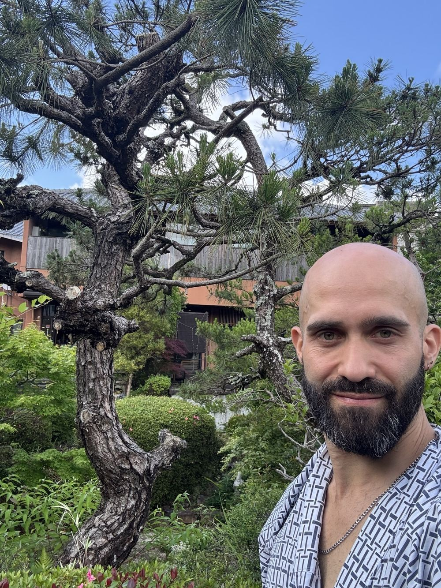

## Story

{.float-right .w-64}

I have had a lifelong passion for Japanese culture. I tried to learn Japanese many times, but always failed. That changed when I started taking Japanese classes during grad school at Georgia Tech in Atlanta — I fell in love with them and started making progress very fast.

Since then I've known I want to dedicate myself to improving Japanese language learning, for me and for others, because it is what I love doing most.

You can follow Koipun's development in the [Follow the Koipun Story](/blog/category/follow-the-koipun-story/) blog series.

## Gabriel J. Pérez Irizarry — Founder

I build Koipun and I absolutely love learning Japanese. My dream is to make Koipun the best Japanese learning resource.

Koipun was born in Atlanta, GA, where my Japanese journey began. — Koipun, LLC.

## Where I am now

I live in Barcelona, Spain now. I kept studying after Koipun and have since passed the JLPT N2.

These days I do [Claude team setup for small teams](https://gabezen.com/): I onboard Claude like a new hire for firms that bill clients, so their team can hand it real work. Before that I spent 15 years building software, including leading tech at CITYROW through its acquisition by WaterRower.

You can read the rest of the story on my personal site, [Gabriel J. Pérez Irizarry at gabezen.com](https://gabezen.com/bio/), or [what I've learned running a company on Claude](https://gabezen.com/blog/).

## Thanks

Thank you to Riho, a native Japanese speaker, for her help creating Koipun's early Japanese learning materials.
