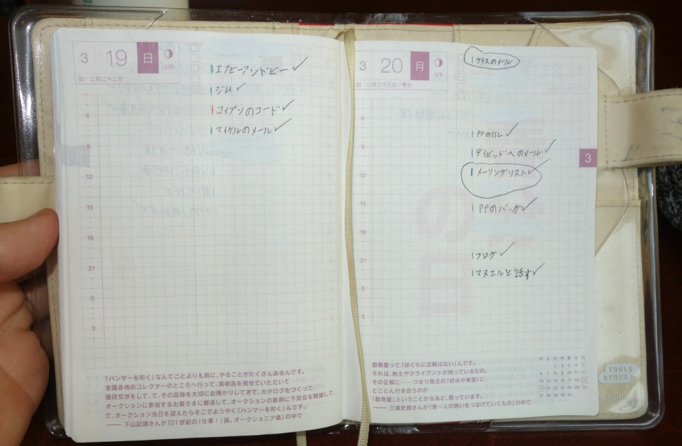
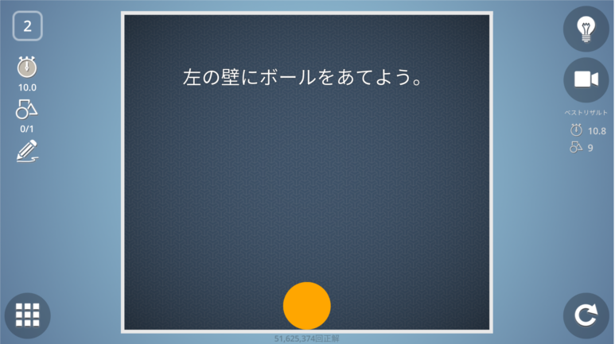
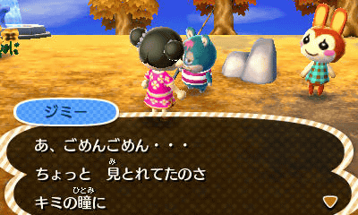
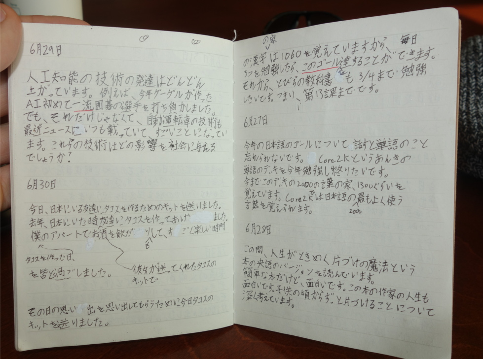
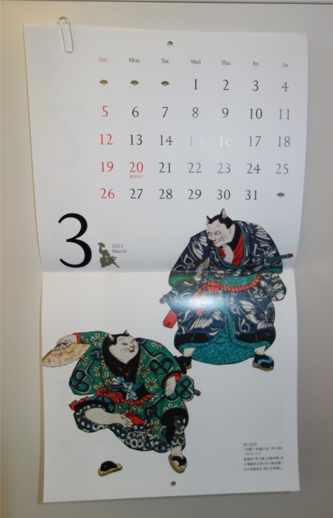
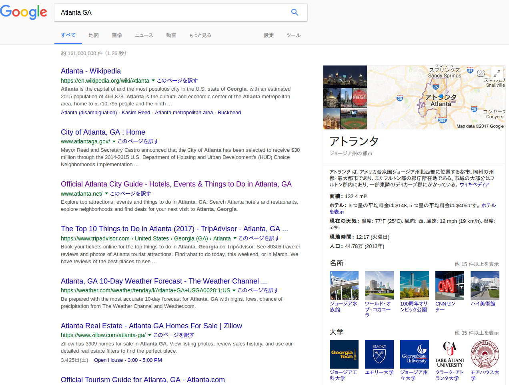
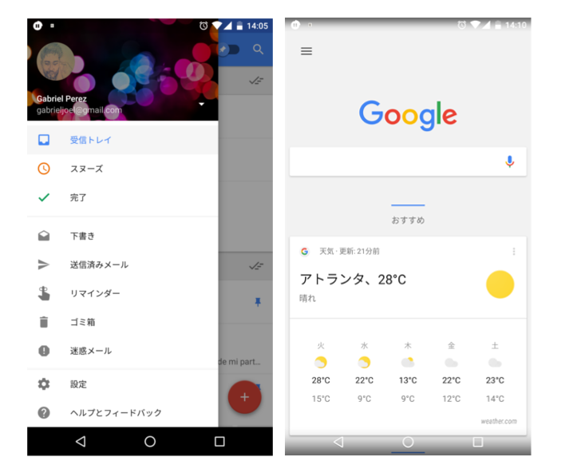

It can be hard to make time for studying Japanese with a busy schedule. One way to get around that problem is by surrounding ourselves with Japanese. While living in Japan, walking down the street and reading signs can become a study session. Of course, not everybody is so lucky as to be able to live in Japan.Thankfully, we can recreate some of those experiences anywhere in the world. And for those of you who are living in Japan, with these strategies you can fit in even more learning opportunities into your daily life.

## 1. Plan your day in Japanese

Writing Todo lists by hand has many advantages.

1. You won't get distracted by Facebook notifications or be tempted to go to Reddit or your favorite sites.
2. You will avoid procrastination, because copying Todos by hand takes time and nobody wants to copy the same Todo over and over.
3. You will tend to want to do tasks immediately so that you don't have to write them.
4. Your Todo list won't grow out of control because it is hard to keep up a massive amount of Todos in paper, so you can focus on what truly matters.

By keeping your Todo list by hand in Japanese, you get all of these benefits and in addition you will look forward to write your Todos, since writing your Todos will become a short Japanese study session. Furthermore, by writing meaningful things related to your daily life, you will naturally acquire a lot of useful vocabulary. This is compounded by the fact that [writing by hand is more effective than typing for learning.](http://lifehacker.com/5738093/why-you-learn-more-effectively-by-writing-than-typing)

If you want to immerse yourself even more while doing your Todos, use a Japanese notebook or 手帳(てちょう） to keep your Todos. I highly recommend the [ほぼ日手帳](http://www.1101.com/store/techo/en/) as it has a terrific design.

## 2. Do your gaming in Japanese

Many people love to play video games to wind down. You can do this in Japanese! If you switch your smartphone to Japanese, games will automatically change to their Japanese versions. Don't worry, switching back and forth between languages is very easy with iPhones and Android phones. Of course, kanji knowledge is absolutely necessary to do this, but not as much as you think! Try your favorite smartphone games in Japanese.

{.float-left}

If you haven't learned many kanji yet, there are also many games that come with furigana now a days. Animal Crossing for 3DS is a gold mine for Japanese learners. Not only does it include furigana, but the vocabulary is fairly simple and you can learn about speech styles by interacting with the animals in your village.

## 3. Write a diary in Japanese

What do Albert Einstein, Marie Curie, Mark Twain, Chareles Darwin, Frida Kahlo and Leonardo da Vinci have in common? They all kept diaries. Keeping a diary helps you distill and process your thoughts, feelings and ideas. When you put your thoughts into words, you can think about them clearly.

Your diary will also become the book of your own history, a powerful tool to learn more effectively from the past. By keeping your diary in Japanese you will find your own Japanese voice and become fluent in talking about your daily life.

## 4. Listen to Japanese podcasts

Many folks enjoy listening to podcasts during their commutes or while driving. Why not try a podcast in Japanese? It doesn't have to be learning content per se, you can listen to podcasts about any topic you are genuinely interested in. There is a surprising amount of podcasts available in Japanese.

Yes, you will miss out on many words and phrases. But as long as you can get the gist of what is being said, you can learn while listening.

There is one podcast that truly stands out amongst all the ones I have tried, Suntory Saturday Waiting Bar Avanti. [The Suntory Saturday Waiting Bar Avanti podcast](http://www.tfm.co.jp/podcasts/avanti/) was originally a broadcast from Tokyo FM, which unfortunately has been discontinued. Thankfully, there is a huge backlog available.

This podcast transports you to an extremely chic or おしゃれ bar in Tokyo where you will be able to eavesdrop on interesting conversations about any topic you can imagine. The dialogues are surprisingly easy to follow and extremely interesting. Each episode features a new guest!

## 5. Keep a Japanese calendar

By keeping a Japanese calendar you will practice Japanese by simply looking at the dates. Furthermore, you can learn about all the interesting Japanese holidays such as 海の日(うみのひ). You can find these calendars in many on-line stores, including Amazon.

## 6. Use Google in Japanese

Using Google in Japanese is surprisingly easy. Since the Google interface is very well designed, if you have any doubts about the interface you can usually figure it out by logic and intuition. When you use Google in Japanese, you get many benefits.

- The information boxes will appear in Japanese, teaching you new vocabulary while you are simply doing Google searches.
- You will naturally interact with kanji throughout the day, like people who live in Japan.
- You will learn about computer terms in Japanese
- You will get more search results in Japanese. Thus, Google will nod you to use more Japanese in your daily life!

Pro-tip: If you use a browser add-on such as [Rikai-chan](https://addons.mozilla.org/ja/firefox/addon/rikaichan/), you can instantly get help with any word or kanji you don't know.

## 7. Use your phone in Japanese

Just as with Google, because both Android and iPhone phones count with intuitive user interfaces, they are relatively easy to use in Japanese. In the case of Android, you can install the [Language Switcher app](https://play.google.com/store/apps/details?id=com.nosapps.android.langswitch&hl=ja) to quickly switch between Japanese and your native language if necessary.

One of the best things about using your phone in Japanese is doing GPS navigation with Google Maps. You can learn how to listen to navigation commands in Japanese just by driving around town!

## 8. Stay fit in Japanese

If you switch your phone to Japanese, your apps will also switch to their Japanese versions, including your fitness apps.This makes for a great opportunity to learn Japanese while exercising. One good option is the Sworkit app, available for both [iPhone](https://itunes.apple.com/us/app/stretching-sworkit-increase-flexibilty-pilates/id1000737374?mt=8) and [Android](https://play.google.com/store/apps/details?id=com.sworkit.stretching&hl=ja) phones.

This Sworkit app has Japanese audio spoken by a real person, that explains to you in Japanese how to do the different exercises. The instructions are easy to follow since the vocabulary is quite simple. The vocabulary mostly consists of body parts and katakana versions of English fitness terms.

## 9. Watch your favorite TV shows in Japanese (even if they are not originally in Japanese)

{.float-left}

Many of you already enjoy tons of Japanese media in Japanese such as anime and dorama. But had you thought of enjoying your favorite non-Japanese shows and movies in Japanese? Many TV shows and movies have Japanese dubs and subs available. You can do this even on Netflix! For example, Rick and Morty is available in Japanese with subtitles on Netflix.

## 10. Listen to Japanese music



Perhaps some of you might have been put off from Japanese music by some of the popular idol groups. But Japan has many great artists, such as 椎名林檎(しいなりんご）.

You can get many artist recommendations from [reddit.com/r/JapaneseMusic](http://reddit.com/r/JapaneseMusic). If you find an artist you like and then study the lyrics of your favorite songs, you will acquire tons of vocabulary by simply listening to the songs you love.
