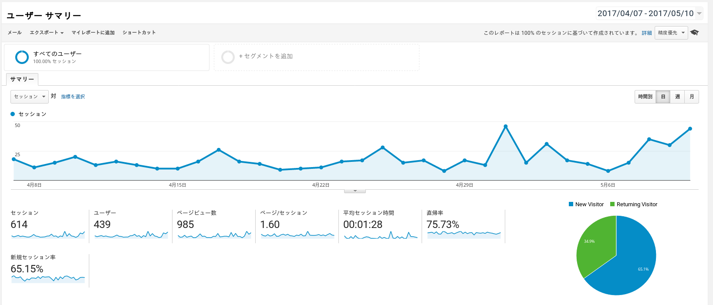

Time flies! It was on December 14th of last year that I launched the first preview of Koipun Reader on [reddit.com/r/LearnJapanese](https://www.reddit.com/r/LearnJapanese/comments/5i7fi7/new_easy_way_to_read_in_japanese_keeps_track_of/). It has already been four months since then. In some ways I am satisfied with my progress, but at the same time I am anxious to get an initial version of Koipun Reader out the door. One of the reasons I can't wait to release Koipun Reader is that next year I am turning thirty.

In reality thirty is just an arbitrary age, an accident of us humans standardizing on base ten numbers, but at the same it holds importance for me. I want to make Koipun a successful business that can give me a decent salary and I am willing to work extremely hard for it and make sacrifices. But I don't want to still be living like a student on my late 30s. By then I expect to be starting a family. There is no way I will compromise to having a day job I hate forever, so I think the only solution for me is to double down on my dreams and work hard!

## Revenue and Expenses

Anki deck sales amounted to $126 dollars USD this month. And expenses went as following:

- One year of FastMail for email hosting: $50.00
- Heroku for hosting the website: $7.00
- MailChimp for the Koipun Newsletter: $9.90
- Payment processing costs: $5.74
- One Koipun t-shirt I gave away: $11.65

That puts me in $41.71 in the green for this month.

## New Interviews

On my [March Month in Review post](/blog/march-month-in-review-2017/) I mentioned that I had the goal of publishing two new interviews in April for the [How I Learned Japanese interview series](/how-to-learn-japanese/). Those where two interviews I had already had in the works. It turns out that since that last March post I have published four new interviews in total. That is because something crazy happened, two persons came to me asking to participate in the series.

One of them was Carley who did a great interview on [her path to become a Japanese translator](/blog/how-to-become-a-japanese-translator-carley/). The other one was a super interesting interview by Jennifer, [on the importance of experimenting with learning methods](/blog/japanese-study-methods-jennifer-interview/). Getting approached by both Carley and Jennifer was quite unexpected, but I was very happy it happened.

If more inbound requests start coming in, it means I have to spend less time looking for people to interview. Furthermore, one of the interviews was an article exchange, meaning that as a bonus I get to write for one of the interviewees blogs. Doing article exchanges should be great for developing quality back-links and improving SEO. Doing guest posts is something I definitely want to invest more on going forward. Especially given that organic traffic to the page is still extremely small.

## Processing Japanese Texts

For this month I also had the goal of releasing a new Koipun Reader version, which again unfortunately did not happen. The good news is that I did make a lot of progress this month in the backend processing of Japanese texts for Koipun Reader. I am close to having an API ready where I can send a POST with Japanese text and get in return a JSON formatted description of the text including definitions for each word, kanji break downs, example sentences and more. After I have this API ready I will get back to work on the front end to make it easy to play around with these capabilities.

## Goals for May

For May I will set a single goal, which was my goal for Koipun Reader last month. Have a working prototype of the Koipun Reader text import functionality where the user can copy and paste any text into Koipun Reader and it will be processed and be beautifully presented. Then I will put it front of users for another round of feedback and hopefully by June release the initial version of Koipun Reader.

As always, thank you for your support — if you've got any ideas, feedback, or questions, [please email me](mailto:gabriel@koipun.com)!
