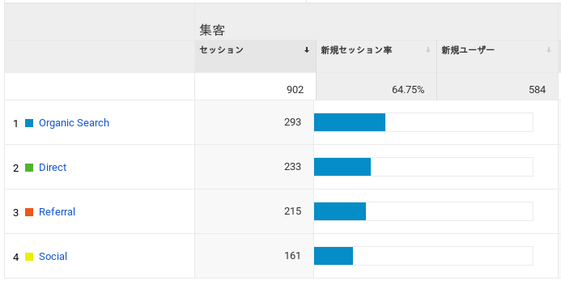
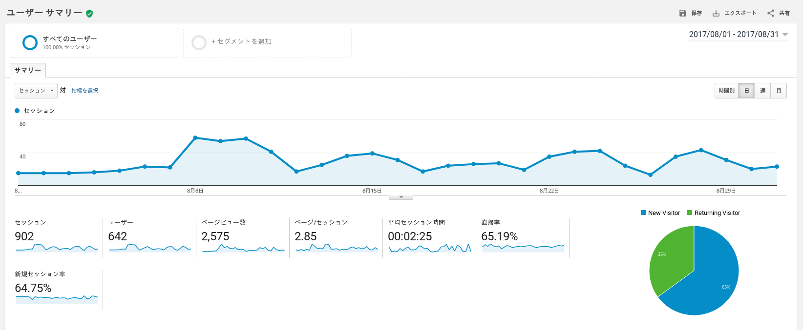
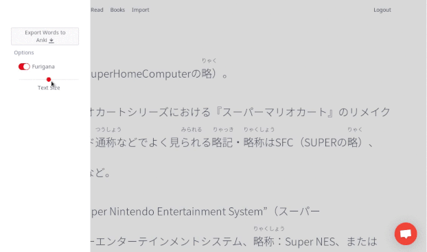
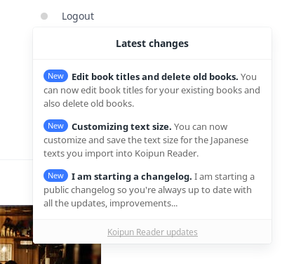

This month I focused on soliciting feedback from users about [Koipun Reader](/reader/) and on implementing user feature requests. Read about how I gathered feedback and the types of feedback I obtained.

*This monthly review comes in extremely late, almost at the end of September. For the sake of consistency I will cover the events from August 8th to the end of August. Revenue and traffic numbers will be strictly for the month of August.*

## Revenues and Expenses

Revenue from [Anki deck sales](/anki/) amounted to a total of $72 USD. Expenses went as following:

- Interview editing service via [Fiverr](https://www.fiverr.com/): $108.75
- [Intro.js](http://introjs.com/) license: $9.99
- [Heroku](http://heroku.com/) for hosting the website: $32.00
- [MailChimp](https://mailchimp.com/) for the [Koipun Newsletter](/newsletter/): $9.90
- [Stripe](https://stripe.com/) payment processing costs: $2.46
- [Paypal](https://www.paypal.com/) payment processing costs: $1.09

That puts me $92.18 in the red for this month.

## Website Traffic

After over nine months of blogging efforts I am finally starting to notice some growth in organic traffic! Organic traffic is still quite minuscule, but it is good to finally see some results.

## Koipun Reader Feedback

After the [release of Koipun Reader in July](/blog/july-month-in-review-2017-koipun-reader-early-adopters-edition-release/) I started working away on getting feedback from users. Initially I requested feedback by sending a message to users who subscribed to the trial asking if they wanted to get a one on one Koipun Reader tutorial via Skype. I also promised users to help them with any Japanese Learning help that I could. This only prompted one reply from a user. Also, I tried creating a survey via Google forms, but that didn't prompt many responses either.

The user who agreed to do the Koipun Reader tour via Skype, has so far the most active in providing feedback and thanks to her I got a massive amount of motivation. Other than her, the reception has been quite mild except for a few exceptions. For example, I got one email from a user who sent me an email with extremely detailed feedback and suggestions. If you are reading this, thank you so much! Finally,  I got tons of great feedback from Jenniffer O' Donnell, the person behind [Japanese Talk Online](http://jtalkonline.com/) and who [participated from my interview series](/blog/japanese-study-methods-jennifer-interview/). She even agreed to write a Koipun Reader review! Below is a high level summary of the feedback I obtained.

- The importer should process the text better
- The exported Anki decks should be more usable
- Add a Tutorial
- Create an explainer video
- Offer OCR imports

To be honest, most of the feedback I received were things I already knew I had to do. But I did get some great new ideas from hearing the requests from potential users and furthermore I got a better idea of which features and improvemnts I should prioritize.

## Koipun Reader Updates

Based on feedback from the initial batch of users I pushed some minor updates for Koipun Reader during August.

First, I implemented a much requested feature, the ability to resize text.

I defaulted Koipun Reader to have fairly big default text size in order to make it easier to distinguish and appreciate kanji. Big text however can be hard for readability of longer texts, so this feature was a must.

{.float-left}

Secondly, using [Headway](https://headwayapp.co/) I added a [sleek looking changelog](https://updates.koipun.com/) feature to Koipun Reader in order to notify users of new features.

## Twitter Experiment

[Koipun's Twitter](http://twitter.com/koipunchan) has been great for me so far mostly as a way to meet people in the Japanese learning community, but so far it hasn't helped me that much with bringing traffic to the site or creating an audience for Koipun. I want to change that so I decided to tweet more consistently on Twitter and see if that helped me get more followers.

Since posting on Twitter manually is a ton of work, I used a tweet scheduling tool called [Twuffer](https://twuffer.com/) to schedule one or two tweets a day for about twenty days in addition of my manual tweets. For the content, I scheduled a hand curated selection of links to what I thought were interesting discussions from the [Japanese Language StackExchange](https://japanese.stackexchange.com/). Unfortunately, those mostly didn't gather much interest.

Perhaps the content wasn't that interesting to that many learners or didn't phrase my tweets correctly, but the experiment was a failure. So far, the only thing that has worked for me to gathering new followers is tweeting links to interviews I have conducted with language learners and mentioning them in the tweets. They then go on to retweet my tweet, which often brings in a few new followers.

I'm not convinced of the usefulness of social media for promoting Koipun, so for now I will just use it to connect with the Japanese learning community.

## Preparing the interview with Gabriel Wyner, author of Fluent Forever, for release

As I mentioned on last month's month review, I did an interview with Gabriel Wyner of [Fluent Forever](https://fluent-forever.com/) via Skype. This is the first time I did an interview via Skype instead of email, so I've had to deal with some new issues.

The interview ran for over an hour, so the interview transcript was too lengthily to publish in its raw form. I also needed some editing to make it useful and entertaining to read.

I didn't want to edit the interview myself, since I knew it would be a lot of work and editing is not something I enjoy, so I decided to get some help. [Elysse Andrews](https://elyssewrites.com/) who has [helped me in the past](/blog/june-month-in-review-2017/) agreed to prepare the interview for me via [fiverr](https://www.fiverr.com/) for a very reasonable rate.

Next month I will talk about how the interview turned out in its final form.

## Goals for September

There is only one week left in September and I am currently in Puerto Rico experiencing the aftermath of [Hurricane Maria](https://en.wikipedia.org/wiki/Hurricane_Maria) so my ability to work productively has been largely hindered.  Thus, I will only set one goal for what is left of September, write the September Month in Review early!
