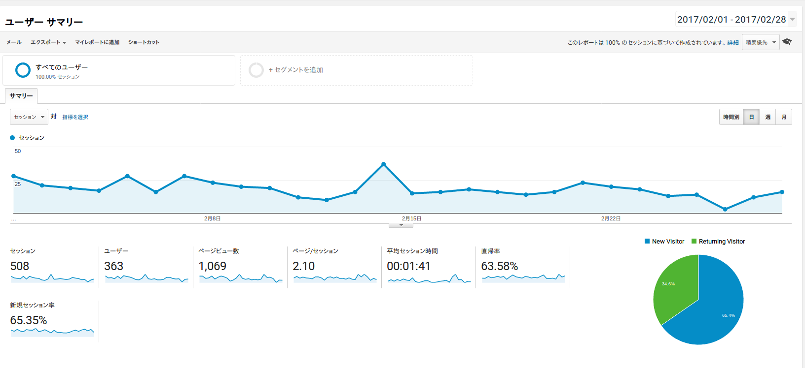
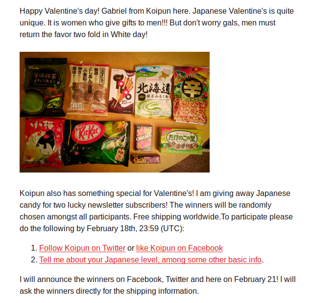

This month I am publishing the monthly review late, which is a little bit of cheating since I pushed out quite a couple of things on the first few days of March (；一_一) The upside is that I have more good things to report on!

## Traffic

Everything has remained stable traffic wise and the traffic sources have stayed the same. I haven't done any big marketing moves, so I didn't expect traffic to improve. In fact, I am happy it has stayed the same without any extra effort.

## Revenue and Expenses

This was a good month for [Anki deck sales](/anki/). I suspect it might have been due to [this post on reddit.com/r/learnjapanese](https://www.reddit.com/r/LearnJapanese/comments/5u2w3l/compiling_anki_grammar_decks_with_full_sentences/) where somebody mentioned our Anki deck. The Anki flash card sales amounted to a total of $108 US dollars. Anki flash card sales remain the only source of revenue, but I do have many expenses for this month.

- Payment Processing Costs: $4.92
- Heroku for hosting the website: $7
- MailChimp for the Koipun Newsletter: $11
- One year of ButterCMS for hosting the blog: $288
- Paid a native speaker on Fiverr to manually revise the Genki I deck: $120.75
- Paid a native speaker on Fiverr to manually revise the Genki II deck: $168
- Paid on Fiverr for a set of 64 recordings of Japanese phrases, which I used to make an Anki deck for the mailing list subscribers: $10.00
- Japanese candy for this month's Valentine's giveaway: ~$40 (didn't keep the receipt)
- Shipping the Japanese candy for this month's giveaway: ~$35 (didn't keep the receipts)

That comes to a grand total of $684.67 in expenses which leaves me $576.67 in the red for this month, ouch! That said, I do not regret any of these expenses. Even the Japanese candy for the giveaway was worth it, even though the Valentine's giveaway was a failed experiment.

## Valentine's Giveaway

At this moment I have over 260 newsletter subscribers, but few Twitter followers and Facebook likes. I wanted to convert some of my newsletter subscribers into Twitter followers and Facebook likers, so I came up with a Valentine's day giveaway to encourage people to join Koipun on those other platforms. The following is a screenshot the relevant part of the newsletter where I promoted the giveaway.

In the end, only around five people ended up participating, which comes around to about $15 per like/follow when taking into account the cost of the candy and the shipping. I was expecting more participation, so I asked the folks at the [SoloFounders Slack group](https://solofoundersteam.slack.com/) for help in doing a post-mortem. These are some of the theories that where floated around:

1. The picture is not good
2. The prize is not enticing enough
3. It is too much work to enroll to participate
4. People want an immediate and guaranteed reward

I think that the giveaway failed because of a combination of all of these points, but perhaps the most important point is that people want immediate and guaranteed rewards. If I try another giveaway in the future, I will probably try it with a digital download that I can give away to everybody who participates.

## "How I learned Japanese" Interview Series

I am running an interview series featuring Japanese learning gurus who share their insights on learning Japanese. The series is tittled, ["How I learned Japanese"](/blog/category/how-i-learned-japanese-an-interview-series/). For February, I had set the goal of reaching a total of six interviews and launching the series on reddit. I didn't reach the six interviews, but I finished and published three new interviews, which brought me to a total of five. The interviews are getting better and better and I have been tremendously lucky to find so many great participants.

The goal of the series is to eventually increase traffic to Koipun, but even if it fails on that regard I will be happy I did it. I have learned so much from talking to these folks, they have been a great source of inspiration. 皆様、参加してくれてありがとうございました！ (Everybody, thank you for participating)

I still want to eventually promote the blog on [reddit.com/r/learnjapanese](http://reddit.com/r/learnjapanese), but I have decided to delay doing that until I have released a new version of Koipun Reader. I am worried that folks who remember Koipun, [from my original release](https://www.reddit.com/r/LearnJapanese/comments/5i7fi7/new_easy_way_to_read_in_japanese_keeps_track_of/), will see it again and lose faith on it because it still looks about the same since the initial release. On the meantime, in order to not operate in a total void of feedback, I will keep posting the interviews on the newsletter.

I have posted all of the interviews on the newsletter and although I haven't received any direct feedback on them, people keep clicking on the them at high rations (~40% click rate) so I assume they are enjoying them. I also got a friend who is into learning languages to read it and even though he is not learning Japanese he enjoyed them and read all of them, without me asking, so I take that as a sign that the content is good and interesting.

## The new Genki II Anki deck

Finally it has been finished and shipped to everybody who pre-ordered it! Shipping this new deck was one of the three major goals I had for February. I had been taking pre-orders for this deck along the sales of the Genki I deck since July of last year. Some people had emailed me already asking about ETAs for the release and it was long over due. I have to thank my girlfriend for doing the bulk of the work.

She wrote all of the sentences, recorded the audio and searched for all the images. It is a tremendous amount of work. After she was done with that work I turned it into an actual Anki deck and had a native speaker I found on Fiverr revise the deck. For the original deck I had done the revision myself, but it is a tremendously painful and time consuming process, so I decided to outsource that part this time. [The deck is available for sale at our Anki decks page](/anki/).

## Koipun Reader Development

My other goal for February was to release a new version of [Koipun Reader](/reader/), which did not happen. The interviews and the other projects, such as the weekly newsletter, have taken way more effort than expected and I found myself quite busy with my day job. That said, I did make some slight improvements. I have everything setup to start migrating from [Angular 1](https://angularjs.org/) to [Vue.js](https://vuejs.org/). I also put in quite a few hours worth of development this month in improving the blog and the overall styling of the page.

## Goals for March

This month I want my main focus to be development on the Koipun Reader, but I must also continue the newsletter, the interview series and finish the Genki I Anki deck revision.

1. Release two new interviews for the "How I learned Japanese" Interview Series
2. This time actually release the blog on reddit.com/r/learnjapanese
3. Make a new Koipun Reader release
4. Released the revised version of the Genki I deck

I want this new Koipun Reader release to run on Vue.js and have the following features:

- True support for mobile
- A new goal based on-boarding tour
- Have a new "article" and an article selection page
- Develop some back-end assistance for the creation of articles, which will put me en route to having a way to import arbitrary text

These are ambitious goals, so I may cut down on some of these features, but I will try as hard as I can to focus on development and get a new version out of the door.

This month I was hoping to report on time spent on Koipun via time tracking, but I have been quite bad at doing time tracking so I do not have any useful data to show. Time tracking is not a priority at the moment, but I will still try to improve in that area so that I can eventually start reporting how much time I am spending on Koipun.

As always, thank you for your support — if you've got any ideas, feedback, or questions, [please email me](mailto:gabriel@koipun.com)!
