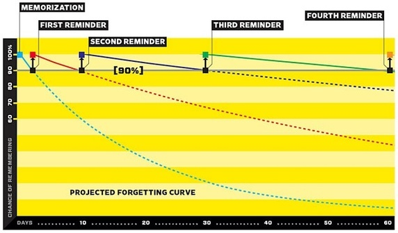
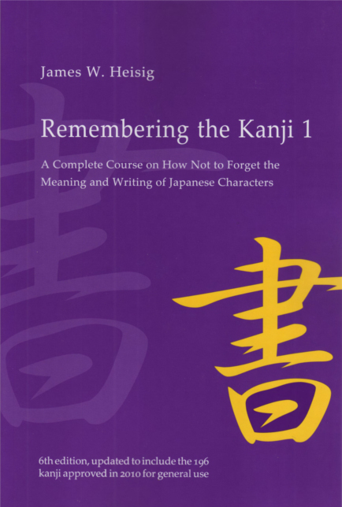

## For how long have you been studying Japanese?

I've been studying Japanese off and on for over a decade. I used to be a bit of an anime otaku and that is what got me started. I first took some classes in college, but I ended up having to quit school for a while. I tried to keep studying on my own, but I didn't really know how to do self-study effectively, and there weren't as many online resources back then as there are now. I eventually quit studying and ended up forgetting almost everything I had learned. Then I went back to school later and began taking classes again. Once I graduated from college, I continued studying on my own and I've kept at it since then.

## What is your ultimate desired Japanese level?

I would be happy to get to the point where I can get the gist of most TV shows and conversations. From there, I think my Japanese will be able to build upon itself a lot easier just from watching and reading things.

## What has kept you going? What keeps you motivated?

{.float-right}

I've been doing my [Anki](http://ankisrs.net/) ([SRS software](http://lifeinthefastlane.com/learning-by-spaced-repetition/)) reviews every day for years now. I think that is what keeps me in. It's a habit that has become a normal part of my life. The other parts of my study are frequently being changed up, so its hard to develop a habit for them. There have been times when I just quit learning new things or I'm not interacting with Japanese in any way aside from just Anki reviews, but as long as I keep doing those reviews everyday, it keeps me from losing most of what I already know. If it weren't for my Anki reviews, I probably would be just another person who gave up.

## How do you use Anki for learning Japanese? What is your study habit like?

I typically do my Anki reivews on my breaks at work. On weekends I do them whenever I am free. Sometimes I'll add new content into Anki, but I try to keep it at a low volume these days, around 5-10 new items per day. It's important for me to have a basic plan for what I want to do aside from my Anki reviews. There have been some times in the past when I quit learning new things for a while, I attribute that mostly to not having a plan.

## Have you started doing study plans now? How did you get back into learning new material?

{.float-left}

I decided to start a blog called [Nihongo No Baka](http://www.nihongonobaka.com/) to help me get my thoughts organized, and because I thought it might help me with my motivation. At the time I decided to start the site, I had just come to the realization that I hadn't been studying any new material or even using Japanese (aside from doing Anki reviews) for half a year or more. I realized that I needed to get myself more organized and start tackling things in a calculated manner. I also had some content that I was looking to share, so I thought that perhaps a blog would be a simple way of tackling all of these goals. Taking the time to write down some things that I have been thinking about has allowed me to look at things from different perspectives that I didn't really notice before. In part, thanks to that, now I am studying in a more structured way and learning new things.

## What is your Japanese study plan?

Right now, my plan just consists of reading some articles on a site I found recently, [和タのC](http://watanoc.com/), and reviewing my [Genki textbooks](http://genki.japantimes.co.jp/index_en), which I haven't looked at in a few years. Once I finish with that, I've got some other things planned. I keep a short list of the things I want to study, read and watch next, so that I don't forget about them. I don't really make my plans much more detailed than "okay, this is what I'm working through for the next few weeks". I try to keep myself focused on just one or two things at a time and then shift to something else. I don't want to find myself in a situation where I don't know what to do next.

### Typically, when do you study?

I usually study either after dinner or right before I go to bed. There are days when I might not feel well or might not have time, so I don't study anything new, but I'll typically get back into it in a day or two just as long as I have that basic plan in place.

## Do you use native resources to study?

I'm a fan of [Stephen Krashen's Input Hypothesis](https://en.wikipedia.org/wiki/Input_hypothesis), which states that we acquire language when we understand what we are reading/hearing. In order for that to work you need to consume material that is on or below your current level. So jumping straight into native material isn't highly effective, and can be really frustrating. Unfortunately, there isn't nearly enough content out there for Japanese learners, so I think we often feel like we have no choice but to try and jump right into something that is way over our heads and just slog through it.

{.float-right}

There are a handful of graded readers out there, which are a fantastic resource, but they are usually prohibitively expensive and there aren't nearly enough of them. I've read the "standard" beginners manga, [Yotsubato!](https://myanimelist.net/manga/104/Yotsuba_to), but when you look at the actual amount of text in the whole series, it's still not enough to make much of an impact. This is the most frustrating thing about learning Japanese for me. I want massive amounts of EASY material, but its just not there, not at lower levels. So I'm always keeping my eyes peeled for the next thing that I can try.

### What is your favorite native resource?

My favorite native resource is probably [EhonNavi](http://www.ehonnavi.net/), which offers hundreds of children's books that you can read once for free. Children's books aren't exactly ideal for adults learning Japanese as a second language, but I feel that this is one of the best free resources currently available.

## Which resources have helped you the most?

There are so many useful resources out there these days that I think it would be easy for a new learner to get overwhelmed by them all. I think the [kanji koohii forums](http://forum.koohii.com/) and the [/r/LearnJapanese subreddit](https://www.reddit.com/r/LearnJapanese/) are both useful to see what is working for other people, and to keep an eye on new things that are coming out. Those are probably where I learned about most of the other resources I have used! I'd also like to mention [和タのC](http://watanoc.com/) because I don't think this site is very well known, but they offer a some good Japanese articles targeted to learners, I just wish they had more!

For my SRS reviews, I use Anki and [Ankidroid](https://play.google.com/store/apps/details?id=com.ichi2.anki&hl=en) all the time. I'm used to them, and they work great for me. I've never really found any compelling reason to switch to any of this newer stuff like [Memrise](https://www.memrise.com/), but maybe I'm just an old fogey. I also use the [Rikai-sama extension on Firefox](http://rikaisama.sourceforge.net/), and I've used a lot of really useful tools created by "[cb4960](https://sourceforge.net/u/cb4960/profile/)" who posts his stuff on the Kanji koohii forum.

## Kanji can be one of the most intimidating aspects of studying Japanese. What methods and resources have you used to learn kanji?

{.float-left}

When I was taking classes, I always struggled with kanji. Then I discovered [Heisig's Remembering the Kanji](https://en.wikipedia.org/wiki/Remembering_the_Kanji_and_Remembering_the_Hanzi) (RTK), and it sort of felt like magic to me, because I was able to remember how to write the characters from memory so easily. I did all of RTK over 3 months one summer (about 3 hours per day), and once that was done, it felt like a huge weight was lifted from my shoulders. Before, kanji where very intimidating to me. If it wasn't one of the beginner level kanji, then they all just looked like a big blob of strokes, but after studying Heisig, I could pick up any new vocabulary word in its kanji form easily. I never had a need to use my writing skills though, so I can't remember how to write most of them anymore, but who needs to write anything in today's world? I can't even remember the last time I wrote something in English.

## Have you been to Japan?

I've been several times, but always just for a couple weeks. I had applied to the [JET Programme](http://jetprogramme.org/en/) once but I didn't make it in. After that, I decided I'd just take a trip, and that trip wasn't enough for me! I'm sure there are a lot of other countries that would be just as fun to visit, but every time I go to Japan I have a lot of new and amazing experiences, and there is still so much more I want to see!

## Are you interested in learning other languages?

I have halfheartedly started learning a couple other languages in the past, like Russian and Korean, but I never had any real motivation to learn them, so I would just give up after a couple weeks. Also, the thought of trying to juggle both another language and Japanese gives me a headache.

## If you had to start over, what would you do differently?

I would not do a lot differently, aside from avoiding things that are obviously too difficult for me. I have wasted too much time slogging through stuff that I don't understand and then not having much to show for it afterwards.

## What is your advice for people who want to learn Japanese?

It takes a lot of time and effort. Don't be in a hurry, and just try to enjoy the journey.

## You have posted on Nihongo No Baka about using video games to learn Japanese. Particularly, you did a [detailed series about the Nintendo DS game Little Charo](http://www.nihongonobaka.com/category/little-charo/). Do you recommend Little Charo for Japanese learners?

{.float-left}

Little Charo is a bilingual visual novel for the Nintendo DS that is intended for Japanese people who are learning English. Due to the fairly simple nature of the Japanese text, it is also useful the other way around. I took the text from the game, and posted scripts for every single chapter as I played through the game. I highly recommend checking it out if your Japanese is around an N4 or N3 level. I don't know of any other resource that can offer you such a vast amount of reading material at this level of difficulty.

### Do you have any recommendations for folks who are interested in learning Japanese through video games?

[I wrote a detailed post with some of my thoughts on how to effectively learn Japanese from games](http://www.nihongonobaka.com/learn-japanese-through-video-games/). Unfortunately, most games simply aren't accessible until your Japanese is pretty good, so I would caution people against trying to jump into games for learning too early.

## Are there any favorite posts from Nihongo No Baka you would like to recommend to people who want to check out your blog?

My most popular post by far, is one where I listed the [Top 11 Games for Learning Japanese](http://www.nihongonobaka.com/top-11-games-for-learning-japanese/). A lot of these are somewhat older games, so I would love to hear if readers have come across any recent releases that tend to be on the easier side.

The post which seems to have been the most well-received is one where I wrote up [mini-reviews for all of the different lessons offered on JapanesePod101.com](http://www.nihongonobaka.com/japanesepod101-com-individual-season-reviews/). They have some great content available, but also some (in my opinion) really crappy content, and a lot of people have found this post  helpful in determining what to check out from [JapanesePod101](http://www.japanesepod101.com/).
