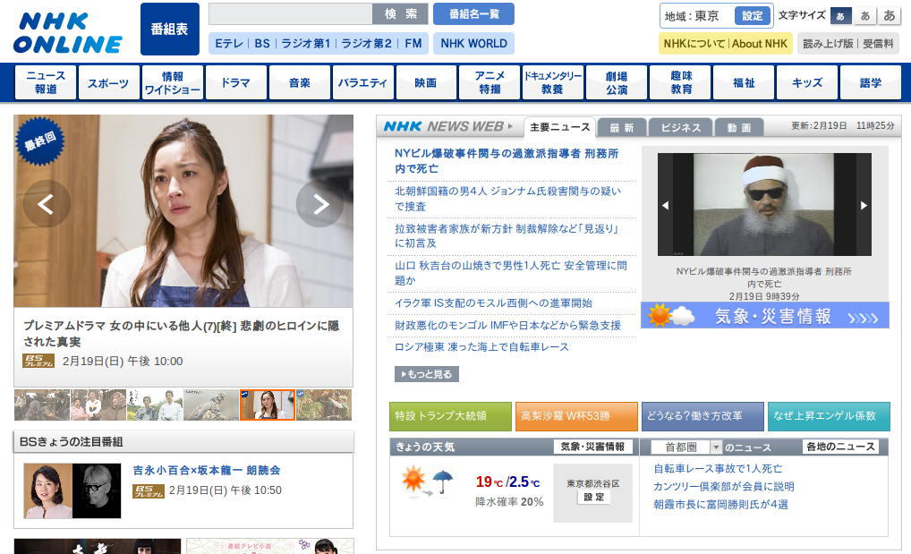
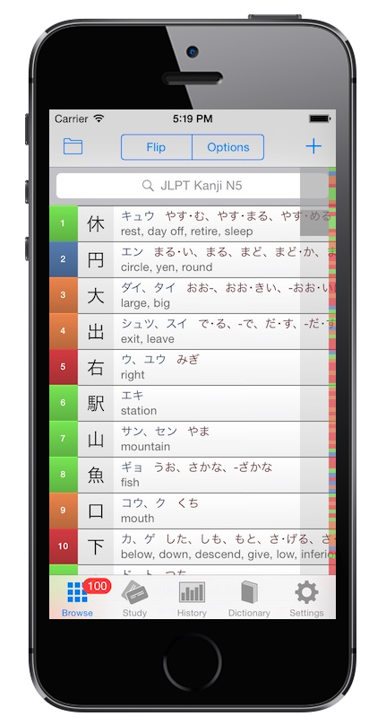

## What is your current Japanese level like?

{.float-left}

My level varies depending on what I’m doing. In my daily life I have no trouble making my ideas and thoughts understood to both friends and strangers. There are times when I’m with a doctor or some other professional that I may feel a bit lost due to jargon that I’m not familiar with.

These days I don’t watch a lot of anime, but I think I could understand enough to grasp the plots and dialog to be able to enjoy it. Japanese dramas would probably be better for me if they’re grounded in reality versus something like the Gundam anime series where you have characters spouting terms often found in science fiction shows.

I have taken the [JLPT](https://en.wikipedia.org/wiki/Japanese-Language_Proficiency_Test) from N4 to N1 and have successfully passed them all. 😁

There’s a small survey you can fill out when registering to take the test about the amount of hours studied. At this point, I really have no idea how many hours I’ve studied! Probably more than average but likely less than some of my hardcore translator friends.

## What got you interested in learning Japanese?

{.float-right}

The first thing was my fascination with various video game series from Japan such as [Final Fantasy](https://en.wikipedia.org/wiki/Final_Fantasy). The second and probably most influential was anime. It was during a time when most people around me weren’t aware of anime that existed outside of what was shown on TV. I watched shows with Japanese audio and English subtitles, which introduced me to so many things.

## What keeps you going? What keeps you motivated?

Burn out is something that I think almost everyone experiences, especially with a language like Japanese if you’re an English speaker.

What helped me the most was learning to stop looking at learning Japanese as such a massive goal. That mountain is so huge that you’ll freeze up just thinking about how high you have to go. Pace yourself and don’t look up. Whether it’s learning new words every day or getting through a textbook, make a small goal that you can get through.

My biggest fear in life has always been starting things, because I could imagine how hard the journey would be. Force yourself to start something with small steps and you’ll be surprised how far you’ll go if you keep at it.

## Has blogging helped you with motivation?

{.float-right}

At the time I made my blog, [Kuro Pixel](http://www.kuropixel.com/), I think I was at the N2 level. In a way, I did stay motivated because I was thinking of things to review and checking my own methods as I was writing my advice for others.

The reason I started blogging about my Japanese learning/studying experience was that my friends/coworkers would always respond to my advice by saying, “Bryan, that’s really useful! You should post that somewhere.”

## How do you organize or plan your studying?

During my hardcore studying days I most certainly had a routine. I would find time to study during my lunch breaks at work and then continue in the evenings when I went home. The most important thing for me was to keep studying every day, even if just for a little bit.

I’ve always self-studied, so I have never been to any sort of lessons. However, if the option of lessons is available to someone, I say definitely do that! It can help with motivation if you have to answer to someone such as a teacher when going through a textbook.

## How did you prepare for the JLPTs?

N2 is such a huge leap compared to the previous tests, you really need to learn much more vocabulary/kanji to stay afloat. One thing that helped me tremendously was taking an interest in reading Japanese news. I would print out one or two Japanese news articles every day and try to comprehend them, circling words I didn’t know. This resulted in a LOT of circles! After doing this every day, I became faster at reading and picked up quite a lot of vocabulary that appears in N2 or above tests. Plus I became able to read Japanese news which was a big step for me.

### How did you read news in Japanese?

I would choose one or two articles that looked interesting on the [normal NHK news site](http://www.nhk.or.jp/), print them out, and then try to make my way through them. If I came across a word I didn’t know, I would circle it and keep going until I came across another unknown word. The goal was to try to get through the article, skipping what I didn’t know and still try to get the main idea of the passage.

After I finished reading what I could until the end of the article, I would go back and look up the words I circled. The fastest method for me was to have the article open on my computer and use a browser extension to allow me to highlight words and quickly get the reading and meaning.

After looking up all the necessary words, I would try to read again through the article hopefully knowing the words this time around. In order to not forget everything I looked up, I created a Japanese News Vocabulary course on [Memrise](https://www.memrise.com/) and input them there.

I think many students of both English and Japanese fall into the trap of trying to understand exactly everything, stopping to look up words they don’t know. This will slow you down and prevent you from trying to understand things in context. Try to read your way around the unknown word and see if you can figure it out from context first.

### How did you prepare for the JLPT N1?

I passed N1, but the one thing I did to prepare was read read read. I was pretty decent at listening and okay at grammar, but reading comprehension questions were the bane of my existence. I loaded myself with practice books geared towards reading comprehension. Even if you can understand what articles are trying to say, you can fail if you don’t pay attention to the nuance of what the questions are asking. It was this tricky dance that I had to learn.

## What is your ultimate desired level in the language?

My desired level would be to enjoy reading a novel without having to look anything up.

## Which resources have you helped you the most?

For getting started: [Genki Elementary Japanese textbook](http://genki.japantimes.co.jp/index_en)

For the JLPT, the [Kanzen Master](http://www.kuropixel.com/kanzen-master-series-review/) and [Sou Matome](http://www.kuropixel.com/nihongo-sou-matome-review/) series of books have been the most useful.

## What are your favorite native resources to consume?

I enjoy the [news page from Yahoo Japan](http://news.yahoo.co.jp/) and editorials from [Yomiuri Shimbun’s](http://www.yomiuri.co.jp/) website. To make things interesting I also read miscellaneous blogs that cover all sorts of topics from funny to gaming. One particular site that is easy to get into is [RocketNews](http://rocketnews24.com/). It's a blog site that covers all kinds of silly and fun topics in Japan. They have an English site and a Japanese site, so you can see articles ahead of time on the Japanese side.

The site that helped me the most would have to be NHK’s standard news site. Their articles and not too long and are great for digesting lots of different topics.

### How have you incorporated gaming into your studies?

I’m not sure whether to call it gaming or not, but I made Japanese friends in the virtual world [Second Life](http://secondlife.com/), which helped with speaking/writing practice.

## What methods and resources have you used to learn kanji?

I remember learning the strokes and practiced writing a lot of kanji when I first started out. Some people prefer to learn everything by writing, but I’ve mostly been a typist so writing everything was never my goal. However, I think it is essential for anyone learning kanji for the first time to learn strokes and how to write maybe the first 50-100. It will give you a foundation that will help later on.

## Do you use any software tools in your learning?

{.float-left}

I originally started with [Anki](https://apps.ankiweb.net/) many years ago, but I got tired of the interface and moved on to other apps and websites. Memrise became my daily driver when I started studying for N3 and N2. I don’t have an Android device, but for iOS I highly recommend the [StickyStudy](http://www.stickystudy.com/) Japanese app. You can choose from the many built in lists of vocab/kanji or make your own list of flash cards. It’s served me well and I continue to use it today.

## You are currently living in Japan?

I’ve been in Japan since 2010. I originally came through the [JET Programme](http://jetprogramme.org/en/) to teach English which I did for five years. These days I still teach, but I also do more freelance jobs as well. I’m originally from the south in the US, so snow was interesting at first but now I find myself wishing snow away in winter.

There is no doubt that being in Japan is the best way to improve your Japanese studies and give you immersion. However, that still requires self-discipline to improve your skills. I’ve seen many others give up their study habits when they become attached to foreign bubble communities.

## Do you have any advice for people who want to get into the JET Programme?

I do have [in-depth advice on my blog for people considering applying for the JET Programme](http://www.kuropixel.com/guide-to-applying-for-the-jet-program/), but here are a few tips.

### On the initial application

Remind yourself that the JET Programme is about teaching English to young people in Japan. No one needs to know how many seasons of X anime you’ve seen. Emphasize the skills/experience you have that will help you with teaching or sharing your culture with others.

### Doing the interview

Try to show that you can be the person that reaches out to interact. If you’re shy, make more of an effort to appear outgoing if you make it to the interview process. Don’t share too much about your passion for Japanese music/dramas/anime/etc. Mention it but focus on how YOU can contribute to the JET Programme.

## How did you transition from the JET Programme to your current job?

I was fortunate enough that I didn’t have to rush after leaving the JET Programme, but I think the biggest issue for most people is finding a company that will help with your visa.

If you plan to stay in Japan after the JET Programme, it’s in your best interest to start looking around before you finish. Seek out companies you’re interested in through job search websites such as [Gaijin Pot Jobs](https://jobs.gaijinpot.com/).

Another thing is to try to get qualifications while you have the time. If you can get JLPT certification, programming, or anything that will help your resume, do it now!

Interviewing is great to do too. You can let your potential employer know you’re eager to start and make a smooth transition from the JET Programme to your new workplace. The JET Programme even holds job fairs for people thinking of staying after JET, one in Osaka and the other in Tokyo last time I checked.

## How do you find freelance jobs in Japan? Any simple tips for those looking to do this kind of work in the future?

It depends what sort of area you want to deal with, but first try networking or asking Japanese friends/acquaintances. Going through people is very important.

Another thing I recommend is putting yourself out there online at the Japanese site [“Lancers”](http://www.lancers.jp/). You can post what services you offer and slowly build a good reputation.

## What other languages do you speak? Are you interested in learning other languages?

I can only speak English/Japanese, but I’m off and on learning Korean. My goal is to become somewhat competent in that language in my lifetime.

## If you had to start over, what would you do differently?

I would try not to be afraid of starting things sooner. Things are always more scary or difficult than we imagine them to be. Don’t be afraid to crack open a new study book or try out a new course, whether it be for languages or anything else you’re learning.

## What is your advice for people who want to learn Japanese?

Think about what you want to do with the language and the specific goals that would come from that. Work on things little by little and eventually you’ll turn around and see how far you’ve already climbed that mountain!

My last tip would be to stay focused and don’t try to do too many things at once. If you find resources that work for you, double down and use those. Do not waste your time jumping to different learning resources just because you have so many choices. I did that and ended up spreading myself too thin with nothing to show for it. Focus on a small number of resources for learning and stick with them!

## Which posts do you recommend people who want to checkout your blog, Kuro Pixel?

For people just getting their feet wet with Japanese, I would ask them to check out my [“Common Mistakes when learning Japanese” post](http://www.kuropixel.com/mistakes-when-learning-japanese/).

For people interested in intermediate to advanced JLPT study recommendations, [my Kanzen Master series review might be a good start](http://www.kuropixel.com/kanzen-master-series-review/).

I wrote about my method and experience learning to read Japanese news, [so those interested should check it out](http://www.kuropixel.com/learn-read-japanese-news-websites/).

You can also checkout my YouTube channel, where I provide further JLPT N1 Advice.


