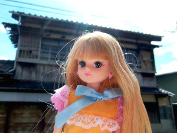
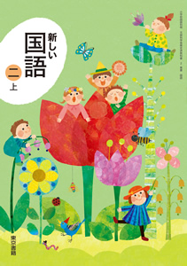
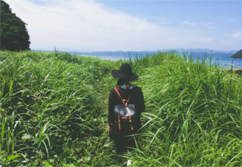
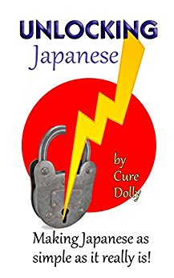

## What is your current level in the language like?

{.float-left}

I am really not sure of my level in Japanese since my learning path has been rather unconventional and I have never taken any exams. I can hold everyday conversations. When I am in Japan I remove my English language circuit so that I can only speak Japanese.

So yes, I can function in a Japanese-only environment. I watch anime and some movies without subtitles and can usually get the drift, although I still need Japanese subtitles for some of the details. I would say listening is my weakest skill. To be honest it isn't that good in English either.

## What got you interested in learning Japanese?

I have never really gotten on all that well with current Western culture. I didn't watch movies or television or anything. I was amazingly ignorant of any popular culture that was not game-related. Even now Japanese people ask me what I think of this or that Western personality and I don't know if it is a singer, an actor or the person who climbed the Empire State Building. Truthfully, I thought that I just didn't like current human culture.

I liked games though, and all the ones I liked were from Japan. Then I encountered someone who had come back from spending some years Japan, and talking with her I somehow knew that I needed to learn Japanese. She taught me a little bit - really very little. But I knew that I had found my language and from then on Japanese became my life.

That was around the middle of 2012. My friend returned to Japan that same year. Ironically enough, as I became increasingly immersed in Japanese, she became increasingly disenchanted with it. By one of those fascinating twists of fate, the day I arrived in Japan in 2015 was the same day she left, from the same airport at the same hour. If there had been a small gap between our flights we might have met in the airport for a cup of coffee, but there wasn't. It felt strangely symbolic. She was going as I was coming.

## What keeps you going? What keeps you motivated?

Actually this is the question I dread when I am helping someone. "How do I keep my motivation up?" or "How do I regain my motivation?" Because I just don't know.

It is one problem I have never had. Japanese people sometimes ask why I am interested in Japanese and I always say that it was 一目惚れ (hitomebore) which is like "love at first sight". I fell in love with Japanese and I have never fallen out of love.

I am a butterfly. Nothing lasts with me except my most basic principles, and somehow Japanese became one of those principles. Every now and again I used to ask myself "Why Japanese?" "Isn't it silly spending all this time on Japanese?"

But it didn't make any difference. It was like asking "Why eat?" or "Why sleep?" Rationally you may not know why, but that doesn't stop it being a basic need that you must satisfy.

And in a way I think I do know why. English - language and culture - never felt like "home" to me. I always felt like a stranger in a strange world. Japanese, while it was still strange, was nowhere near as strange as English or anything else I had ever encountered. It felt as near to home as I could get on this world.

At first I occasionally thought things like "When I get good at Japanese maybe I'll move on to Korean". Now I realize that was nonsense. I am not interested in "languages", I am interested in Language, and to me Language is Japanese. Not Korean and not English.

## Has working on KawaJapa helped you with your Japanese?

{.float-right}

Yes it has. Actually in the early days [KawaJapa](http://learnjapaneseonline.info/) was a kind of scratch-pad where I and a couple of other Cures hashed out some of our ideas. At that time we didn't think of it as becoming a big site with a large-ish audience.

While I don't use the site "experimentally" - that is, I don't float ideas until they've been tried and tested - I have used it to formulate and consolidate things. Particularly [some of my kanji articles](http://learnjapaneseonline.info/category/kanji/) have been a way of consolidating my own work on the particular kanji.

This is even more true of my upcoming book. While it is a beginners' kanji book, it is intended secondarily for people who know a lot of kanji by "facial recognition" and want to hone their knowledge into more exact form. I am one of those people, and writing the book has been quite helpful!

While I am not a kanji-writer and haven't tried to be, I was a bit appalled by the fact that I couldn't even pass the Kanji Recognizer First-Grade writing quiz (even though I can obviously read all the kanji). After writing the First-Grade part of the book I could ace the quiz.

## How do you organize or plan your studying?

I can't manage routine at all. I mean not at all. As I said, I am a butterfly. Many dolls are. I become furiously involved with one thing and then another. But they are all in Japanese because - what other language is there? I did some online lessons with amateur tutors via Skype in the first year but other than that I have had no formal schooling in Japanese. The only thing I really keep up on a daily basis is my [Anki](https://apps.ankiweb.net/) which I now have down to one (very big) deck. Mostly because I am so bad at managing even a few decks.

## What is your ultimate desired level in the language?

I want to write books in Japanese. I am a writer. It's the only thing I am any good at. I don't want to go on writing in English forever. My language is Japanese. So I want to become as proficient in Japanese as I am in English. I'll probably always have a funny accent, but then I have a funny accent in English too.

## Which resources have you helped you the most?

{.float-left}

I am not sure if Anki counts as a resource, but it is the one study tool I have consistently used and recommend to everyone. [Rikaisama](http://rikaisama.sourceforge.net/) with its ability to return Japanese-Japanese definitions of words and then bringing them directly into Anki is the other thing I would hate to be without. Beyond that, the Internet! Where would we be without it? It has absolutely transformed the possibilities of self-immersion.

Another resource I really like is Japanese school 国語 (kokugo, Japanese as a native language) textbooks. They have helped me a great deal to understand how Japanese grammar really fits together from a Japanese point of view, which is very different in some respects from the Japanese grammar taught in textbooks for 外国人 (gaikokujin, foreigners).

> Another resource I really like is Japanese school 国語 (kokugo, Japanese as a native language) textbooks. They have helped me a great deal to understand how Japanese grammar really fits together from a Japanese point of view, which is very different in some respects from the Japanese grammar taught in textbooks for 外国人 (gaikokujin, foreigners).

## What are your favorite native resources to consume?

{.float-left}

I almost never used to read books in English, and no fiction. Now I am something of a bookworm. I love 魔法少女 (mahou shoujo, magical girl) novels! I like a lot of anime and am gradually coming around to manga (for some reason I didn't get on with manga at first).

I don't really do much study-as-study beyond the above-mentioned Japanese school textbooks and ever-present Anki, (which I think of as a vocabulary-pinner/kanji trainer). However, I learn a lot of vocabulary from my reading. In fact I learn nearly all my vocabulary from Japanese materials and the rest from conversation with Japanese people.

Mostly I don't really think of myself as "studying". I think of myself as doing whatever I am doing - watching anime, playing a game, talking to someone, whatever it may be. I guess I think of myself as "growing up" in Japanese rather than studying it.

## You are a big advocate for immersion. Can you offer some immersion examples/tips for our readers?

As mentioned above, the Internet has revolutionized the possibilities for Japanese immersion. You can get access to all kinds of media from wherever you are.

You can find Japanese subtitles for many anime and dorama online.

{.float-right}

You can watch Japanese lessons in Japanese from lower Intermediate level upward ([Nihongo no Mori on YouTube](https://www.youtube.com/user/freejapaneselessons3) is very good).

If you play games you can find Japanese versions on Ebay or elsewhere. Steam also has Japanese language games, including visual novels (often cheap, sometimes free), if you are a パソコン (pasokon) player. I am a Nintendo-doll and I play a lot of text-heavy adventures and visual novels.

Whatever your interests you can find the materials for pursuing them in Japanese.

## What methods and resources have you used to learn kanji?

I have always advocated learning kanji as words, not as kanji-in-the-abstract.

{.float-left}

I am not good at writing kanji by hand and it is a question I am a little torn on. On the one hand I don't want to grow up unable to write properly, like Sailor Moon (Usagi was such a poor scholar that even after she became Princess Serenity she wrote a letter in all-hiragana)...

On the other hand I don't write English by hand. Not at all. Not shopping lists. Not Notes to Self (or anyone else). Nothing. I don't think I write (by hand) 50 words of English in a year. Pens and pencils are very big for a doll's hands you know. Sometimes people give me pretty notebooks and I feel guilty because I know I will never touch them. I am a paperless, all-electronic doll.

So it feels strange and kind of circular, to someone who believes in learning Japanese by using it, to practice a skill which will only ever be used to practice the skill. I think I will probably learn to write kanji eventually but it isn't a priority.

I have mainly used Anki to help cement kanji, in the form of words. I mostly break the kanji down into their components and make stories of them like [Heisig-sensei](https://nirc.nanzan-u.ac.jp/en/files/2012/12/RK-1-6th-edition-sample.pdf) (and many Japanese schoolchildren), but there we part company because I believe in learning them as part of living the language, not as keyworded abstractions.

Ironically enough, I am currently working on a kanji book. I am not a great advocate of kanji books. However, I think this one will be useful for people taking my kind of approach. It is essentially a story-book approach to the first kanji (all Japanese first-grade kanji and all those needed for JLPT N5), showing how kanji fit together in themselves and with each other.

The idea of the book (I'll share the title for the first time publicly here - it will be called Alice in Kanji Land) is to show kanji as characters and adventures. Because to me they are living entities. I love kanji. To me a phonetic-only writing system feels rather cold and 寂しい (sabishii). Kanji plus kana is how human language should be written. Without one or the other written language is half-formed and lacking. That is how I feel. But who am I to lecture humans about their language? I am just a doll.

## Can you tell us more about how you use Anki for studying Japanese?

I think Anki is a very useful tool and I have always advocated it. I do think some people take it too far and make it too central to their learning (at least from my point of view - multiple approaches are of course valid). Anki is a prop. It is a set of training wheels. Or to put it another way it is like the scaffolding used in constructing a building or the tacking-stitches used when making clothes. It helps enormously to keep things (words and kanji) in place until they are structurally incorporated into one's psyche by real immersion.

I have used Anki in a few ways, some of them not very Anki-like. For example, for a while I used Anki as a device for audio-shadowing - [I wrote an article on this](http://learnjapaneseonline.info/2015/07/11/harmonizing-how-to-shadow-japanese-for-people-who-cant-shadow/). Currently I only have one big deck and it is essentially a vocabulary deck (I don't regard vocabulary and kanji as two separate projects).

Currently I use J-J definitions as far as possible and my typical Anki-card will have a word in kanji on the front while the back will have the reading in kana and the definition in Japanese. Often it will have an example sentence very occasionally more than one, also in Japanese (in many cases an example sentence is better than a definition for telling you what the word actually means). It will have audio for both the reading and the definition, and the example sentence if there is one. Most of the time I only look at the front and do the rest by ear.

{.float-right}

Occasionally when a word is an object with a clear form but a complex definition - such as プリン (purin, creme caramel) or a cheese-grater - I will have a picture in place of a definition.

I have always made my own decks because I believe in learning from one's immersion experience, not from some list (including a pre-made deck - though I have used, and we do in fact make, limited pre-made decks for particular purposes - Anki is a very versatile tool). I often associate a word with my first encounter with it in a story.

With Rikaisama you can automate the whole process of producing a card, back and front, with audio for a word. It takes one keypress. [I wrote an article on how to do this as the sound part is not at all obvious from the documentation](http://learnjapaneseonline.info/2016/08/02/the-magic-of-sound-harness-audio-power-to-turbo-charge-your-japanese/). My own cards take a little longer because I TTS the Japanese definition and may look for and TTS an example sentence. I think it is worth it to me.

Actually example sentences can also be semi-automated. I will be writing an article on how to do this in the not-too-distant future.

## Can you tell us some of you favorite experiences in Japan? Do you have plans to go there again in the future?

{.float-left}

From my first time in Japan I made it an absolute rule to use nothing but Japanese under any circumstances. On one occasion I was questioned by the police (I had become hopelessly lost looking for the library where I needed to return some books and wandered onto private property). It was a bit scary. They asked if I could speak English and I didn't want to break my no-English rule, so I hesitantly said cho-tto. They decided my Japanese was probably better than my English and we continued in Japanese. They were very nice and ended up driving me to the library in their police car.

People have always been very kind to me in Japan. I was impressed with things like the お祖母さん (obasan) in the street who saw that I had left the top button undone at the back of my dress and came and did it up for me, saying ボタンが外れました (botan ga hazuremashita). I liked that because it showed concern, but it also showed some other things. It never occurred to this お祖母さん that I might object to having my clothing corrected by a total stranger (I didn't) or might say "Hey, I wear it like that on purpose." She had no doubt about the Rightness of Things or that that sense of Rightness would be shared by any reasonable person or doll. This may be an example of what a lot of people don't like about Japan, but that in itself is one reason why I prefer Japan to the West.

I should say that this incident took place in a country town, little more than a village. Things are different in the big cities. But, for the most part, not as different as they may superficially appear to be.

One last story. I used to frequent a cafe where artists often gathered. Not cosmopolitan artists, but local people who pursued creative cultural activities. One of them is an artist who does many wonderful things with kanji and kana. When I first saw him, he was showing the Mama (owner) of the cafe some of his paintings, framed and prepared for a local exhibition and I was brave enough to show interest in them. He asked my name and I showed him how I write it (I have a Japanese name and it is written as a kind of kanji pun).

The next time I saw him, as we were chatting he looked at my face and made some sketches. The third time he presented me with a hand-carved stone 印鑑 (inkan, personal seal) that consists of a very stylized representation of my face made from the characters of my name. It is one of my most treasured items.

And yes. I am planning to go back to Japan this year. How could I not?

## How is it like to be a doll in Japan? Can other dolls easily integrate into Japanese society?

Dolls are very well accepted in Japan. I go around there with my friend Licca-chan and some others (you can see photographs of some of my doll-friends on the [KawaJapa header](http://learnjapaneseonline.info/)). Everyone recognizes Licca-chan who is as famous as Barbie in the West.

Most Japanese dolls, like most Japanese people, are very friendly, if often a little shy. The ball-jointed community is said to be a bit proud and stand-offish, but I haven't met any of them yet. My joints are just normal, so I can't do all the poses they can, which makes me feel a slightly nervous of meeting them.

## What other languages do you speak? Are you interested in learning other languages?

Really only English, though I know bits and pieces of other languages. I am very interested in the concept of Language itself, not so much interested in actual languages - other than Japanese. I live in a non-English-speaking country and don't speak the language very well at all. Embarrassing really, but I just don't have the polyglot urge, and have it less now than ever. Flirting with other languages was all right when I was single. Now I am married to Japanese.

If I do ever learn another language, I will learn it through the medium of Japanese.

## If you had to start over, what would you do differently?

If I had to start over, I would love to know what I know now, which is mainly why I write KawaJapa - so that other people will be able to know the things I learned by stumbling through and finding out everything the hard way..

I guess I write first and foremost for people like myself who are not a "good fit" for the more conventional methods of learning, or even for the very Heisig-and-Anki-intensive methods of the main online "immersionist" approaches (I do not wish to disparage them in the least, I know that they work well for some people, and I only use the scare-quotes because to me immersion means immersing in Japanese material, not doing the whole of Heisig without knowing a word of Japanese or plowing through 10,000 Anki sentences).

I would still learn primarily by the [Anime Method I describe on KawaJapa](http://learnjapaneseonline.info/2013/11/05/learn-japanese-through-anime/). I would start with simpler anime than I did (I had no idea at the time what was available).

But I don't think you can go too far wrong in learning Japanese in the early stages - just so long as you don't burn yourself out, which abstract study can do. Sometimes I help people work out their own immersion path and they say "Oh but I've done all this. Did I waste my time?", and I tell them that of course they didn't. Everything they learned will help them on the way forward.

I don't think it is at all easy to get to real competence by study alone. Some form of immersion is pretty much necessary to most people if they want to take Japanese beyond being an "academic subject". But everything you learn in the early stages - however you learn it - will help your immersion path.

## What is your advice for people who want to learn Japanese? Do you have any particular advice to people who want to use anime/manga to study Japanese?

I have written so much on this that it is hard to summarize it here. What I would say is that you can do this. It isn't easy. It takes a lot of determination - but so does any other method of study that doesn't move at a snail's pace. But you can definitely learn Japanese through anime/manga. Anime must be Japanese subtitled and I prefer anime early on because you are hearing as well as seeing the words.

Do learn basic grammar first though. You don't need to finish some grammar course, but you do need to get a grasp of the rudiments of how the language hangs together.

If you are an absolute beginner you don't need to learn a lot of kanji before you start. You do need to learn hiragana at a minimum and katakana soon afterwards.

## What have you learned from [teaching/coaching others Japanese](http://learnjapaneseonline.info/2015/11/11/meet-your-japanese-immersion-senpai/)?

This experience has really reinforced for me how much different people learn differently. I don't think there is any one "method" that works for everyone. Insofar as I teach a "method", that method is adapted by every individual to her own needs. That is one of the things I help people with in personal sessions.

For example, even though I advocate Anki, I realize there are some people who don't need it or can't use it. Their minds work differently, they have a different set of problems and abilities. I would say Anki is right for 90% of people (it is very adaptable and can be used in various ways). But there are very few absolutes (there are some). And the more people I work with, the more I realize that this is true.

## Are there any particular KawaJapa articles you would recommend to new readers?

For beginners who want to know what our approach is, [this is an introduction to the "Core 4 Plus 1" immersion strategy](http://learnjapaneseonline.info/2015/06/04/learn-japanese-online/)

A very popular article is this one on [how to build a core vocabulary organically](http://learnjapaneseonline.info/2015/05/10/core-japanese-vocabulary/)

This is [an introduction to how to use Anki for immersion support](http://learnjapaneseonline.info/2016/07/22/anki-for-self-immersionists-the-master-class/)

For intermediate learners we have a wide array of material. I'll just pop in one sample here which gives some v[ery useful information for predicting the on-readings of a range of kanji](http://learnjapaneseonline.info/2014/12/06/the-key-to-japanese-kanji-pronunciation-meet-the-sound-sisterhoods/). I find it an invaluable help in learning and remembering many words

## Can you tell us about your books on Japanese learning?

So far I have only one book actually on the subject learning Japanese, with another one coming soon.

{.float-left}

[My first book](https://www.amazon.com/Unlocking-Japanese-Making-simple-really/dp/1539485501) is a short one but I believe a very important one. Because I believe the way Japanese is currently taught in the West is in some respects more confusing than helpful. It sows some misconceptions that make Japanese seem more complex than it really is, and leads to confusion about how various things work, when in fact they work in a very consistent, logical and simple manner.

I can't claim full credit for Unlocking Japanese, because I was started on the path by Dr. Jay Rubin's book, [Making Sense of Japanese: What the Textbooks Don't Tell You](https://www.amazon.com/Making-Sense-Japanese-What-Textbooks/dp/156836492X/ref=sr_1_1?ie=UTF8&qid=1488770710&sr=8-1&keywords=making+sense+of+japanese). Rubin-sensei's first few chapters were a revelation that made Japanese grammar fall into place for me. After that he goes off onto a variety of random grammar points that are all helpful, but really are only grammar points rather than continuing to deal with the core logic of the language.

What I did was follow his initial logic and develop it further (with the help of what I had learned from native Japanese school grammar). The really revealing things he says at the beginning of the book, which I recap in my first chapter (which is also available online, entitled ["I Am Not an Eel"](http://learnjapaneseonline.info/2014/06/05/i-am-not-an-eel-the-mysteries-of-invisible-japanese-pronouns-and-the-real-meaing-of-the-wa-particle/)). From there on I tease out the logic of this and what it implies for many aspects of Japanese grammar. How it simplifies and clarifies everything, and does away with many of the apparent exceptions and inconsistencies thrown up by conventional Western-oriented "Japanese grammar".

I seriously believe (and many people have confirmed to me) that an evening with this small book can cut months off your path to mastering grammar and dispel confusions that last many learners a lifetime, or even end their Japanese learning altogether.

The new book, as I mentioned, will be Alice in Kanji Land. It really is an Alice book. Like many Japanese people I love Alice, and the Wonderland world, with its constant puns and twists of logic (Lewis Carroll was a great logician) is an ideal territory for the kind of things we need to do to tie together the form, meaning and pronunciation of kanji in our minds.

Of course kanji per se do not have "a pronunciation", but our approach has always been to encounter kanji through actual words, and this book follows that principle, and deals not only with the kanji and their structure but also with words that can be made with them, introducing kun-readings and on-readings ("regular names and glue-names" as Alice and her kanji-friends call them) in their natural context.

Japanese people have emotional associations with kanji, while foreign learners can find them abstract and forbidding. This book is designed to work on an emotional as well as a logical level. It is subtitled "Kanji as Character and Adventure" and aims to help readers develop a heart-relationship with the kanji.
