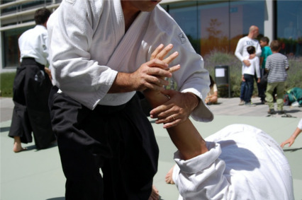
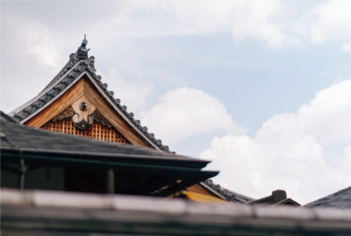
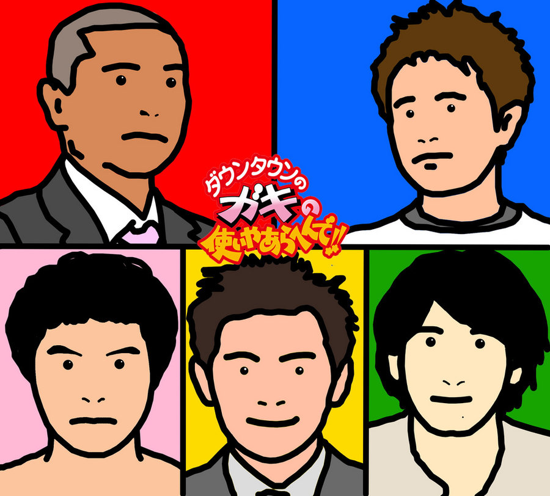
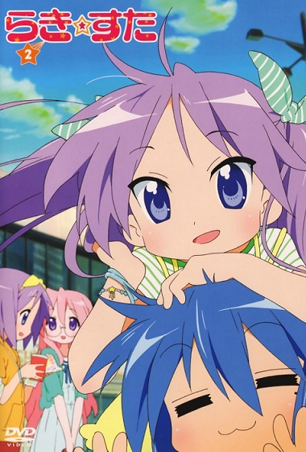
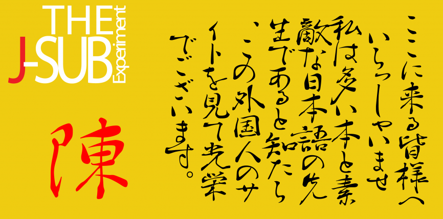

## What is your current level in the language like?

I’m a much better reader and writer than I am a speaker. Very recently, I’ve found that I can read an article pretty well without one of the rikai software and I can type conversations okay. With listening, it tends to be that to fully understand a film or series I’ll need subtitles once but not for a second viewing.

I took the N5 way back in 2012 when I was a sophomore in college and I passed. I took the N2 last year in December and I didn’t pass. I thought I’d have time to sit down and commit a lot of information to memory, but due to work obligations I really wasn’t able to study much. Oh well... Next year, right?

I’ve been studying Japanese since the summer before my senior year. I did the equivalent to a semester at a summer school program in Harvard, then I took two years of Japanese at Boston College. I’ve picked up studying again since last year, when I was able to commit to the [J-Sub Experiment](https://thejsubexperiment.com/) as a full-time job.

## What got you interested in learning Japanese?

{.float-left}

I grew up doing Aikido, and thankfully my school maintained a lot of the traditional terminology and the teachers knew what they meant. So Japanese was always in the periphery of my “language awareness” for a long time, so that was my initial interest. It was when I started studying linguistics in college that I realized that Japanese is a fascinating and fun language to study from that perspective, and it’s something worth looking into. Thankfully one of my linguistics professors knew Japanese and taught a Japanese philology class and introduced me to a lot of the ideas I discuss on my platform.

### Can you briefly explain what is philology?

Philology is the study of a language through texts. Philologists tend to use the classics for their research. Latin philologists will read Tacitus and Julius Caesar, for example. I use anime scripts for Japanese. It’s the job of philology to contextualize and analyze the use of a language in the text. Who is it directed towards? Why was it written? Is this way of expressing oneself typical of the time or is it peculiar? Is it hard or easy to understand? What nuances is the writer bringing about?

## What keeps you going? What keeps you motivated?

{.float-right}

This is a great question because of how many layers exist in motivations. I’ll admit that on a very superficial level what keeps me going in terms of my personal studying is an ego thing. I’m a linguist, not a translator or interpreter or a language professor, and that allows me to not need to be fluent, but I also feel that I need to prove to myself and others that I can get to that level — and it’s a good thing to be at that level. I’ll also say that for professional reasons, because I don’t have the time to explain to people what my skills are exactly, it’s good to have a certificate (like a JLPT) and just show them that I do have some level of mastery over Japanese. And also on a philosophical/social level I just know that there’s a world I’ve yet to experience that I really want to be able to peek into, but I need a stronger grasp of the language to do that.

## How do you organize or plan your studying?

It depends a lot on what my work schedule looks like, but right now I’m trying to dedicate a few hours a day to reviewing Kanji, and once I’m fairly comfortable with that I’ll look at some textbooks, see what insights they offer. So I’m trying to work up to about 4 hours of daily studying divided between Kanji and just reading/grammar stuff.

### How does your typical kanji study session look like?

I’ll start off with about 100 Kanji flashcards and sift through them to find the one’s I don’t know. I’ll set those aside, study them, and then take another 100 Kanji flashcards and do the same thing, adding the ones I don’t know to my original stack of Kanji I don’t know. I’ll do this as many times as I need until I have a set of about 400 Kanji I don’t know so that I can just study those. On most days, I’m just trying to study meanings. If I’m working on writing, then I’m looking at the meaning and writing the Kanji. Needless to say, that takes a lot more time, so I’m only able to go through about 200 in about 5 hours.

## Could you please share about your linguistics background and how that has affected how you approach to learning Japanese?

So I studied Linguistics in college, where a lot of our training went into syntax and semantics and historical linguistics. We were required to take philology courses where we’d look at texts and have to explain every single bit about them, not unlike my runthroughs. (I actually took a philology course in Classical Armenian and the textbook was in German. That was insane.)

{.float-left}

When it came to Japanese, I realized relatively quickly that the textbook has a very specific agenda to have you speaking very formally and agreeably, and it’s willing to bend truths to get you to do that. So I was always skeptical and kind of wondering what’s really going on. But with my other obligations I was never able to do some independent studying and research. (My independent work was in Ancient and Byzantine Greek philology.) Once I started working on The J-Sub Experiment, it became clear the information needed to tackle a standard text or conversation in Japanese isn’t any harder than what one needs to work with Ancient Greek. So I see things from that technical perspective about 85% of the time.

## What is your ultimate desired level in the language?

Ideally, I’d like to be able to do Old and Middle Japanese philology, where the answers to many of my questions undoubtedly lie. I recognize that I won’t be able to do that alone — and step one is mastering Modern Japanese — and that it’s something to look into later down the line.

## Which resources have you helped you the most?

I’m not going to lie, [Wikipedia’s pages on Japanese](https://ja.wikipedia.org/wiki/%E3%83%A1%E3%82%A4%E3%83%B3%E3%83%9A%E3%83%BC%E3%82%B8) are very good, even if they come across as fairly technical to some. [Tusjimura Natsuko’s An Introduction to Japanese Linguistics](https://www.amazon.com/Introduction-Japanese-Linguistics-Natsuko-Tsujimura/dp/1405110651) was my go-to resource when I started this project. [Kuno Susumu’s The Structure of the Japanese Language](https://www.amazon.com/Structure-Japanese-Language-Current-Linguistics/dp/0262519283) is another great book, one I wrestled with and eventually conceded to.

## What are your favorite native resources to consume?

I’m a big fan of [Downtown and the Gaki no Tsukai](https://en.wikipedia.org/wiki/Downtown_no_Gaki_no_Tsukai_ya_Arahende!!) television program. I think those guys are really funny. But they speak in Kansai-ben and they speak fast. The resource that’s helped me the most to learn is anime, if only as a byproduct of work. I’m very thankful that I have the time to sit down and watch an anime and the skills to get something out of it. I particularly like [Toradora](https://myanimelist.net/anime/4224/Toradora) and [Lucky Star](https://myanimelist.net/anime/1887/Lucky%E2%98%86Star).

I’ve mentioned this before on one of my blogs, but I’m not a big anime fan personally. The media I consume that I always have on my mind and can’t get enough of is opera.

### What type of opera do you like?

I listen to right about everything, from the Baroque to operas that came out a few years go. What I listen to more than anything, though, is Wagner, who is probably the most controversial composer in all of Classical music. You can say whatever you want about the guy, but there’s no arguing that the music itself is some of the most sublime ever written.

## How have you incorporated anime into your studies?

{.float-right}

Currently just writing run throughs helps a lot, and it’s something I look back on, ponder how I’d handle it differently (especially those early Lucky Star posts.) Outside that, I don’t have a structured way of using anime.

## What methods and resources have you used to learn kanji?

I’ve promoted prioritizing reading, but writing is something that helps you recognize Kanji, so ultimately I want to do both. I’m philosophically aligned with [Heisig](https://nirc.nanzan-u.ac.jp/en/files/2012/12/RK-1-6th-edition-sample.pdf) (for the most part), and I did use his first book. I’ve also used the Kanji books Japanese schoolkids use (the ones with Pokémon and Doraemon characters) that give the stroke order and example words, because they’re fun. Outside of that, my studies involve using official [Jōyō Kanji](https://en.wikipedia.org/wiki/J%C5%8Dy%C5%8D_kanji) lists and example words I find through databases.

## Do you use any software tools in your learning?

I use flashcards I make on [Quizlet](https://quizlet.com/), and I use the databases of [www.saiga-jp.com](http://www.saiga-jp.com) and [kanji.sljfaq.org](http://kanji.sljfaq.org) for my Kanji needs.

## Have you been to Japan?

Never been. I suspect that for work reasons I will eventually have to visit the country (boring business stuff), but I have no immediate plans.

## What other languages do you speak?

I also speak Spanish and French. I read a bunch of other languages and varying skill levels. Spanish is my first language and I learned French at my local [Alliance Française](https://afatl.com/) one summer to read philosophy and linguistic resources. It was a really great experience since it was just me one-on-one with the teacher. Because I had some experience with Latin and I know Spanish, I was able to triangulate on French and with practice and listening to many operas I was able to come to speak it conversationally fairly well.
 I still have to talk to myself in French every now and again to keep the tongue rapid.

## If you had to start over, what would you do differently?

Oh that’s tough. I started learning Japanese at such a strange point in my life. Hindsight is 20/20, but nevertheless I feel like I should have dedicated more time to acquiring Japanese linguistics resources while I still had them available to me for free in college, because it would’ve helped me a lot now.

## What is your advice for people who want to learn Japanese?

Give yourself the experience of trying to learn it all at once at least one time in your journey. Sit down and tell yourself that you’re going to learn all the Jōyō Kanji and 5,000 vocabulary words and read every grammar textbook one would need in just a year’s time. It’s probably not going to work, but you’re going to see a lot of things, and the more things you expose yourself to when you’re starting out, the less things you’ll be surprised by in the long run. So when you eventually get to those things that you only glanced at once upon a time, you’ll go “Oh yeah!” and not “Oh my goodness, what the hell??”

## Can you tell us about your project, The J-Sub Experiment?

The J-Sub Experiment is a platform where we help people learn Japanese with the help of anime and related media (visual novels, video games, etc.) We look at Japanese from a linguistic standpoint, linguistics being the science of language, breaking it down and using technical terms to describe the relationships between the words and phrases and discerning patterns that repeat themselves all the time. So learning Japanese becomes less of a list of “expressions” and becomes a very regular repetition of patterns.

If you want to get an idea of what Japanese linguistics looks like, our [Starter Kit](https://thejsubexperiment.com/starter-kit-guide/) will give you a very vivid image, especially our Verbs section. It throws a lot of terminology at you, but you don’t need to memorize any of it since we bring things up again and again in our other works, so it’ll all sink in eventually, promise. We also wrote a [very popular article on Tumblr](http://thejsubexperiment.tumblr.com/post/151916695484/genki-lesson-1-linguistic-perspective) on a linguistic perspective of the first lesson from the Genki textbook, just so that one can see how we treat things and how traditional language instruction teaches things.

For people who want JLPT resources in our style, the [Daily Japanese Study Units](https://thejsubexperiment.com/2017/02/08/daily-japanese-study-unit-index/) from the Tumblr blog dontcallmesensei, are very popular because they show that there really isn’t anything special about most “expressions” one needs to memorize. That’s a personal pet project that has helped lots of people who are higher up in college courses when the amount of explanations become few.
