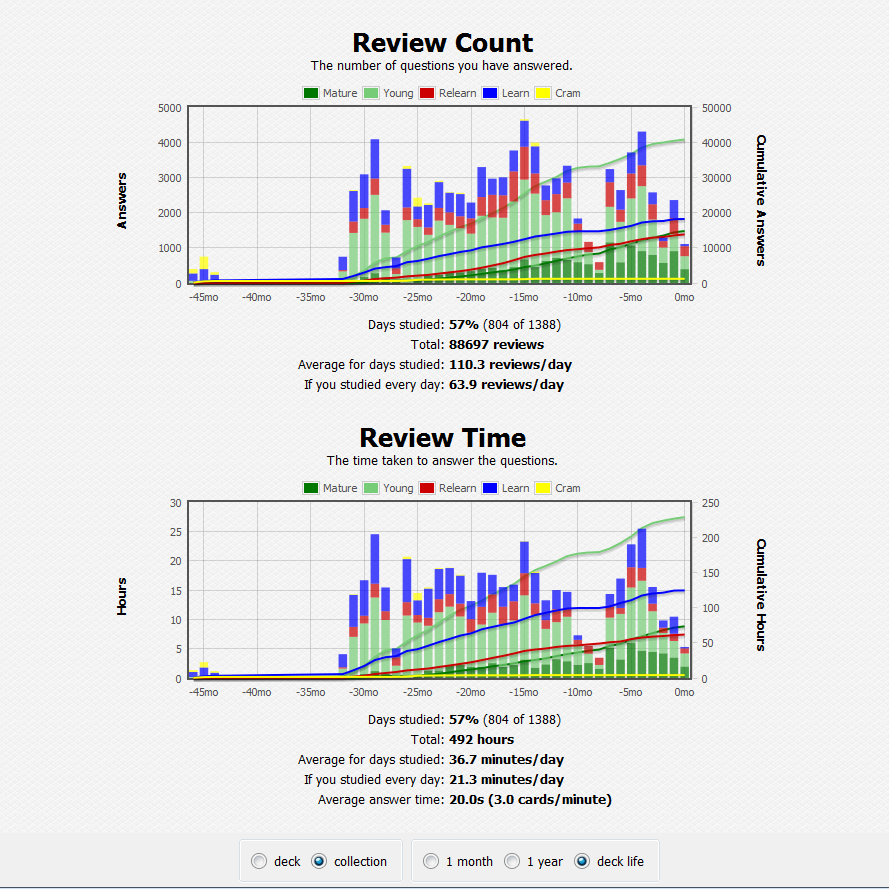
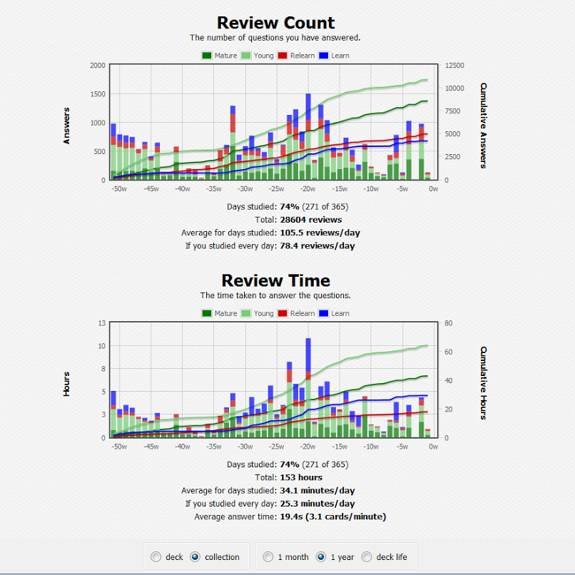
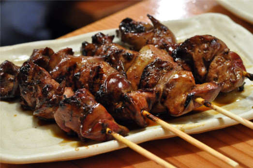

## What is your current Japanese level like?

I have taken the [JLPT](https://en.wikipedia.org/wiki/Japanese-Language_Proficiency_Test) N2 twice and I’ve been studying for five years. Currently I know around 1500 kanji and about seven or eight thousand words. At this level, I can skim through most news articles and get the gist of the stories. Speaking is more difficult, especially with rougher, more masculine speaking partners. I can’t understand half of what they say. I can watch a lot of anime but drama are impossible.

## What is the hardest part of the JLPT N2? How did you prepare for the JLPT N2?

The hardest part of the N2 is probably the reading section. It’s a comprehensive test of your Japanese skills. The first time I took the JLPT N2 I did worst on the reading section.

For preparing for my second attempt, I went back and looked at practice questions for the reading section. I realized that my biggest gap was in vocabulary. It turns out that on the N2 reading section I was mostly missing N3 level words, so I started studying an N3 vocab list.

For kanji, I started searching through my [KanjiDamage](http://www.kanjidamage.com/) [Anki flashcards](https://ankiweb.net/shared/info/748570187) for N2 level Kanji and only studied those. I also read [NHK Easy News](http://www3.nhk.or.jp/news/easy/) every now and then, and I studied an N2 sentence deck that had multiple examples for each grammar point. Overall, I definitely had gaps in listening and N2 level vocabulary. I just couldn’t find the time to fit in more practice. I will eventually go back for a third attempt.

## What got you interested in learning Japanese?

{.float-right}

I get asked this so much and I don’t have a great answer. I think it might have been the challenge. Spanish just didn’t inspire me. I was also attracted to the possibility of opening up a massively rich foreign culture.

Going to Japan during undergrad sealed the deal. Seeing the concrete and lights of Tokyo in the rain was life-changing. I honestly started out more obsessed with Tokyo than Japan as a whole. But that has changed as I have explored more of the country.

## What keeps you going? What keeps you motivated?

Motivation is an almost everyday struggle. Lately I have been spending less time on doing [Anki flashcard](https://apps.ankiweb.net/) reviews. Instead, I’ve been speaking more in Japanese and I have also been teaching Japanese to more students than ever. In addition, I have also been doing more English to Japanese translation work than ever.

## How did you find work as a Japanese teacher?

To find students I post on [Craigslist](https://www.craigslist.org/about/sites), a classifieds website, and I also get referrals from former students.

### How is it like to teach Japanese as a non-native speaker?

I find it rewarding to figure out exactly what is holding back each and every student and helping them out. I think that me being a native English speaker helps me better understand how other English speakers are having problems with Japanese. I think that the obsession with being taught by a native speaker is misplaced.

Out of all my previous Japanese teachers, my favorite was a college professor from the United State's Midwest. I think it’s more important to accurately and intuitively understand the students' problems than to give the most nuanced and perfect explanation of a grammar point, especially for beginners. That said, at the higher levels, Japanese can be learned more and more through exposure.

## How did find work as a Japanese translator?

I am a member of [Pro-Z](http://www.proz.com/) and have applied to many different online agencies that send me work occasionally. These are very low paying jobs and I mostly do it for the experience and practice.

## How do you organize or plan your studying?

{.float-left}

For me It changes constantly. I’m transitioning away from studying grammar and vocabulary through Anki to having as much real conversations in Japanese as I can and only adding words that I hear or encounter to my Anki lists. I practice conversations through Skype exchanges with friends in Japan, with a Japanese person here in Atlanta, and while working about sixteen hours a week in the kitchen of a Japanese restaurant with an all Japanese speaking staff.

I am also considering to start studying an hour a week with a private native speaker tutor. I recognize that if I want to take and pass the JLPT N1 I will have to eventually return to learning vocabulary lists with Anki. Anki allows you to study while walking down the street or waiting for the train. If you take advantage of every five minutes of free time you have you can get through a couple hundred reviews a day.

## How did you find a job working on a Japanese restaurant? How is the experience like?

I simply replied to a sign I saw. It’s intense working there; very Japanese. Eight hour shifts with no breaks and you are expected to always be doing something, even when there are no customers. I mostly make ramen and prepare the fish and meat for sushi and yakitori. The kitchen staff speaks Japanese to me but they are very stern and aren’t interested in helping me learn Japanese for the most part (they’ll indulge me if I ask them to define a single word). If I ask them to repeat or speak more slowly they usually just speak in broken English.

{.float-right}

I see working there more as a proving ground for already acquired skills rather than the learning of new skills. The staff speak in the style typical of casual, hyper-masculine Japanese, which I find to be the most difficult to understand, so it will continue to be an excellent opportunity to practice speaking, if I can handle the stress of working there.

### What kind of customers go to this restaurant?

The customers are mostly non-Asian, although there are lots of Koreans. There are at least some Japanese customers everyday. This is in intown Atlanta rather than the suburbs so I find that quite impressive.

### What is your favorite Japanese food?

My favorite Japanese food is probably yakisoba or some sort of soup like nabeyaki or sukiyaki. Any grilled seafood is great too.

## What is your ultimate desired Japanese level?

{.float-left}

To be able to speak fluidly about complex topics such as politics and literature. To be able to open a book in [紀伊国屋](http://www.kinokuniya.com/us/), the famous Japanese bookstore, and flip to a random page and quickly figure out what’s going on. To be able to converse with the roughest, most casual, slangy, and accented speakers. Homeless people in Tokyo might be a good metric.

## Which resources have you helped you the most?

Anki definitely. The [Japanese Pod 101](https://www.japanesepod101.com/) lessons are also excellent given you have a premium membership that will let you play the dialogs and read along with them.

## What are your favorite native resources to consume?

I’ve been mostly using resources designed for learning. I need to transition away from those.

Living in Tokyo helped me the most, but not in the way you would think. Simply being part of a community of Japanese language learners was probably much more helpful than saying the same five Japanese words in a コンビニ(konbini) everyday.

Unless you plan to work in Japan, you probably won’t get as much language learning out of it as you expect, unless you actively try to speak with people in Japanese and interact with the environment. Learn Japanese takesl takes a lot of effort even when you're in Japan.

## What methods and resources have you used to learn kanji?

Kanji has been one of the easier aspects of the language for me. I started with school textbooks ([Nakama](https://www.amazon.com/Nakama-Japanese-Communication-Culture-Languages/dp/1285429591/ref=dp_ob_title_bk) and [So-Matome](https://shop.whiterabbitjapan.com/products/nihongo-so-matome-jlpt-n3-grammar)) but I advanced the most by grinding on [KanjiDamage](http://www.kanjidamage.com/), using a corresponding Anki deck. If you actually intend to learn all of the 常用漢字(jouyou kanji), studying in the frequency order is not necessary.

KanjiDamage organizes kanji by radicals and similarity. This makes it much easier to remember the difference between kanji that would otherwise be hard to tell apart. 持 and 待 are two early ones that are taught right next to each other in KanjiDamage so that you never confuse them.

### While studying KanjiDamage with Anki. Did you write kanji? How did you do you practice with the KanjiDamage + Anki combo?

I did not write Kanji. I found that after learning to write a few hundred kanji, I no longer felt it necessary to continue writing practice. I am familiar with every radical I come across now and I can remember them more easily through mnemonics than writing. If I ever end up living in Japan and having to write in Japanese constantly (very unlikely) I will have to study writing intensely though.

## Can you share more about your time in Japan?

I did a study abroad in Chiba for three months. I also lived in Harajuku, Tokyo for nine months while I was enrolled in a language school. I also lived in Hiroshima for a couple weeks. I go back to Japan at least once year. This year I’m going to Japan for three weeks in November.

## How did you find and decide on a Japanese language school? Do you have advice for people looking for a Japanese language school?

{.float-left}

I simply researched the various schools on the west side of Tokyo (where I knew I wanted to be). I chose [Kai in Shinokubo](http://en.kaij.jp/) as it had a great website and good reviews and was in Korea town, which I took as evidence of being friendly to the mindset of the “global citizen.” Studying there was intense and it eventually switched from a class setting to private tutoring.

If I where looking for a language school again, I would now ignore location and instead focus on the community and the opportunities they offer to engage with Japanese society. The main problem with a language school is that it is extremely easy to simply spend your time with your fellow students speaking English (the lingua franca of just about everyone there).

## What other languages do you speak? Are you interested in learning other languages?

I can understand a bit of Spanish. I’d love to eventually understand Chinese, because it’s such a massive and fascinating culture. But learning Chinese is a huge undertaking and I currently have no plans for doing it. I may also learn more Spanish as it’s pretty useful around Atlanta.

## If you had to start over, what would you do differently?

Focus my times in Japan less on hanging out with foreigners and more on conversation exchange. I also wish I had started earlier with KanjiDamage or a similar kanji learning program.

## What is your advice for people who want to learn Japanese?

Find a community. Do whatever you need to do to remain motivated and disciplined. Try to integrate Japanese into your leisure time as much as possible. Go out with Japanese speakers to get beers. Go see a Japanese movie or read manga. It needs to be a normal part of your life instead of just this monumental task hanging over your head.

## Where can we find you online?

You can message me via [Linked In](https://www.linkedin.com/in/jeffrey-salazar-55241367) or [you can visit my Japanese lessons page](https://www.atljapanese.com/)
