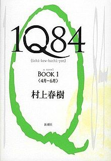
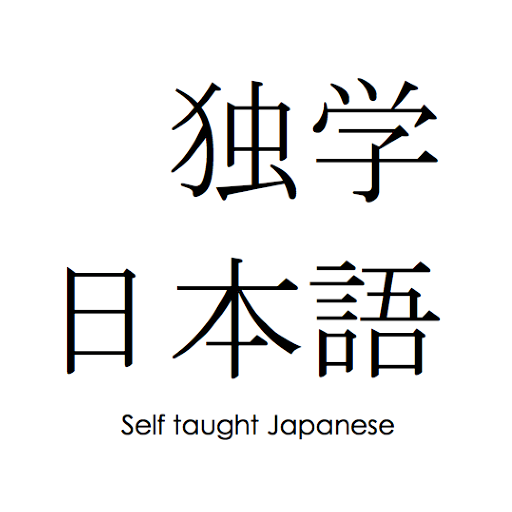
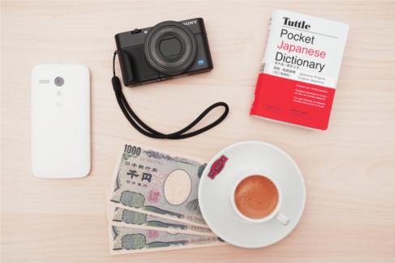

## What is your current level in the language like?

{.float-left}

My level varies pretty heavily between reading, listening, writing, and speaking, roughly in order from most to less proficient. I can hold everyday conversations without too much difficulty, although sometimes I get nervous around people I just met and can stumble a little. Overall, I like to think of my Japanese ability is pretty good, given I have never lived in Japan. I’ve had a few native speakers ask me “So, how long have you lived in Japan?” early in the conversation, and it’s always fun to tell them I haven’t. But to be honest, I still am only able to express a fraction of the things I would like to, and have much more to learn in terms of conversation skills.

As for understanding media, I’ve went into phases where I’ve watched mostly anime or dramas, though in recent years I have focused more on reading novels. Over time, I think I’ve read over 50-100 Japanese novels, many paper novels and some E-books.

For all these media, my understanding depends heavily on the subject matter, though usually once I watch an episode or two (or read a chapter or two) my understanding improves significantly. Generally I can enjoy dramas without subtitles, and a good portion of anime.

## Have you taken any of the JLPTs? For how long have you been studying?

I have never taken any Japanese classes or formal certifications like JLPT, while I have in recent years considered the latter. I think I could probably pass a few levels of it, though I might need to polish up in a few areas first. The question is whether it is worth the time and money to study and get a plane ticket to travel to a location that holds the tests (I think it’s in California). I am pretty comfortable with my reading skills, and I don’t think the test really measures conversation skills, where I need more work.

I picked up interest in Japanese in high school and got pretty serious about studying it college. The first phrase a friend (thanks KR) told me was “Hajimemashite. Douzo yoroshiku onegaishimasu”, and that was over 20 years ago.

## What got you interested in learning Japanese?

{.float-right}

Though it’s a little hackneyed, anime was one the main things that got me started (Akira, Ghost in the Shell, etc.). My push to learn to read adult-level novels came much from a desire to read Haruki Murakami novels in their original, untranslated form. Also, I always wanted to learn a second language, since I feel that it allows thinking in new ways and appreciating another culture in raw form.

## What keeps you going? What keeps you motivated?

I was recently asked the same question and at the time I struggled for a concise answer. I think it has to do with me being a perfectionist, and because of the positive feedback loop I’ve managed to create where studying Japanese is fun and satisfying.

After a few years of learning the basics, I’ve graduated to the point where I don’t really “study”, I just enjoy some form of media (and may look up words as I go) or have a conversation with someone.

Also, while it sounds a little cheesy, I think it’s just plain cool to be able to understand, speak, and write in Japanese. At least for me, I feel the time I’ve put into Japanese has rewarded me richly.

## You are working on the [Language on Track](http://www.languageontrack.com) site. What is your vision for the site and how will it help language learners?

The purpose of the site is to help you track your progress in Japanese, or any other foreign language, and to also promote sharing resources with other people. For example, you can set goals for yourself, and get points for achieving those goals.

To be honest, I created this site some time ago and it is still in a beta state. I think I need to polish up the interface and maybe refine some of the site before I consider it more than an experiment.

But I have had a bunch of people try it, and gotten some good feedback on it. If anyone is interested, feel free to try it out and let me know what you think (there is a feedback option on the site).

## Has working on [Self Taught Japanese](http://selftaughtjapanese.com/) helped you with your Japanese?

{.float-left}

I am not sure if it is directly improved my Japanese too much, although I have gotten a few comments on my articles which help me refine my knowledge. Often when I get questions from readers, I’ll do some research and write an article about the topic, which further enriches me in that area.

I’ve also learned much about how to write a language-learning blog, and what sorts of things people are having trouble with.

## How do you organize or plan your studying?

As I mentioned in a previous answer, I am mostly out the phase where I am “studying”, as in reading a textbook or online lesson. Instead, I appreciate various media and conversations in Japanese, and learn as I go. Off and on I go through periods where I have listened to at least one Japanese podcast (with native speakers) on my way to work, and I found this helps greatly with listening comprehension, vocabulary, and even some culture knowledge.

In the first few years of studying a foreign language, I would say explicit studying is very important, especially to get a very firm grasp on grammar and the characters (Kanji in the case of Japanese). I read many books on grammar in my early years. But the sooner you can get to point where you can start consuming media, the easier you can maintain your motivation. One shortcut is to start with books for babies or children.

Back when I was in “study” mode, I’d spend a big portion of my free time reading Japanese textbooks, and watching anime and dramas. During some periods, I’d spend several hours a day. When watching animes and dramas I’d frequently pause the video to look up words.

For those who are beginning or intermediate Japanese students, I recommend you focus on finding a consistent, enjoyable study schedule instead of forcing yourself to memorize thousands of Kanji in a short period of time (one thing that always makes me cringe to think about).

I  speak Japanese together with my wife and our son most of the time, and that helps me practice listening and speaking on a daily basis. But I had strong fundamentals which helped me do this, and had I not studied extensively it would have been hard to raise a child on a language that is not my native one. It still is quite difficult, though.

## What is your ultimate desired level in the language?

Native-level fluency in all areas, and the ability to translate and interpret between Japanese and English.

Perfect pronunciation gets harder the older you are, and while I still pay attention to pronunciation, I think I’ve given up the goal of sounding 100% like a native.

## Which resources have you helped you the most?

It really depends on the phase of my studying. Back years ago, I used the [Kanji Leaner's Dictionary](https://www.amazon.com/Kodansha-Kanji-Learners-Dictionary-Expanded/dp/1568364075) and [Jim Breen’s WWDC site](http://www.edrdg.org/cgi-bin/wwwjdic/wwwjdic?1C=) often. One of my first textbooks was [Youkoso](https://www.amazon.com/Yookoso-Invitation-Contemporary-Japanese-Third/dp/0072408154) which I still think is a good resource. Now I use [Dictionary Goo](http://dictionary.goo.ne.jp/) and just general web searches.

With all the resources on the web, I think it’s easy to get fooled into thinking if you read enough random web sites you’ll get all the basics down, but I don’t think that’s the case. Whether paper or digital form, I think you need to go through a comprehensive treatment of things like grammar.

[I have a page of resources if you would like more suggestions](http://selftaughtjapanese.com/2017/02/19/japanese-resource-list/)

## What are your favorite native resources to consume?

{.float-left}

Dictionary Goo, as I just mentioned above, is one of the main ones. The last few months, I’ve been using [Syosetu](http://syosetu.com/) to read free, online novels in Japanese. Once you get to the point where you can read native-level Japanese text, it opens up so many more resources that are not available in English. I highly recommend novels once you get to that point.

If I am trying to get a good overview of a single phrase or word, I may just do a Google search and read a handful of pages about the word, some in English and some in Japanese.

## What methods and resources have you used to learn kanji?

One of the only areas of Japanese that I pretty actively de-emphasize is writing. While I was able to write a few hundred Kanji at one point, I’ve forgotten how to write a majority of them. I can even forget how to write characters in Hiragana and Katakana because I write by hand so rarely, though I can quickly re-learn the ones I forgot with a little time. I am sure living in Japan requires the ability to write by hand, but otherwise I see very few reasons to learn to write by hand.

Having said that, when I did focus on learning to write Kanji I learned a great deal about radicals in the process, and that helped me memorize Kanji for reading more easily. Kanji Learners Dictionary and [A Guide To Remember Japanese Characters](https://www.amazon.com/Guide-Remembering-Japanese-Characters/dp/0804820384) really helped me through this.

Kanji is important, and for raw memorization I think are many websites and mobile apps out there to help you. But the fact is that if you don’t use that memory, you’ll quickly forget them (unless you happen to have a great memory). So it’s equally important to actually read texts that contain those Kanji to help you integrate that knowledge.

For me, after a few years of study and a few hundred Kanji under my belt, I just started reading adult-level Japanese novels. While the first few were quite slow going, having to look up many Kanji and words along the way, years later I am much more comfortable with reading. My main frustration to this day is just that my Japanese reading speed is still much slower than my English speed.

One trick I use is making sure I (almost) always know how to pronounce words as I read. This slows things down, but makes it easier for me to look them up in the future, or use them in conversation.

## Are there any software tools you use in your learning?

I’ve experimented with a few, but there is really none that I use consistently (not counting Google Docs for writing translations). Many of them are targeted at beginner or intermediate level students, so there isn’t that much for me to learn.

I think some of these tools can be great, but none of them replaces the need to put in serious effort to learn the basics, especially regarding grammar.

## Can you tell us some of you favorite experiences in Japan?

{.float-right}

I’ve been there three times, each trip no more than two weeks or less.

[I’ve actually written a series of detailed articles on my last trip](http://selftaughtjapanese.com/2015/09/08/travels-in-japan-2015-overview-series-of-articles/), so rather than rehashing that please check it out if you are interested.

But to talk briefly on this topic, there is little that I don’t like about Japan: the big cities, beautiful countrysides, ancient temples and shrines, etc. It’s visually stunning and the food is almost always superb. I haven’t done as much world traveling as I would like, but Japan just feels so different from the US and everything is so fresh, despite the recent strong western influences in recent years.

And of course, Japan is the best place to learn Japanese, whether that is seeing how written Japanese is used in context, listening to college students speak at a cafe, or figuring out how to check in at a hotel.

## What other languages do you speak? Are you interested in learning other languages?

{.float-left}

English is my native language, and I studied a little Spanish in high school (forgot most of it, though). Not counting programming languages and music, Japanese is my second most fluent language after English.

I think learning languages is great, but being a perfectionist it may be a long time until I decide to switch gears. I think Mandarin Chinese might be my next language, eventually.

## If you had to start over, what would you do differently?

Since I don’t particularly regret anything about how I studied Japanese, I am not sure if I would do anything differently for that language. I guess I could have done things more efficiently, but half the fun is getting there ☺

I guess a more realistic and less philosophical question is how I would study another language from scratch, like Mandarin. As with Japanese, I would focus on getting strong grammar fundamentals, however I’d like to experiment immersing myself more in the language early on. For example, just watch random TV shows without subtitles and see if I can gradually pick up on words. I might try to read children’s books earlier, since while I do suggest that for Japanese, I didn’t actually try it myself until I had studied for a few years.

## How would you compare learning Japanese today, to how it was when you first got started?

I touched on this briefly in a different question, but now we have many more resources available, especially in the form of websites and mobile apps. We also have the ability to experience various forms of Japanese media (books, magazines, TV shows, etc.), often for free. There are also more specialized websites to help with reading or online instruction.

While I think these tools can make studying more efficient than, say, a decade or two ago, overall an aspiring student still has to put in the hours of time to become fluent or close to it. There are really no shortcuts. Actually, living in Japan can be considered to be a shortcut since it puts all this information and context in your face to make it easier to pick up. In particular, learning conversation is ultimately about real people and real life, so if you watch anime all day you’ll never become fluent in it. However, even if you are in Japan, learning Japanese still ultimately requires great effort, and if you continue to use English in Japan you’ll be wasting your time. Just because you’ve lived in Japan doesn’t mean you are fluent, though the longer the period the higher the chances.

While I have never taken a class in Japanese, It is not because I am against them. Rather the contrary–having a great teacher is an important element in increasing your odds to pick up the language in a short time.

## What is your advice for people who want to learn Japanese?

I think learning strong grammar fundamentals is one of the keys to allowing you to bootstrap your learning to take it to the next level. I guess Youkoso is a bit old now, but I’ve heard good things about [Genki](http://genki.japantimes.co.jp/index_en) so I think that might be a good resource to begin with. But don’t stop after that. I recommend getting your hands on as many textbooks as you can and go through them at a comfortable pace.

But most importantly, make sure you are enjoying your Japanese studies, and try to incorporate things like anime, manga, and dramas to create a positive feedback loop to increase motivation.

Oh, and also try to make friends with Japanese people that you can exchange emails with, as that helped me greatly in my early years. I think there still may be a few “penpal” of “penfriend” sites out there.

## What have you learned from translating Japanese to English? Do you have any advice to people who want to become translators?

I’m really into translation now and actually spending more time on this than nearly anything else (in my hobby time). I have a great deal to write on this matter and could probably fill a few pages, but I’ll keep it brief for now. However, at the same time, my experience in translating pales in comparison to my experience in Japanese, so I am not sure if I am really qualified to speak much about it.

In short, translation is a great way to make sure you actually comprehend a piece a text, and it’s very satisfying to be able to leverage my knowledge of both languages to enable an original Japanese work to be appreciated by a English speaker. However, I am still in the process of evaluating whether I can ever make a career (or side job) out of it.

If you are interested in translation, first make sure you are pretty confident about your reading comprehension abilities and have read a lot of native Japanese to start picking up nuances of words. Then you can start somewhere like [Gengo](https://gengo.com/), which will give you a taste of what translating as a profession is like.

I’m in the process of translating several works (fiction novels or short stories) and am in active contact with several authors, something which helps me improve my polite-level Japanese. I have done sample chapters of published works, and more extensive translations (at least several chapters) of some unpublished works. If you are interested, [please check out my list of translations](http://selftaughtjapanese.com/my-unofficial-translations-japanese-english/).

The work I have been spending the most time on lately is [a light novel called “Welcome to the Raindance Cafe”](http://selftaughtjapanese.com/japanese-novel-translation-welcome-to-the-raindance-cafe-table-of-contents/).

Finally, I have written a few posts on translation. [This one goes over my translation process in depth](http://selftaughtjapanese.com/2016/10/10/the-art-of-translation-my-process-for-translating-from-japanese-to-english/).

## How can we contact you?

I always welcome comments and questions, so please feel free to email me at the below address:

SelfTaughtJapanese (at) gmail.com
