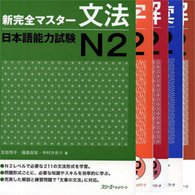
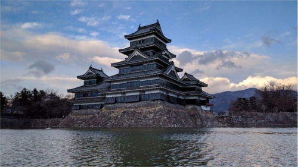
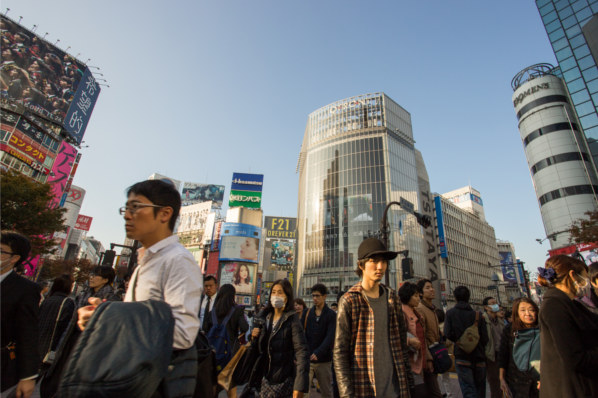

## What is your current level in the language like? For how long have you been studying? A the N1 level, do you still “study”?

Currently, I work as a translator, and this often means working with legal and  medical documents. At N1 level, reading is no longer the difficult and daunting task it used to be, certainly--however, I want to expel this common misconception that those at N1 know everything. I still run into unfamiliar words, unfamiliar kanji compounds, quite often. However, at this level, context clues are easy to find, and kanji isn’t as mysterious as it used to be. As far as studying, I do, believe it or not! I like to read on topics I’m unfamiliar with, and list the unfamiliar words I find. Just writing them out a few times makes them stick in my head.

## Which of the JLPTs did you take? How long did it take you to reach the N1 level? How did you prepare for the N1? Do you have any general tips for JLPT preparation?

I’ve taken the N2 and the N1. I was in Japan for the N2, and passed on the first try, which surprised even me. The N1, I wasn’t so lucky--I failed the first time by three points! (You can’t imagine the pain.) It’s important not to overestimate your skill. Don’t be cocky. The N1 is a monster, and the others in the room all reflected the same look of pure panic during the reading portion. You have to be able to read and retain information very quickly--I’d guess 95% of those in the room finished RIGHT on time. ***Read every single day. I can’t stress this enough.*** Read different things, not just manga or celebrity blogs. Read essays, political news, cookbooks, newspapers, anything you can get your hands on. Note the words you don’t know into Anki, or handwritten flashcards.  I’d recommend the [Kanzen master books](https://www.kuropixel.com/kanzen-master-series-review/) for the N1, as they compact a wealth of knowledge into easy chunks.

## What got you interested in learning Japanese?

{.float-right}

Short answer? Anime. Longer answer? I went to the video store during my Sailor Moon phase, and they had [Sailor Moon S: Hearts on Ice](https://en.wikipedia.org/wiki/Sailor_Moon_S:_The_Movie) with the original Japanese audio. That was the first time I heard the language, and right when it ended, I said ‘I’m going to learn this.’ That might sound a little overzealous for an elementary schooler, but hey, I was headstrong. To me, it was the most beautiful, bizarre thing I had ever heard, and from then on out, I was reading all about the country, the people, the customs, the history--I fell headfirst into obsession. I’m willing to bet there are a few people out there who met the same fate!

## What keeps you going? What keeps you motivated?

It can be hard, when you hit a plateau, to keep going. When I attended Florida State University, there were about 400 students in Japanese 101. When I graduated with my B.A. in Japanese, only seven of my peers graduated with me. It’s difficult, there is no getting around that, but it’s important to have a clear goal. Are you learning it because you want to pursue a particular career? To travel to Japan, and be able to communicate fluently? To simply play games in the original language, or watch anime or dramas without needing to wait for subtitles? No matter what, it’s important to be passionate and invested in that end goal. Don’t take no for an answer. It’s okay to take a short break, but once the language becomes simple, once you start speaking and reading with no roadblocks, you will thank yourself for never giving up. For me, personally, I love the Japanese culture and it’s people. Getting to work with it every day  means that my skills will always stay sharp, and I can always be connected to the country that means so much to me.

## What is your ultimate desired level in the language?

I would love to be so skilled as to have an easy grasp of local accents and slang usage. Living in Niigata prefecture, I heard some different phrases that might not have a place in standard Tokyo dialect, and found myself fascinated. Now, I’ve been collecting some texts on the subject. Even at N1 level, you still find new things to keep you interested, and keep expanding!

## Which resources have you helped you the most?

{.float-left}

When I first started learning Japanese, the internet wasn’t as popular as it is now. I was left with textbooks and dictionaries--but I also look at these things fondly. Sometimes, it’s good to study from a book, as there is way less distraction! (You learn much more when you aren’t checking your Tumblr messages every five minutes.) The Kanzen Master series is really incredible, and I can’t recommend it enough. With that being said, there are also a multitude of free resources online that are becoming available for serious learners. [Imabi](http://www.imabi.net/) is an incredible resource for EVERYTHING Japanese, from vocab to kanji to grammar. For those looking for reading materials, [Shousetsu wo Yomou](http://yomou.syosetu.com/rank/top/) has light novels for free, which is perfect for those readying themselves for the N2 or N1. And of course, [Koipun](/) is shaping up to be a great resource for those like myself who love the anime and manga side of learning Japanese.

## What are your favorite native resources to consume? Which have helped you learn the most?

{.float-right}

Personally, I love internet culture, so [Hamusoku](http://hamusoku.com/) is great for seeing what’s trending online, and also reading some comments that are more colloquial. I’m also a huge fan of Japanese Idol culture, so I read a lot of blogs on [Ameba](https://official.ameba.jp/), to stay up with my favorite celebrities. And for those looking for some free Manga, [Comico](http://www.comico.jp/) is there for you! [Yomiuri Shinbun](http://www.yomiuri.co.jp) is my favorite for news, as well.

## What methods and resources have you used to learn kanji?

I tend to discourage learning Kanji character by character. Of course, knowing the meaning of a Kanji is helpful, and it can be useful for learning how to write--however, I’ve found in my studied that learning vocabulary is far more useful than simply learning one by one. This goes back to reading every day. Kanji compounds are what you need to learn, not kanji alone. Focus on vocab and the kanji knowledge will come!

## How did you tackle learning vocabulary at your earlier stages of learning? How do you tackle learning vocabulary now?

When I first started learning the language, I only had textbooks and dictionaries, so I learned the vocab that was available in this way. (Mostly, I simply learned from the dictionary--yes, that’s very dry and I wouldn’t recommend it.) I also learned a lot from anime over time, and more and more words and phrases became second nature after hearing them so often. However, in the internet age we live in now, I’d say that Anki is a great resource, as well as Memrise, for all manner of vocabulary. It’s great to put aside a chunk of time each day, whether it be 10 minutes or an hour, to open these programs and review vocab. Also...yes, reading!

## Do you use any software tools in your learning?

[Anki](https://apps.ankiweb.net/), [Memrise](https://www.memrise.com/), and [Takoboto](http://takoboto.jp/?tab=apps) are three applications that I think are incredibly useful. Takoboto is great for looking up words when reading articles on your phone, and you can even use it offline, and save vocab. And, best part, it’s free!

## When did you first go to Japan? How was the experience like?

{.float-right}

I first went to Japan when I was 11 years old! I went to Dunedin Middle School in Dunedin, Florida, and the school had a partnership with the local town of Clearwater. My geography teacher was an avid traveller, and actually took students every few years to a different international locale as a type of cultural enrichment program--and it just so happened that the trip announced during my time at the school was a Japan trip! Clearwater, Florida is the sister city of Nagano, Japan, so we had a host family, and were able to experience everyday live in a small city. We also went to Tokyo, Kyoto, Nara, Osaka and Hiroshima--it was a perfect experience, and even though I was so young, I had already loved Japan for five years. It was as glorious as I imagined it would be.

I should mention that I wasn’t actually old enough to go on the trip--I was told it was for eighth graders only, and I was a sixth grader--but, I’m very headstrong. I wasn’t going to be left behind!  (Hence, I stood outside the teacher's office every day for six months, and spoke Japanese at the interview he finally gave me! Never give up on your dreams.)

## How was the experience of majoring in Japanese language and culture like? What are your recommendations for people who want to follow a similar path?

I majored in Japanese Language and Culture at Florida State University. When arriving, I was already at a high level, and while there was no ‘official’ test to allow me to skip the first few introductory levels of Japanese, the head of the program did a short interview with me, and allowed me to progress immediately to Junior level Japanese. For those who are used to studying at home, it’s a very big change of pace--but, it’s enjoyable to be surrounded by those with a similar interest and goal, and great to have professors that allow you to ask all the things you’ve wanted to know about Japanese. It’s a bit of a niche major, still, as it’s so difficult--however, it has given me a leg up in my translator career, and I wanted to major in what I was passionate about. I’d also ask those who want to be translators to see if their college has a translation course, or even a minor. Those are becoming increasingly wanted, and will greatly help you in the future.

## How was your [JET Programme](http://jetprogramme.org/en/) experience like? What were your favorite moments? What are the downsides to doing JET? Do you have any tips for those who want to do the JET Programme?

Funny story--my JET interview was Miami, and I was in Tallahassee. I travelled home to Dunedin (about the halfway point) the day before, and on my way to Miami, I got what I believe to have been food poisoning. Stopping at every rest area on the way there? Yeah, it was a little stressful. And showing up with nothing in my stomach and watery red eyes? I wasn’t expecting that I’d be getting the job.

But, surprise! Interviews typically last about 20 minutes, and they kept me for an hour. While speaking Japanese isn’t a requirement for JET, it is an asset.

Those on JET will tell you, every experience is different. Depending on your placement, you will either love it, or hate it. I was somewhere in the middle. I was placed in Kashiwazaki, Niigata Prefecture, which isn’t too small of a town, and is located on the Sea of Japan, so a great beach community. However, you often don’t get to choose your apartment, and in winter, it was frigid. Japan isn’t great with heating, and since I’m a Florida girl, I had to stock up on electric blankets to survive. However, with that being said, I did love the six schools I was able to teach at, and the students were incredible. The pay is extremely good for those right out of school wanting to live abroad, and the people you meet will stay with you for the rest of your life. I’d say, apply early, and give it a try. Even if you only want to stay for a year, it gives those learning the language a chance to use it everyday, which improves speaking ability at a ridiculously fast rate!

## How did you progress from the JET Programme to professional life in Japan? Is Japanese work life as rough as it is portrayed?

{.float-left}

I stayed on JET for a year, before returning home to the states and working as a translator on a freelance basis, to really get my bearings and start working on a portfolio. While JET was enjoyable, you use nothing but English at school, and I wanted to use my Japanese skills much more than I was. As it usually happens, about six months after getting back to the US, I got the Japan bug again, and started searching jobs in Tokyo on a whim. I found an editor/translator position at a financial communications company and saw no harm in applying. After a phone and skype interview, and several translation tests, I got the job, and moved to Tokyo another three months later, after my visa was processed.

As for Japanese work life, it is very tough from an American standpoint. When I arrived, there was one day to get my bearings at the company--I was read my contract, expected to go set up my bank account, and given a company cell phone--and was left to my own devices. It was expected that I arrived at work around 7:30, and while the workday claimed to only be until 5PM, we weren’t to leave until the boss left, which could be as late as 10PM some nights. The people I worked with were very kind, however, and the office wasn’t some stuffy place where everyone was all business all the time--there was laughter and joking! Out of about 400 employees, only five of us weren’t Japanese, and of the five, I was the only one in my 20’s and female. So, it did take some getting used to.

## How is life in Tokyo like? What are your favorite things about living in Tokyo?

Life in Tokyo is incredible. The trains are so accessible and always on time, there are a million things to do and places to explore, everything is convenient, clean and the people are kind. I first lived in Monzen Nakacho when I arrived, but decided to find a bigger apartment, and spent most of my time in Kagurazaka, in Shinjuku. It was the ‘French quarter’ of the city, and was lined with bakeries and small alleys with all kinds of shops and bars. It might sound silly, but those who have been to Japan will agree--the convenience stores are my favorite thing. You’d never say that here in America, but in Japan? The food is delicious, and after a long day, it’s great to just be able to pick up a bento on the way home!

## How is working like a translator like? How did you prepare to start working on translations? How do you find translating work? Would you like to share any tips for aspiring translators?

Working as a translator isn’t easy at first, and it doesn’t become easy until you make a name for yourself. I started volunteering, simply to create my translation portfolio. It’s important to keep a record of what you’ve done, side by side, to show to prospective clients in the future. With the internet, finding work has become a tad bit easier. For those starting out, I would make an account on [ProZ](http://www.proz.com/), which is a resources not only for jobs, but offers a great forum full of translators asking questions, getting advice and exchanging stories. This also goes back to reading--translating isn’t just putting one word into another language. You have to be aware of the tone of the passage, and be able to seamlessly write it in a way that keeps the original feeling and intent. It’s not quite as easy as it seems, but once you start translating, it becomes much more fun.

## What other languages do you speak? Are you interested in learning other languages?

I speak German, and I would love to learn Korean and Mandarin Chinese, if I ever have enough time. A quick tip I’d give to language learners--it’s always tempting to learn more than one language at a time, but don’t. If you split up your attention, you’re only learning each language at 50%, when focusing on one means that you’re giving it your all!

## If you had to start over, what would you do differently?

That’s a tough question. There wasn’t a lot I could have done, since I learned on my own the majority of the time, but I would say that after I learned Hiragana and Katakana, I should have cut romaji out completely. If you use romaji too much, you begin to rely on it, and it hurts you when starting to read without it. Try only to read Japanese characters!

## What is your advice for people who want to learn Japanese?

Devote time each and every day. That isn’t a suggestion, it’s a necessity. Even if you only have 15 minutes in the morning, or before you go to sleep, something is better than nothing at all. A professor once told me, learn 5 new things every day, and I think that is a great goal to set, among other things. Whether it’s 5 new words, 5 kanji, even 5 cultural facts, learning a language is nothing but building blocks. Add five each day, and before you know it, you’ll have a castle.

## Where can we reach out to you online?

I love to answer questions. You can reach me on Twitter at [@carleyjpn](https://twitter.com/carleyjpn), and if you need translation or would like to talk translation, shoot me a message on my website, [jptranslation.weebly.com](http://jptranslation.weebly.com/).
