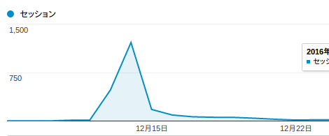
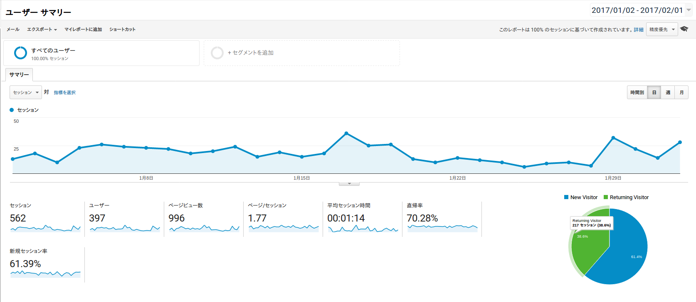

This is the first of what will be a series of blog posts that I will be publishing about the story behind Koipun. I was inspired by [Indie Hackers](http://indiehackers.com/) to start doing this series. I love [Allen's](https://twitter.com/csallen) blogging style for Indie Hackers so much that I will base this series around it.

Well, I am crazy excited about Koipun and my girlfriend is probably super tired of hearing me talk about it, so at the very least this shall give her some respite.

## Revenue and Expenses

This month I got a total of $54 US dollars in revenue, all of it from [Anki flash card sales](/anki/). Given that I still haven't started monetizing [Koipun Reader](/reader/) this is the only current source of income. $54 dollars is about an average month in Anki flash card sales. As for expenses, I had the following:

- Payment Processing Costs: $3.92
- Heroku for hosting the website: $7
- MailChimp for the [Koipun Newsletter](/newsletter/): $11
- Registering Koipun LLC: $200

That comes to a grand total of $221.92 in expenses, which puts me in the red for this month. But that is only because I finally got around to officially register Koipun as a US LLC!

## Traffic after launch

In December of last year [I launched Koipun on reddit.com/r/learnjapanese](https://www.reddit.com/r/LearnJapanese/comments/5i7fi7/new_easy_way_to_read_in_japanese_keeps_track_of/) which gave me a huge spike in traffic which quickly died out.

This is how a regular traffic pattern for Koipun looks like.

As you can see, this month I got 996 page views. A great portion of it is still reddit traffic! It seems that people are still finding a way to the original launch post. The rest are mostly from [Ankiweb where I have the free version of our Genki I grammar deck](https://ankiweb.net/shared/info/1758197267). Getting consistent traffic to Koipun is going to be a big challenge, but I have several ideas to help attract more traffic.

## "How I learned Japanese" Interview Series

As part of an effort to get more traffic to Koipun I started a new blog series. For this series I also borrowed a page from Indie Hackers. In Indie Hackers style, I am interviewing successful Japanese learners about their study methods.

Learning a language is a personal journey and everybody will end up developing their own study methods. I have always been curious about other people's methods and have tried to integrate other learners' techniques into my own repertoire. I have a hunch that other Japanese learners feel the same, so I started seeking out folks to interview.

So far I have published two interviews. After I gather six interviews or more I plan to start promoting the blog. But even if the blog ultimately fails, I have already been reaping benefits from this project. Reaching out to many of the Japanese learning bloggers and gurus has been great.

In the process of doing the interviews I have learned some lessons which will affect the design of Koipun Reader. Furthermore, these interviewees have been extremely generous and have given me tremendously valuable feedback on Koipun Reader. The frosting of the cake is that I am getting to further validate the Koipun Reader idea!

## Koipun Blog Infrastructure

In order to host the new "How I learned Japanese" interview series I needed a blog to host it. I had built a Wordpress blog a couple of months back on a sub-domain, but I never got around to using it. I could have just used that Wordpress blog but I ended up getting rid of it and making a new blog hosted at [koipun.com/blog](/blog/). For the new blog I used [ButterCMS](../), which is a category of product I didn't even know existed. It is a blog/CMS as an API.

The rational part of thought I should just use the Wordpress I had setup for speed and not waste time on adding a new blog, but I talked myself into making the new one because I thought that maybe having the blog on a sub-domain would be bad for SEO purposes.

I am still not sure if hosting a blog on a sub-domain vs on the root domain makes any difference for SEO, but I am glad I did the move to having the blog on the main domain using ButterCMS. Now I am able to integrate the styling with the rest of the site and style the blog to my liking without having to deal with customizing Worpress themes or building a Wordpress theme from scratch.

## The Koipun Newsletter

This month at around the one month anniversary of the Koipun Reader launch on Reddit I started the weekly Koipun Newsletter. So far I have modeled the newsletter around the Indie Hackers and the [Tofugu](http://www.tofugu.com/) newsletters, but I haven't settled on a format yet. I have only sent two newsletters so far, so I need to experiment a lot more to see what kind of content are the subscribers interested in.

I have given away free Anki decks on every newsletter so far, but I am not sure if this model is sustainable as creating the Anki decks is a substantial amount of work. Also, I am still not sure if the subscribers enjoy these Anki decks. Newsletters are definitely a lot harder than they seem, but writing them has been rewarding plus it helps a lot with accountability!

## Koipun Reader Development

The Reader barely saw any development this month as I have been focusing on marketing and validation efforts, but it did receive an update! Koipun Reader now counts the ability to export Anki decks for SRS reviews of Koipun Reader content. It has been an interesting month dedicating myself to marketing and reading about SEO and other topics I have no experience with, but I am getting very itchy to get back to coding.

## Learning

This month I spent a substantial amount of time just learning new things. I know next to nothing about marketing and SEO, so I started reading about those topics. In addition to reading, I have listened to many episodes of [Startups for the Rest of Us](http://www.startupsfortherestofus.com/), which have been incredibly helpful. I can not recommend it enough. Also, I have read every single interview on [Indie Hackers](http://indiehackers.com/), all of which have been a tremendous source of inspiration and knowledge.

In the past, I have had the problem of learning as a form procrastination. I would read tons of books about a topic and never make any actual progress on my projects. But this month I tried my best to not slip into that and just do "just in time learning" i.e. just learning what I need, right when I need the information.

Finally, I joined a Mastermind Group via [MastermindJam](https://mastermindjam.com/). I joined the group because I wanted to have people  with whom I could brainstorm and discuss problems with, but after further reflection I realized that what I need is more of a support group to share the ups and downs with. I am not sure if the Mastermind can fulfill that need, but I will assist a few meetings and see if helps.

## Goals for February

If everything goes as planned, February is going to be a big month. I plan on having three launches this month:

1. Launch the "How I learned Japanese" blog on [reddit.com/r/learnjapanese](https://www.reddit.com/r/learnjapanese)
2. Launch the Anki Grammar deck for Genki II on the newsletter and [Ankiweb](https://ankiweb.net/decks/)
3. Launch a new version of the Koipun Reader on the newsletter.

Releasing the blog and new the new Anki Grammar deck should be doable, but I am not sure if I will make it for the new Koipun Reader version. For the new release I want to port the Reader code to [Vue.js](https://vuejs.org/) from [Angular 1](https://angularjs.org/) which should take at least one week worth of development, but could end up sucking a lot more time.

For February, I also want to get better at time tracking. I want to measure how many hours I am spending on Koipun. I have started using [PomoDoneApp](https://pomodoneapp.com/) for time tracking, but sometimes I get in the flow and forget setting the timer, among other issues.

Thanks everyone for all your support this month — if you've got any ideas, feedback, or questions, [please email me](mailto:gabriel@koipun.com)!
