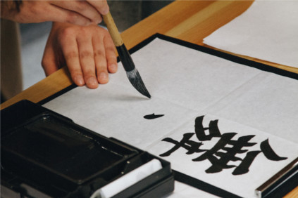

## What is your current level in the language like?

I have been learning Japanese since 2010 when I first entered college. My major was Japanese and while in college I went to Japan on a few short-term programs. I have also worked in a Japanese-style office based in my home state. I still use Japanese in my current job, which is helping Japanese expat families adjust to their new life and to the education system in America.

I passed JLPT N2 in 2013 but I'm still studying for the N1. I feel comfortable carrying conversations and overall understanding the things I read, though lately I feel I have limited ability in expressing myself deeply about more complex topics. This is my next step.

## What got you interested in learning Japanese?

{.float-right}

When I was in middle school, I was into manga, anime, and JRPG video games, but hearing my first J-pop song (I think by Utada Hikaru) got me fascinated with trying to learn the language. However, at the time, I didn't have the resources or the "know-how" on how to go about studying Japanese. So what really got me into studying was my first few college Japanese language courses. Everything about that start - my teachers, the camaraderie of my classmates, the small triumphs in saying things I couldn't before - really motivated me to study Japanese for the long-run.

## What keeps you going? What keeps you motivated?

I understand the feeling of people who end up stopping, especially if they don't have the chance to use the language or don't feel like they're getting better. I have been fortunate to have had the opportunities to go to Japan and work in a Japanese-speaking environment, but there had been times I didn't feel like pushing my studies any further, especially since I no longer had a class to go to. I think having an enjoyable outlet for Japanese has helped immensely.

I'm not saying that studying is all fun and games, but in between flashcards and [Kanzen Master](http://www.kuropixel.com/kanzen-master-series-review/) textbook sessions, watching an anime/drama or reading a manga/book and experiencing a synthesis of what you studied is highly rewarding. Another thing that helped motivate me was using what I learned with a native speaker, and this was helpful at all stages, especially when I was a beginner. Most Japanese people I know have been really appreciative and supportive of others studying Japanese, and it's a great feeling to deepen ties through the language.

## Has working on your YouTube channel, ADBChannel, helped you with motivation?

It has, especially since I want it to be motivating for those who have been studying Japanese, and also make it approachable for those who are starting their studies. That means I myself have to review concepts or learn something new to share, and this helped me in my studies overall. The idea came about at a time when I first started working.

Even though I was using Japanese at work, I was normally frustrated or tired by the end of the day and didn't feeling like studying when I went home. At the time, it had also been a while since I last watched anime, but when I started watching some I was surprised and really happy with how much I could understand. I started noticing how much useful, conversational Japanese was present throughout anime (albeit in a more casual, direct form) and wanted to make videos introducing these lines from anime. It took me a while to put stuff together, just because I'm rather camera shy.

## How do you organize or plan your studying?

In terms of formal studying, on a weekly basis I try to do flashcards, read articles in Japanese, and listen to some Japanese-related podcast episodes. While I try to do these activities in the morning, normally I get the motivation when I catch myself doing something in English that I could do inJapanese. For example, if I'm realizing I'm reading the news in English, I'll make the switch to find the equivalent of that same story in Japanese. This can't really apply to podcasts but when I find myself wanting to listen to something while driving or walking my dog, I try to make sure a few times a week that it's something Japanese.

## What is your ultimate desired level in the language?

This level is hard to describe and quantify, but I would like to be at a level where I can express everything I feel and experience without cutting out the minor nuances. Journaling is a big part of my life now, and if I could comfortably do that in Japanese - then expand upon that into story-telling and debating in real life, I would be set.. until the next goal.

## Which resources have you helped you the most?

Having had great teachers from the start is what got me through a lot of the initial hurdles of learning Japanese. I know a lot of people reading this might be self-teaching themselves Japanese or not have access to a teacher, so one resource I would recommend that I still use and think is accessible for all learners is [JapanesePod101](https://www.japanesepod101.com/).

The podcast hosts do a great job of providing a context for learning grammar and vocabulary, and going in depth about culture. There are also detailed PDFs with the lessons, and they're pretty responsive to questions in the comments section. Yes, there's a subscription fee but it's probably less than a private tutor or language program - but in those cases, if you have a great teacher who motivates you, I say stick with them.

## What are your favorite native resources to consume?

I like using the app called [Flipboard](https://flipboard.com/), and changing the settings to Japanese so I can search for articles in Japanese. If there's a topic that I like reading in English, such as health or self-improvement, I challenge myself to read them in Japanese. By using Flipboard, I have come across some really great Japanese websites like [tabi-labo.com](http://tabi-labo.com/) and [sirabee.com](http://sirabee.com/), which have interesting articles on various topics.

## How have you incorporated anime into your studies?

Most of the time recently, when I watch anime it's to make content for [Youtube](https://www.youtube.com/channel/UC9NOMk6RgRikBIsiLUb5mTw) or [Twitter](https://twitter.com/gaikokujenny). However, the process of teaching things from anime has helped enforce and refresh my memory of concepts. Additionally if I studied new words/grammar with other resources and THEN come across it in anime, the word really sticks because of the exposure and association to a scene. So this is why I think anime is also a great resource, since it provides exposure to concepts people study, and with a context.

## What methods and resources have you used to learn kanji?

{.float-left}

Definitely kanji and all of their several readings was one of the hardest concepts for me to grasp when I was first learning Japanese. For beginners, I think you have to initially just memorize the kanji readings for the most frequently used words, especially if they are in kun-yomi, and learn how to write them with the correct stroke order, which will help ingrain them. After advancing in your studies, I recommend a more systematic approach to recognizing and remembering characters, like [Remember the Kanji](https://nirc.nanzan-u.ac.jp/en/files/2012/12/RK-1-6th-edition-sample.pdf) series, and getting comfortable with on-yomi readings by recognizing the radicals. Just by having the meaning and the pronunciation associated with a kanji, you can learn a lot of new words, or at least get the relative meaning even at a glance.

## Do you use any software tools in your learning?

I use the [Memrise](https://www.memrise.com/) app for flashcards. I also use [WWWJDIC](https://play.google.com/store/apps/details?id=org.nick.wwwjdic) on Android for looking up words, and the [Tangorin app](https://play.google.com/store/apps/details?id=com.tangorin.app) for looking up example sentences for a word. I use Flipboard for reading articles in Japanese, since it organizes stories based on interests and is one of the only news apps I have seen that has access to Japanese articles. I do recommend the [NHK Easy Web News](https://play.google.com/store/apps/details?id=com.aovill.language.e2l.ejn) app for the Android for people who are beginner/intermediate. Japanesepod101 also has a great app, with a nice interface for accessing episodes and PDF files.

## Could you share some of your experiences in Japan?

The first time I went to Japan was in 2012 for a short-term study abroad, under a government program called [Critical Language Scholarship](http://www.clscholarship.org/). The program was intensive, so it really challenged me to use the language in ways that I hadn't had a chance to in my first few years of studying in America. I had a wonderful host family and a Japanese language partner, and since the program took place in Kyoto I was able to enjoy a lot of the local culture thanks to them. The following summer I went for a 2-month internship at a tea company called [Kyoto Obubu Tea Farms](https://obubutea.com/).

This company has a great mission of sharing tea with the community and making the knowledge of tea farming fun and accessible. It was great learning about the tea culture and helping them at their events, whether it was selling tea at Kyoto station or serving tea to the elderly in a nursing home. I got to meet a lot of kind people, both locals and people from abroad through this opportunity. And since the office was in the countryside, it was a huge contrast to what I had experienced in Kyoto the previous year - but it was also nice to see Japan from a different side.

## What other languages do you speak? Are you interested in learning other languages?

I don't speak any other languages besides English or Japanese, though I did take Spanish in high school and one year of Mandarin in college. Those languages would be something I would like to get back into. I would try to approach them differently by creating a deeper motivation anchor so I can be more consistent about studying.

## If you had to start over, what would you do differently?

I'm not sure what I would change, since the stumbling and subsequently overcoming the stumbling in my Japanese studies has helped me get to where I am now. I sometimes wish I had done a longer study abroad program when I was in college. Even though there may be opportunities to work in Japan, the people you can meet and experiences you can have in a college environment versus an office environment are vastly different.

## What is your advice for people who want to learn Japanese?

Enjoy the ride and don't chase after instant results. There's a great amount of advice on the internet on how to go about studying Japanese. However, regardless of which approach you follow, take the time to appreciate how far you have come, whether it's in realizing that you were able to express more in a conversation than you could before, or that you could understand something in show, book, or song that you weren't able to previously. This can help motivate you and serve as a reward through the hours of studying. As for expecting a certain level of fluency in x amount of months or even years, I think that can possibly be discouraging if a person doesn't meet their own expectations.

## Could you recommend some videos for people who want to get started with your YouTube channel?

I think a good start would be the [Clannad Episode Special](https://www.youtube.com/watch?v=KlJWgwTRuWg&feature=youtu.be) or [Space Brothers Episode Special](https://youtu.be/73RGUw-mU9o). What I really liked about making these episodes is that I felt like I could highlight material that would be useful to both beginners and to people who have been learning Japanese for a while. Even if people don't listen to the explanations following the anime scenes, I hope they can enjoy viewing the subtitles I provided on the clips and get a chance to pick out something new to learn.
