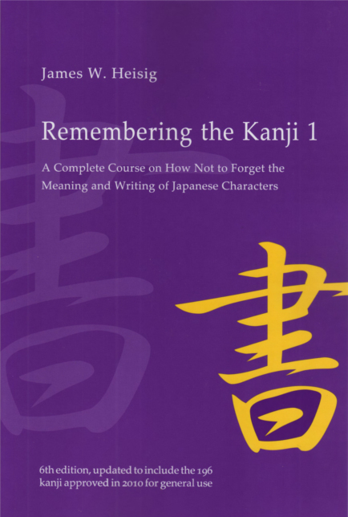
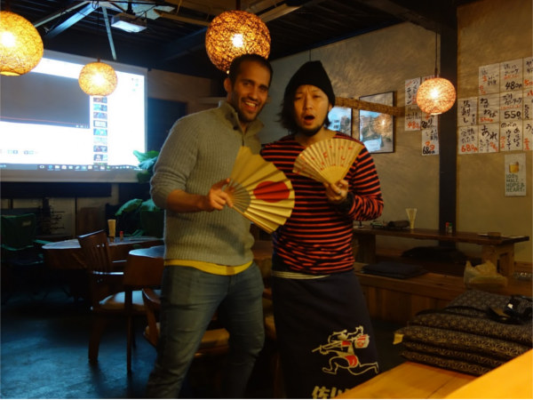

## 1. Finish studying Tobira

In 2016 I started seriously studying an intermediate level Japanese textbook called [上級へのとびら](http://tobiraweb.9640.jp/). This book is commonly called Tobira and its full English title is Tobira: Gateway To Avanced Japanese. In late 2015 I had done some initial work on it, but very little to count for any significant progress. In all of 2016 I managed to cover six of the chapters of Tobira with my Japanese teacher, [絵理子先生](http://elcbkk.wixsite.com/erikojuku2016). The book has a total of 15 chapters so if I work somewhat faster than last year, I should be able to finish this texbook by the end of the year.

### Why this goal?

After finishing Tobira I should be able to pass the [JLPT](https://en.wikipedia.org/wiki/Japanese-Language_Proficiency_Test) N3 without much effort and should put me on track to take the JLPT N2. Furthermore it will greatly expand my vocabulary and improve my reading skills significanlty.

I have found that many people do not enjoy working through textbooks, because they find them dry and boring. Also, the practice excercises can get repetitive. Yet, I enjoy working with textbooks because they give me a sense of progress and achievement that I can not get with other kinds of materials. With a textbook I can easily measure progress, but when I study native materials exclusively sometimes I wonder if I am just spinning the wheels.

### How can I achieve this goal?

To achieve this goal I need to cover each of the remaining chapters in under five weeks.

## 2. Finish studying Heisig's Remembering the Kanji

{.float-left}

[Heisig](https://nirc.nanzan-u.ac.jp/en/files/2012/12/RK-1-6th-edition-sample.pdf) is supposed to be something one finishes studying in a couple of months, but I have already spent almost three years on it and I am still at about 60% completion. Part of the reason it has taken me so long is because I am spending a lot of time practicing writing every single kanji by hand. Also, against Heisig's recommendations, I have never dedicated myself solely to studying this book. I have always been studying it in parallel to my other Japanese studies. I usually do about thirty minutes practice with Anki, so I can not add many new cards or they simply do not stick in my mind with the number of small number of daily reviews I am doing.

### Why this goal?

I have often questioned myself if studying Heisig's at this pace and writing everything by hand with correct stroke orders and endings is worth it. But I enjoy being able to write Japanese by hand, and this is the only method that has allowed me to learn to write kanji fluently without forgetting, so I have kept going at it. Furthermore, this is the sunk cost fallacy, but I still don't want to lose all the hardwork I have already put into this.

After finishing studying Heisig's Remembering the Kanji, I will be able to write all of the [常用漢字](https://en.wikipedia.org/wiki/J%C5%8Dy%C5%8D_kanji) by hand. More importantly I will be able to indentify all of the kanji in this book, which will put me on a fast track to learn Kanji readings by just simply reading and watching media with subtitles.

### How can I achieve this goal?

I have 852 kaji left to study. By studying just three kanji a day I am good to go with this goal.

## 3. Finish Chrono Trigger in Japanese

{.float-left}

Last year I started playing [Chrono Trigger](https://www.youtube.com/watch?v=6GGb0mO4z7Y), the Nintendo DS version, in Japanese. This game is a masterpiece and it is [often cited on best video games of all times](http://www.gamesradar.com/why-chrono-trigger-one-greatest-games-ever-made/). The soundtrack, the story, the art, all give me tons of motivation to work through it. I have found the vocabulary and grammar levels of this game are appropiate for my Japanese level. It is challenging enough that I am pushing myself and learning new things, but not so hard that I get frustrated and bored. Another thing going for this game is that because of the [Chrono Trigger Retranslation Project](https://www.chronocompendium.com/Term/Retranslation.html), we have access to the full game script with translations in an accesible format, which is a tremendous advantage for learners.

### Why this goal?

I want to start diving more into native materials and I love [JRPGs](https://en.wikipedia.org/wiki/Japanese_role-playing_game) and this is one of the best of the genre. Also, I remember how video games helped me learn English when I was young, so I want to experiment with replicating that with Japanese.

### How can I achieve this goal?

Just by playing a few times a week should be enough. The game is not very long and I have already spent a good number of hours on this. A bigger challenge than time, is that I need to figure out out how to actually learn from this game. Without any kind of reviewing and formal studying I don't think I will get much out of it. I expect to be able to use [Koipun Reader](/reader/) to help me in this area, once I finish the import text feature.

## 4. Spend more time chatting on the phone and on Skype with my Japanese friends

{.float-right}

While I was on the [JET programme](http://jetprogramme.org/en/) I made tons of friends in Japan. I became very close to them very fast. We just clicked in a way that I rarely do with most people. Unfortunately although I stay in touch with them, I haven't been seeing them on Skype all that much. I miss them so much, so I will put more effort in staying in touch, even though dealing with schedules and time zone differences can make it a bit difficult. As a sidenote, I should also speak more in Japanese with my girlfriend. Although I text her almost exclusively in Japanese, when we speak, unless it is for basic conversations we usually speak in English.

### Why this goal?

I miss my friends. Also, while simply speaking with them, I naturally get to practice.

### How can I achieve this goal?

I will schedule more time to spend talking with friends, instead of relying on spontainiaty. I will phone/skype of one of them at least once a week.
