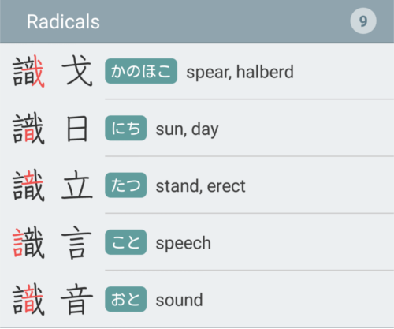
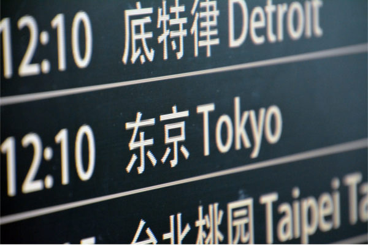
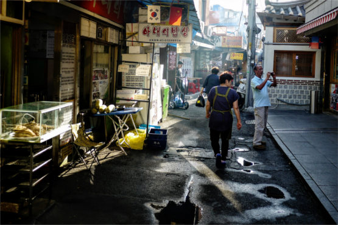

## What is your current level in the language like? For how long have you been studying Japanese?

I started studying Japanese about 11 years ago, although there were a lot of times when I stopped and started again. So really it was more like 7 years across 11 years?

I’ve passed the JLPT N2 and failed the N1 twice now! I want to get good enough to pass the N1, but the JLPT isn’t always a clear sign of your Japanese ability. I can hold conversations, read books, manga and articles, and watch anime very easily. Sure there are times when I don’t understand 100% but I can get the general context then look up the details later.

## What got you interested in learning Japanese?

{.float-left}

A friend of mine was doing her Japanese homework in the cafeteria at College (High School). It looked interesting so I asked her to introduce me to her teacher. I began studying 1 hour a week with that teacher for about 2 years.

When I was at Secondary School (Middle School) I was made to learn French, Spanish and German. I don’t remember ANY of them. None of them were enjoyable. But Japanese just made sense. It clicked.

I was a very lazy student, only doing the bare minimum of homework, but unlike piano or kung-fu, I didn’t stop doing Japanese. I still don’t know why. Maybe because I had a friend learning at the same time so we could share our knowledge and write secret messages. We also shared anime which boosted my listening skills early on.

After 2 years my friend and I went to Japan for 4 months. We studied at a language school in Fukuoka for 2 months, and then volunteered on organic farms with [WWOOF](http://wwoofinternational.org/) for 2 months. That trip literally changed my life.

My Japanese not only got 100% better, but I really fell in love with the country and the people. I still clearly remember jumping down a mountain thinking “I want to be an interpreter”, and have kept that with me always.

## You mentioned that you stopped studying a few times. How did you get back into the habit during those times? What gets you motivated?

It was really a mixture of things that drove me: Guilt for not studying for so long; the enjoyment I felt when I understood something (mostly in anime).

But over the years that have been 2 major things that would drive me to study again:

1. The JLPT
2. Going to Japan

I would go through periods when I knew I should be studying but “I’ll do it tomorrow”, “I’ll do it this weekend when I have more time”, and then never did. So after several weeks of coming up with excuses I would normally give myself a goal. This was often passing the next JLPT level, which would push me to find a teacher/class, and/or go buy a pile of textbooks.

I found the JLPT to be a great motivator. It gave me a solid goal to work towards with (fairly) clear set vocabulary, grammar and kanji that I needed to know.

The second biggest motivator that would kick me back into gear was actually going to Japan. After I’d go there (often for the purpose of study) I’d fall back in love with the language. Then when I got back to the UK I’d throw myself into self-study again.

Going to Japan, meeting people, living there, making friends, using it every day, etc., would re-awaken why I wanted to throw myself into Japanese in the first place. I’d get that image of me jumping down the mountain again.

## What is your ultimate desired level in the language?

{.float-right}

I don’t think I have an ‘ultimate desired level’. I’m always setting myself new goals to reach.

Right now they’re:

- Passing the JLPT N1. Getting good enough at listening/speaking to start studying interpreting.
- Catch up on un-read Japanese novels.
- Translate a novel.
- Being able to read newspapers without looking up much kanji.

I’ve had some of these goals for a few years now. But even if I achieve one of those goals, I’ll always set myself another.

For example, I’d never finished a Japanese novel until this year! I’d always said I’d do it but kept coming up with excuses.

Then I started working with a 1 hour commute on the bus, so began reading 魔女の宅急便 (Kiki’s Delivery Service). I finished it in 2 weeks. Then I moved onto a slightly harder まおゆう： 魔王と勇者 (Maouyuu: Maou to Yuusha) - lots of war, politics and economics, although the book is entirely conversation. I finished that in about 6 weeks. So I set myself the new goal to catch up on the huge pile that I’ve been collecting over the years.

## Which resources have you helped you the most?

I’ve always fluttered between resources over the years, but the largest helpers have been native Japanese people and [Memrise](https://www.memrise.com/).

Memrise I can use to focus on studying. Speaking with and messaging Japanese friends means I’m forced to use what I study and learn new things.

Learning from Japanese people is probably one of the best ways because you can mimic natural phrases and work out the best words depending on the situation.

For example, the first time I went to Japan I remember using “大丈夫 ” (daijyobu) to turn down people offering me leaflets on the street. Because in English we say “I’m fine” when we don’t want something. Then I was out with Japanese friends and they said “結構” (kekkou) instead. It was like something click. Of course they wouldn’t say “大丈夫”! That makes no sense in that situation! No wonder I got so many strange looks! Hahaha!

 I’ve had a lot of moments like that over the years. But I think it’s also important to learn from mistakes as well as people around you.

## How did you prepare for the JLPT N2 and N1?

I had very different approaches to studying for the N2 and N1.

I had wanted to pass the N1 within a year of graduating from University, so I planned a 6 month trip to study at a school in Fukuoka. I quickly realized that N2 was a more realistic goal at that point.

We would study everyday using the [Nihongo Soumatome books](https://www.kuropixel.com/nihongo-sou-matome-review/), but those only just helped me scrape a pass mark. I think living in Japan during that time helped just as much (arguably even more) than the text books did.

When I was back in the UK I had to self-study so I decided to use the Nihongo Soumatome books again for the N1… and got absolutely stomped by the exam.

So I took a new approach, using different resources for self-study and… still got stomped (although my vocabulary score was a lot better).

Now I’m taking [Bryan’s advice](/blog/how-i-learned-japanese-bryan-from-kuro-pixel/) to heart and focusing on my reading comprehension and learning kanji and vocabulary that way. I’ll pick up my previous study methods again closer to the exam (because they DID help a lot), but right now I’m focusing on my reading skills.

## What are your favorite native resources to consume? Which have helped you learn the most?

Originally it was anime. Watching anime constantly as a beginner helped a LOT with my listening skills. Listening is my strongest skill.

Now it’s novels. As I said I only recently started reading Japanese novels. I felt like if shouldn’t have been reading because I had to “study for the JLPT” or “should be focusing on my translating”. Those were a huge mistake as I’ve already learnt so much from just reading 2 books in 3 months!

## What methods and resources have you used to learn kanji?

I’m not too concerned with learning to write kanji, although it’s a very important skill to learn at the beginning so you know how to write.

When I started learning kanji I used the [Basic Kanji Book](https://shop.whiterabbitjapan.com/products/basic-kanji-book-vol-1) series. They were a great introduction to beginner’s kanji, stroke order and how to write. Not so great for vocabulary, or remembering the kanji long-term.

Since then I’ve learnt kanji through vocabulary. Focusing more on kanji’s application rather than their “meaning” or “readings”. But focusing on that method alone was a mistake too. Because it meant that when I came across a new word I often wasn’t sure of the reading or meaning.

I tried Heisig’s Remembering the Kanji but it didn’t work for me. It did teach me to use mnemonics to help me learn / remember how to write some kanji though.

{.float-left}

Last year I began using the [Japanese Kanji Study app](http://mindtwisted.com/) and it’s been fantastic for helping me with the N1. I went over all the kanji from N5 to N2 which was a great refresher and helped make a lot of the kanji I’d previously learnt make more sense in advanced settings.

What’s really helped over the years is finding a study method that works best for me at that time. Then mixing it up or taking another approach. Over the years these different methods have built up so I’m at the level I’m at now, although I’m still always learning something new.

## Do you use any software tools in your learning?

Memrise is my go-to app. I love that I’m able to create my own vocabulary and kanji decks, that I can use it on the go, and that it rewards me with points.

Japanese Kanji Study is my second go-to app, although I have to force myself to use that on a consistent basis. The developer is great and I know he’s trying to work on spaced repetition programming, which would make it so much easier to learn with.

[Italki](http://www.italki.com) isn’t exactly software, but it is my go-to website for working with Japanese teachers when I want to boost my Japanese. I also use italki as well as [MeetUp](https://www.meetup.com/) to find speaking partners to practice with and to make new friends.

## You switched from Anki to Memrise. What didn’t you like about Anki and how do you compare Anki to Memrise?

[Anki](https://apps.ankiweb.net/) just wasn’t very user friendly for me. It was very hard to find good courses and was just overall clunky. I didn’t find it as enjoyable to use like Memrise.

Of course there are lots of Anki fans out there. But I think you need to find the best program that works for you.

## How do you tackle vocabulary acquisition? Could you share some concrete examples?

At first I learnt the basic vocabulary by labelling EVERYTHING in my house. I stuck hand written paper with vocabulary and kana to my bedroom wall.

For many years (until 2013) I used hand written flashcards and notebooks where I’d write vocabulary over and over. I got through a lot of books.

But the problem with that method was that I’d rarely go back over what I’d learnt because I felt like I should have known it (when I actually didn’t). It’s very important to study new vocabulary on a regular basis, which is why Memrise’s spaced repetition program is so helpful.

Most of my vocabulary acquisition was probably from studying at language schools and university in Japan. But since 2013 (when I studied in Japan for the N2) I’ve been self-studying more and using Memrise.

Not only do I use decks made by others in Memrise, but [I’ve made a lot of my own on various topics for others to use](https://www.memrise.com/user/JTalkOnline/courses/teaching/).

The one resource for vocabulary that I found recently and wish I’d found sooner was the[日本語単語スピードマスター (Nihongo Tango Speed Master)](http://jtalkonline.com/review-nihongo-tango-speed-master/) books.

I found the N2 and N1 volumes in a second hand store and didn’t touch them for years. Turns out that was a huge mistake and they are CRAMMED with useful vocabulary and example sentences! More than any JLPT vocabulary book I’ve come across.

I went through both books (covering over 5300 vocabulary) in about 4 months and [put all the vocabulary I didn’t know or had forgotten into Memrise](https://www.memrise.com/course/1190569/3000-n1-vocabulary-ri-ben-yu-dan-yu-supidomasuta/).

## Can you share with us your Memrise workflow? What is your advice for people who want to get started with Memrise for learning Japanese?

 If you want to start learning Japanese it’s incredibly important you learn hiragana and katakana right away. These open up so many other options for you! But I personally find it dull to just drill the characters, which is why I made courses to help people learn the alphabets through vocabulary.

- [Learn Hiragana using Vocabulary](https://www.memrise.com/course/231088/learn-hiragana-using-vocabulary/)
- [Learn Katakana using Vocabulary](https://www.memrise.com/course/231349/learn-katakana-using-vocabulary/)

The idea is that you’ll learn not only the alphabets but also about 200 words in hiragana and katakana.

Then it’s important to get the basics covered. Again, I find learning any old vocabulary pretty useless (I hate vocabulary lists that are in alphabetical order! They’re so dull!). So I took vocabulary lists for JLPT N5 and N4 and organized them into specific subjects in each course. So you learn family members, objects, verbs, etc in different levels, followed by the kanji for those vocabulary.

- [JLPT N5 Vocabulary and Kanji](https://www.memrise.com/course/251292/jlpt-n5-vocabulary-kanji/)
- [JLPT N4 Vocabulary](https://www.memrise.com/course/348761/jlpt-n4-vocabulary-4/)
- [JLPT N4 Kanji](https://www.memrise.com/course/373686/jlpt-n4-kanji/)

I’ve had some great feedback from the N5 and N4 courses from people who were able to pass the exams with them!

I’ve also made courses for more advanced levels. My favorites are probably [Japanese Cooking](https://www.memrise.com/course/231569/japanese-cooking-ingredients/), [Newspaper Japanese](https://www.memrise.com/course/437502/newspaper-japanese/), and [Advanced Reading Practice](https://www.memrise.com/course/543097/advanced-japanese-reading-practice/).

What I normally do is aim to learn about 10 new vocabulary a day and then review at least 50 (although I suggest fewer for beginners).

When I haven’t studied with Memrise in a long time I sometimes start a course from the beginning. This means wiping my progress and learning everything from scratch. It stops me from getting lazy.

There have been times when I’ve used Memrise in a way that didn’t help me learn. Such as focusing on points or guessing the answer rather than clicking it because I knew it. I think [it’s easy to use Memrise (or any spaced repetition program) inefficiently](http://jtalkonline.com/how-not-to-use-memrise/) if you’re not careful.

## How was life in Fukuoka? How did you get the opportunity to live there? How long did you live there?

{.float-left}

I moved to Fukuoka after I graduated for 6 months (although the original plan to get a job visa and stay there permanently). This was studying at [NILS Language School](http://jtalkonline.com/review-of-nils-language-school-fukuoka/) in order to pass the JLPT N2.

I love Fukuoka so much. It’s not like the other main cities in Japan. For one there are barely any non-Japanese tourists (besides people studying at NILS or Genki JACs). It’s also a lot smaller. I would often bike to explore the city, often stopping at Book Offs (second hand book shops). I once biked from my apartment on the edge of the city, to the beach on the other side of the city, in about 3 hours!

It was also really easy to make Japanese friends there. There was a large language exchange program and a lot of English conversation clubs. And because the city is small, they were easy to get to.

Fukuoka is also close to a lot of countryside. You can spend many weekends going out to explore Kyushu, such as Nagasaki, Mt.Aso National Park, Beppu, Miyazaki, etc.

## You mentioned that you worked in Tokyo. How was Japanese work life like?

{.float-left}

After studying in Fukuoka I wanted to work there so looked for a job that would let me work in Japan. I ended up working for an American automotive company whose main client was based in Tokyo.

The original plan was to open an office there so they would have someone near their client. This meant a lot of trips to Tokyo. It was… a strange experience to say the least. The team at the Japanese company were very welcoming. It was a joy to work with them.

I wasn’t so much of a fan of going out every evening for food and drink. Smoking indoors is still acceptable so it meant late nights with dry eyes and everything smelling of smoke, which was exhausting.

 The atmosphere was very much work hard, play hard. I don’t know if I could have survived that kind of salaryman life long term.

What was interesting was they had one American in their team who’s been living in Japan for 17 years. He even had his own bar. But he couldn’t speak any Japanese! He knew the basics but even that had a thick American accent.

After talking to my friends who work for JET I found out that many people who live in Japan don’t bother learning the language. Which is such a waste in my eyes! (Which is why I wrote [Japanese for Expats](http://j-entranslations.com/essential-japanese-for-expats/).)

## What other languages do you speak? What other languages do you want to learn? Does knowing Japanese help with learning Korean?

{.float-right}

I can speak British English and Japanese haha! But I’m learning Korean and want to get back into Japanese sign language (I learnt a little at university in Japan).

Korean isn’t a big step from Japanese, they’re both rooted from the same language so the grammar is practically the same. Some words are also very similar.

I’m mostly focusing on learning Korean vocabulary and speaking it with Korean natives. Although this has been an on-and-off process because of other priorities.

I’d say if you want to learn multiple languages don’t put it off “until I reach ___ point with my current one.” I regret not starting Korean sooner. But then again Korean is very similar to Japanese. I think I’d have a much harder time if I started learning German (although I do want to learn German too…)

I think the fastest way to learn if you want to learn multiple languages for communicating, is to learn the basic 1000-1500 vocabulary and speak to natives. Even if it’s just a splattering of words at the beginning, you can pick up a lot from speaking with native speakers and learn faster.

(I write about this a lot in my articles on [Speaking Japanese](http://jtalkonline.com/speaking/))

## If you had to start over, what would you do differently?

I wouldn’t be such a lazy bum!

When I started I only studied 1 hour a week. It took me 2 years to learn the very basics (hiragana and katakana, basic grammar and vocabulary). If I could start over I’d study outside of my lessons. I would consume everything and learn from others to learn faster.

If I could start over I would go to Japan for 1-2 years to study at school. I went to language schools a few times and did my year abroad in Osaka, but I wish I’d gone to a long-term Japanese language school to learn the language even faster.

If I could start over I wouldn’t keep putting things off. I would have started reading books sooner. I would have got a job as a teacher if it meant I was in Japan.

But things don’t work out the way we plan them to. I think it’s important to remember that and not kick yourself too much about what you did or didn’t do. Things are the way they are and we need to learn from our mistakes. I don’t regret taking so long to get to this point and I still have a lot more to learn, but I’m excited about it.

## What is your advice for people who want to learn Japanese?

Have fun and challenge yourself.

Don’t let Japanese become a chore, try and keep it interesting but also push yourself. Explore opportunities outside of your comfort zone (like studying in Japan, talking with Japanese people, etc.) and you might be surprised.

## Can you please introduce the readers to Japanese Talk Online and your translation work? Any tips on those who want to get started with translation work?

### [Japanese Talk Online](http://jtalkonline.com/)

You may have noticed I’ve written a lot of articles on studying Japanese as well as the Memrise courses. Japanese Talk Online started as J-Talk, Japanese lessons for my university anime society.

After I graduated I want to keep helping the society so I started a facebook group. But I found myself repeating a lot of things, which eventually led to 3 years running a website all about Japanese.

I write articles based on my own experiences learning the language, hoping that they’ll help others (hoping they don’t make the same mistakes I have!)

### [J-En Translations](http://j-entranslations.com/home/)

J-En Translations is a fairly recent thing. I did an MA in Translation ([which was a disaster](http://j-entranslations.com/ma-in-translation-doesnt-teach-you/)) and fumbled around as a freelance translator as I sorted out moving to the US.

But I’ve recently found my groove. I’ve found what I enjoy translating and what I enjoy talking about. I write articles about video game translations as well as advice to help others get into translating. (Again, so they don’t make the same mistakes I did! Hahaha!)

If you’d like to know how to translate I suggest this article: [Translating Japanese for Beginners](http://j-entranslations.com/translating-japanese-for-beginners/)

If you’re interested in translation as a career I suggest: [How to Become a Japanese Translator](http://jtalkonline.com/how-to-become-a-japanese-translator/)
