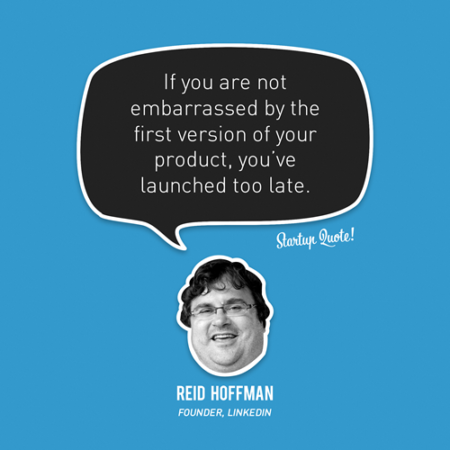

July was a big month!!! I finally released [Koipun Reader](/reader/), which I have been working on since at least [December of last year](/blog/january-month-in-review-2017/). So please read on!

*This monthly review comes in extremely late, almost at the end of August. For the sake of consistency I will cover the events of July up to the 8th of August, when I launched Koipun Reader. Revenue and traffic numbers will be strictly for the month of July.*

## Revenues and Expenses

Revenue from Anki deck sales amounted to a total of $108 USD. Expenses went as following:

- Audio fixing service via [Fiverr](https://www.fiverr.com/) for an interview I recorded: $26.25
- Transcribing an audio interview with [Scribie](https://scribie.com/): $90.11
- [Heroku](http://heroku.com/) for hosting the website: $32.00
- [MailChimp](https://mailchimp.com/) for the Koipun Newsletter: $9.90
- [Stripe](https://stripe.com/) payment processing costs: $4.92

That puts me $55.18 in the red for this month.

## Website Traffic

Nothing to exciting this month in terms of traffic. I didn't make any marketing moves at all, so it was all natural traffic from existing back-links, organic searches and the like.

## Interview with Gabriel Wyner, author of Fluent Forever

The last few months I have been focused on Koipun Reader, so I haven't been releasing many [blog posts](/blog/) or new [interviews](/how-to-learn-japanese/), but I did manage to get through one big interview. The interview was with Gabriel Wyner, author of the well known language learning book [Fluent Forever](https://fluent-forever.com/).

Gabriel had been very busy with his projects and his wedding, so it took several months until we could find a date to do the interview, but we settled on date for July.

For this interview, I did something different to all the ones I had done before. All previous interviews had been text interviews conducted via email, but this interview was done via Skype.

To give some structure to the interview and avoid awkward silences, I prepared some 8-10 questions in advance to serve. The interview lasted for about an hour and went by quite fast and smoothly, but unfortunately I didn't feel I get any new major insights out of it. Perhaps that happened because I was already quite familiar with Gabriel's work, given that I have read Fluent Forever and that I have used some of his materials, such as his [Japanese Pronunciation Trainer](https://fluent-forever.com/pronunciation-trainers/japanese/). Nonetheless, I think the end product should be quite enjoyable for Japanese learners. Unfortunately, it will take at least one more week before I can release this interview.

Not having experience with recording interviews over the Internet, I made a mistake where Gabriel's volume ended up much more volume than mine. This mistake turned out to be quite expensive. I had to pay at least triple the regular cost for the transcription over at [Scribie](https://scribie.com/) and I also had to pay somebody at [Fiverr](https://www.fiverr.com/) to improve the audio quality before I could submit the interview audio to Scribie. The blames falls squarely on me. Next time I record an interview I will do more testing in preparation. On the bright side, I have this big interview coming up and I gained valuable experience into carrying out an interview over the Internet. Furthermore I discovered a really nice piece of software. For recording the interview I used [OBS Studio](https://obsproject.com/), which turned out to be quite great. I recommend it for this purpose, especially for Linux users.

## Koipun Reader Early Adopters Edition Released!

I was able to complete my main goal for July, get Koipun Reader ready to ship. That said, I missed my original release date of August 1 and ended up releasing one week late on August 8. I released the product via my [newsletter](/newsletter/) and through [Indie Hackers](https://www.indiehackers.com/forum/post/-Kr19oVE1phJUa3yKbf6). The initial reception was a bit underwhelming. Very few people actually tried the product beyond making an account and testing it for a few moments. That said, I did get one person who is super into Koipun Reader, which is quite encouraging. If it wouldn't have been for that person, I would be feeling quite down. So if you are reading this, thank you very much!!

{.float-left}

I think the main reason that I got so little engagement is because people didn't understand how to use and why to use it. This is the fault of me trying to be aggressive with shipping the product already. I guess I shipped on time.

The good news is that thanks to the initial feedback I got from the launch, now I have more information to prioritize the features which are truly important.

Stay tuned, on next month's post I will speak more about the launch results.

## Goals for August

 There is only one week left in August, so I will set only one simple goal. Reach out to existing Koipun Reader trial users and get as much feedback as I can.
