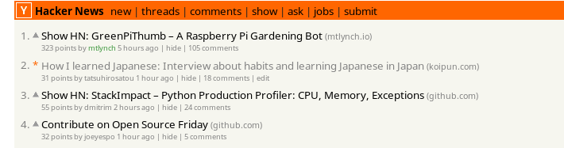
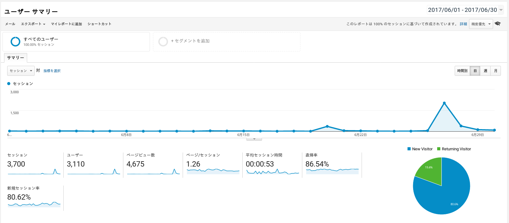

こんにちは！Since the release of the [new Koipun Reader preview](/blog/may-month-in-review-2017/) last month I have working hard at cranking out code as fast a can in order to deliver an initial Reader release. I set the release date for the initial Koipun release to August 1st 2017! With many features still in the pipeline, let's double compile the code to make it on time with a great release.



## Revenues and Expenses

[Anki deck sales](/anki/) were a bit slow this month and amounted to $18.00 USD. Expenses went as following:

- Two blog articles I commissioned: $62.50
- Heroku for hosting the website: $16.00
- MailChimp for the Koipun Newsletter: $9.90
- Payment processing costs: $0.82

That puts me in $71.22 in the red for this month.

## Getting help with content creation

I heard from a friend who runs a blog that he has had some success with hiring free lancers to write content for his blog.  Given that I've been focused mostly on development as of late, I decided I should give it a try. If I could get a writer to write quality content at an affordable price, I would be able to keep pushing my content marketing efforts while focusing on development. Thus I went ahead started looking for a writer on [fiverr](https://www.fiverr.com/).

While searching on fivver, I noticed that most of the content marketing gigs where promising to write incredible articles for a mere $5 USD, which seemed to good to be true.  After some more research, I decided to try out a gig titled ["I will create engaging SEO content marketing"](https://www.fiverr.com/elysseandrews/create-engaging-content-marketing?funnel=e06c1c93-c56c-460c-bd21-cb58d88236a4) by [Elysse Andrews](https://elyssewrites.com/) since she had set a more realistic price of $25 for a 1000 words article and because she had a professional looking site with some writing samples. The result of that gig is an article titled [Top 5 Manga to Learn Japanese.](/blog/top-manga-for-learning-japanese/)

 Elysse wrote the article by herself after I gave her some links for inspiration and some links she could use to source the material. After she finished the article, I added the images and did the formatting. After some light editing from myself, the article turned out good enough that I could declare the experiment a success. Given that I decided on the content and the title after doing keyword research using [Google's Keyword Planner](https://www.google.com.pr/url?sa=t&rct=j&q=&esrc=s&source=web&cd=1&cad=rja&uact=8&ved=0ahUKEwjYobTO2PrUAhXCKCYKHThlDeMQFggmMAA&url=https%3A%2F%2Fadwords.google.com%2Fhome%2Ftools%2Fkeyword-planner%2F&usg=AFQjCNGIzFnIxVGl8Q7cKGQzhzXQvX9toQ) the article should eventually bring in some organic traffic. Since this first article worked out I tried commissioning another article with Elysse.

 The second article is about the top books for studying for the [JLPT N3](https://en.wikipedia.org/wiki/Japanese-Language_Proficiency_Test). Taking into consideration the limitation that Elysse is not learning Japanese herself, the article turned out fairly well, but this time I will have to put some in more writing of my own, so that is up to par with the quality I need. Thus even though I was able to outsource part of the writing process, it still requires a lot of work from my part to produce content. Since this experiment didn't save me as much time as I wanted, I will not try again until I have more time to dedicate to the blog.

## Hacker News loves Japanese for some reason

 This month I released one of the interviews from my [How I learned Japanese interview series](/how-to-learn-japanese/) on [Hacker News](https://news.ycombinator.com/item?id=14646646). Hacker News is a community mainly focused on startups and technology, but for some reason they are quite fond of Japanese and Japan so I decided to try launching one of the articles on the site.

The first time I posted an interview the article [got not traction at all](https://news.ycombinator.com/item?id=14640862), but the next day I posted another interview with an improved title "How I learned Japanese: Interview about habits and learning Japanese in Japan" and the article reached all the way to the front page.

The article stayed in the front page for a few hours and got fair amount of comment activity. I felt quite vindicated about the quality of the interviews, but I did notice that on average Hacker News visitors didn't stay that long on the site, compared to readers from [/r/learnjapanese.](https://www.reddit.com/r/LearnJapanese/) This perhaps reinforces the notion that the quality of traffic is more important than the quantity of the traffic.

## How often can one post on reddit?

This month I tried to promote [another interview through /r/learnjapanese](https://www.reddit.com/r/LearnJapanese/comments/6idnnx/becoming_an_engineer_in_tokyo_and_passing_the/), but it didn't go well. Although the interview started getting traction, there were some negative comments such as "how does shit like this that spends pages not really saying anything repeatedly get posted" that started getting a good amount of upvotes and also in a few hours one of the moderators removed the link from the front page. Before this I hadn't posted any interviews since the first one I posted about three months ago, which [had gotten a very positive reception](https://www.reddit.com/r/LearnJapanese/comments/5y2wqi/a_story_of_learning_japanese_passing_the_jlpt_n1/). Although a few weeks ago, one of the persons I had interviewed posted her interview by herself on the same sub-reddit. That too, was very well received.

My theory as to what happened this time, is that a small group of people who frequent the sub-reddit every day noticed that this was already the third interview and since reddit usually hates self-promotion, they saw this as self promotion and decided to go against it. I am against blatant self-promotion myself, so I understand that feeling. If I post again on /r/learnjapanese, I will make sure to ask for permission from the moderators first and allow at least 5-6 months in between postings. Nonetheless, posting this interview on reddit helped bring in quality traffic for this month.

## Koipun Reader launching next month!

Yes, finally! After almost a year in development, this moment is finally arriving. The feature set will be quite spartan and there will be bugs, but the core workflow will be there. Given that, I have decided to dub this release "Early adopters edition" and will be offered at a special price and will include a free upgrade to a more premium plan, once that new plan is available.

## Goals for July

 There is only one goal for July! Finish Koipun Reader and have it ready to ship on August 1 2017. Here are the main features that still need work:

- Saving words
- Export to Anki
- Saving imports
- Find a deal a way to deal with long imports
- Make some improvements to the import process
