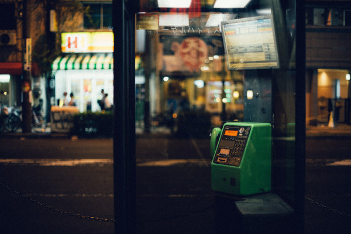

## For how long have you been studying Japanese?

{.float-right}

Strictly speaking, I started Japanese in Summer 2016, but I had learned some Chinese at school and I had studied Korean for some years just before starting Japanese. Thanks to that, I was able to make a quick start in Japanese.

I cannot speak Chinese and I have forgotten everything I had learned, but the experience with Chinese characters undoubtedly helped me when I started Japanese. I would say that Chinese and Korean spared me at least one year of study, if not more.

My level in Japanese is very uneven. I have been focusing on developing my reading skills, and I have completely ignored speaking. I can read genre like mystery or detective novels, but most literary fiction is still out of reach. My listening is not good, I can understand some audio-books because they are always spoken clearly and slowly, but I am lost when watching a film. Speaking is not something I am interested in because I don’t live in Japan and don’t have Japanese friends, so I almost never worked on it.

## What got you interested in learning Japanese? What got you interested in Japanese literature?

{.float-left}

I cannot recall any triggering event that made me think “I want to learn Japanese”. I think that I have always wanted to learn the language because there were so many Japanese things that interested me, starting with the anime I used to watch as a child. But I always thought Japanese would be too difficult to learn on my own. Living in Korea where publishers make attractive textbooks for self-learners certainly decided me to take action.

> Living in Korea where publishers make attractive textbooks for self-learners certainly decided me to take action.

As for Japanese literature, I used to know only great authors of the 20th Century through translation, and best-selling authors that were translated into French. The first time I stepped into a bookshop in Japan and stood before shelves and shelves of new publications, best and steady sellers and mystery novels, I realised that a little more effort on my part would give me access to a ton of works of fiction that were not translated. It is more accurate to say that my interest in Japanese literature grew with my learning Japanese, rather than saying that it triggered it.

## How was your Japanese level like when you started reading your first book in Japanese? What did you do to prepare to read Japanese books?

I will never forget the first novel I read in Japanese, it was [『卒業』 by Keigo Higashino](http://www.kinokuniya.com/us/index.php/fbs003?common_param=9784061844407). When I read it, my level must have been somewhere between [JLPT levels N3 and N2](https://www.jlpt.jp/e/about/levelsummary.html).

I was already thinking of the books I would read in Japanese when I was learning the hiragana! **I started reading in Japanese with the [Japanese Graded Readers](https://www.whiterabbitpress.com/japanesegradedreaders/)**. The first story of the series is very easy and can be read after completing the first chapters of your textbook. The Japanese Graded Readers series accompanied me during my first months of learning Japanese and gave me confidence.

By the time I had secured all the N4 grammar and was working my way through N3, I started reading the manga[『名探偵コナン』(*Case Closed*)](http://www.kinokuniya.com/us/index.php/fbs003?common_param=9784091233714). I don’t read many mangas, but I absolutely loved this one. I looked up every single word and added it to [Anki](https://apps.ankiweb.net/), and I made sure that I understood everything before moving on. It really helped me to build my vocabulary. I also learned a lot of words relative to detective investigation, which was useful to read Keigo Higashino.

Then I tackled my first novel in Japanese. I had to look up many words, and in the end, I did not understand the novel well. Enough to keep on reading, but not enough to really enjoy the story.

## What do you recommend to people who want to start reading in Japanese? How can you prepare to start reading?

I think that you need two things to read a book in a foreign language: a certain amount of vocabulary and grammar plus a reading skill that develops itself the more you read. If you can improve this reading skill, you will be able to read easy novels even with a modest set of actively known vocabulary.

{.float-right}

It is my belief that the reading skill you develop is more important than the set of vocabulary and grammar you start with. The more you read, the easier it will be to recognise kanji, guess the meaning of a word from the context, understand the general meaning of a sentence even with unknown words.

When I read my first novel, I didn’t understand it very well. As soon as I finished it, I started a new one: same author, same genre, same writing style. I understood this second novel better. I felt that I could read more comfortably when I tackled my third book by this same author. Only around the fourth or fifth book could I say: I can read this author without problems and fully enjoy the story.

The important thing is that between my first and second novel, I hadn’t learned that many new words, I hadn’t added that many grammar rules to my knowledge. If I could understand the second novel better than the first one, it is not because I had learned tons of vocabulary in the meantime. It is because I had improved my reading capacity. So what I would recommend to people who want to start reading in Japanese is to persevere even if they feel that they don’t understand what they read. As long as you can roughly sum up what happened on the page you read, you can move on to the next.

> So what I would recommend to people who want to start reading in Japanese is to persevere even if they feel that they don’t understand what they read. As long as you can roughly sum up what happened on the page you read, you can move on to the next.

Don’t close your book because you think it is too soon, too difficult, that you must learn more words before starting. You might not understand what you read well, you might understand only half of it, but the efforts you put into reading it will help you to make significant progress. You will start recognising more kanji and have an intuition of what an unknown word means because you already saw the kanji in a similar context.

As for selecting good material, I think that we have to find a compromise between our interests and ambition on one side and our level on the other, but if it has to be more on one side, then I would recommend picking something you are interested in.

When it comes to novels, some publishers have a collection for children with full furigana, this can be a good start. Light novels are always a good option and the story is bound to be more appealing to adult readers than books designed for children. You can also look at the best-selling titles. I like mystery and detective novels because the suspense will keep me reading even if it is difficult. Generally speaking, stories that involve everyday life situations are easier to read than the ones with surrealistic or fantastic elements.

## While reading, how do you tackle unknown grammar and vocabulary, especially vocabulary that does not appear in dictionaries?

Anytime I come across a word or expression that does not make sense to me even after looking it up, I simply google it. I remember that the novel [『舟を編む』by Shion Miura](http://www.kinokuniya.com/us/index.php/fbs003?common_param=9784334768805) was full of allusions and references that I didn’t know. I googled a lot of words and expressions when reading this book, and I would always find an answer. Either someone would have talked about it on their blog or asked a question on a Japanese forum. It was very encouraging to see that Japanese people themselves could be puzzled by some of the references that were in the novel.

This being said, I don’t often come across words that I cannot find in the dictionary. I have a [Casio electronic dictionary](https://insidethatjapanesebook.com/2017/11/06/how-i-chose-my-electronic-dictionary-and-why-i-love-it/) so I have access to several dictionaries in one place. When I cannot find a word in the English-Japanese dictionary, I usually find it in the Japanese-Japanese one.

As for grammar, before I bought the [『日本文型辞典』](http://www.kinokuniya.com/us/index.php/fbs003?common_param=9784874246788), I also used to check unknown grammar on Internet. **Now I prefer to use the 『日本文型辞典』. I am not saying that it is better than what you can find online, but I want to avoid using my phone or my computer to study. I don’t have enough self-discipline, and I always end up losing time on the Internet.**

## While reading, how do you balance enjoyment vs learning? For example, how thorough are you in trying to understand kanji/vocabulary/grammar before moving on to different sections?

It depends on the book. Some books are for enjoyment only and I don’t care if I don’t understand a descriptive passage, a joke in a dialogue or if I find unknown kanji in a sentence. As long as it does not prevent me from understanding the story, I will move on. All the books by Keigo Higashino fall in this category.

There are some mystery or detective novels that I read for enjoyment but which require the use of the dictionary because they are slightly above my level. I sometimes have to look up unknown words that prevent me from understanding what is going on.

If I read literary fiction, I will try to understand as much as I can and look up more words than I would do with genre fiction. I save these words in my electronic dictionary and add them to Anki later.

Sometimes, I will study a short passage in a book, look up every unknown word and make sure that I understand everything. Sometimes, I even loosely translate what I read. In this case, I am more using the book to study than reading the book.

## How do you find new books to read? How do you find new Japanese content in general e.g. music, games, movies?

Until now, I used to go to a bookshop and choose one of the books that are piled up on the tables. Now, I am starting to be more active, browse publishers’ websites, look at literary prizes and rankings or recommendations on [Amazon](https://www.amazon.co.jp/) or [Bookmeter](https://bookmeter.com/). If a book has been adapted into film or translated, it will also kindle my interest.

For music, I rely on [iTunes music](https://www.apple.com/jp/itunes/music/), which has a lot of good recommendations and several playlists of Japanese music. I had the subscription well before starting Japanese, and for a while, I didn’t think of browsing it for Japanese music. It is great if you are looking for artists other than J-pop.

I don’t watch much film or drama, but I will usually follow the recommendations of other Japanese learners on [Twitter](https://twitter.com/) or [Wordpress](https://wordpress.com/).

## How do you get over that feeling of “reading in a new language puts a heavy load on my brain, let’s just enjoy something easy”?

**I find that the best way to absorb content in Japanese rather than English is to define a set of activities that I only do in Japanese. If these activities make me feel happy, I will be likely to gravitate to them.** These are activities that allow me to relieve stress and anxiety, like playing games with talking animals, read detective novels and watch anime for children. I never do these three activities in my native language.

I think that I grew up thinking that I should do “serious” activities like reading literature instead of detective novels. One day, I found out that learning languages was a good excuse to do all the things that I really wanted to do!

> I think that I grew up thinking that I should do “serious” activities like reading literature instead of detective novels. One day, I found out that learning languages was a good excuse to do all the things that I really wanted to do!

As far as reading is concerned, I rarely feel that I would rather read in English than in Japanese because the novels that I read in Japanese are more entertaining than the ones I would read in English. Japanese is for childish, fun and relaxing content. When I do read difficult and challenging books in Japanese and think “let’s just enjoy something easy!” I turn to something easy in Japanese. For example, I recently started reading [*Harry Potter* in Japanese](http://www.kinokuniya.com/us/index.php/fbs003?common_param=9784863894631). I wanted to re-read the Harry Potter series for some time, but I could not allow myself to read it in English, because I felt I should use my time differently. But thinking “I will read the series in Japanese” solved this issue. When I am bored with the other novels or find them too difficult, I turn to *Harry Potter*.

## We now live in a world of short attention spans, constant interruptions from email, smartphones and social media, and endless information on the Internet. How can you focus on reading in Japanese?

The only way for me is to put my phone away when I am reading. When I say “put it away”, I mean put it on silence, turn off the notifications and even put it out of sight.

> The only way for me is to put my phone away when I am reading. When I say “put it away”, I mean put it on silence, turn off the notifications and even put it out of sight.

Then I will set myself a number of pages to read (depending on the book, it can be 10 to 20 pages), and I won’t stop or grab my phone as long as I haven’t read these pages.

{.float-left}

The problem is that I used to use my phone to look up words so it was not always possible to get rid of it. The day I bought my electronic dictionary really changed my life! Thanks to it, I was able to put my phone away while reading or studying. It saved me a lot of precious study time! When I was considering whether or not to buy this expensive item, I only took the dictionaries that were in it into account. It turned out that in addition to being a wonderful studying tool, my electronic dictionary allowed me to stay focused, far away from notifications and temptations.

**Recently, I also re-discovered the pleasure of handwriting. I acquired some fountain pens and several bottles of ink, did some research concerning the best notebooks and paper, and got into the habit of writing things down instead of using my computer or phone. It is a good way to stay focused.**

## Most people who set out to learn a language will probably stop learning or practising it at some point. What keeps you going? What keeps you motivated?

What keeps me motivated is to consume native materials and to set myself goals using a physical journal. I may be wrong, but I think that one of the reasons why some people stop learning is because they wait too long before tackling native resources.

> I think that one of the reasons why some people stop learning is because they wait too long before tackling native resources.

In the end, they get bored with grammar and vocabulary and give up. On the other hand, by just immersing ourselves without actively studying, we can have the feeling that we don’t make progress, and this can be discouraging too.

**I have never felt like losing interest in Japanese because I am surrounded by native resources that I like.** When I feel a lack of motivation, I search for new singers or groups to listen to, authors that I have never read, best-sellers of the moment, the latest winner of literary prizes. It immediately motivates me.

Taking the [JLPT](https://en.wikipedia.org/wiki/Japanese-Language_Proficiency_Test) has also been a good source of motivation for studying. It gives me a deadline and material to study and there are so many people out there who take the test that it is encouraging.

Finally, following other language learners on Wordpress or Twitter is a great source of inspiration. Seeing other people studying and making progress always motivates me to do the same.

## What is your ultimate desired level in the language? How far would you like to take your reading skills?

This might be a lifetime goal, but I want to bring my reading skills to the native level! I would like to read historical fiction, and I know it will take me a lot of time before getting there. Same for literary fiction. I don’t want to just understand what I read, but I want to be able to enjoy the tone of certain works or the particularities of the author’s writing style.

## Which learning resources have you helped you the most? e.g. textbooks, guides, dictionaries

I mainly used Korean textbooks to learn Japanese. They were generally good, with colours and cute illustrations. The first and main textbook I used is called 일본어 무작정따라하기. It has a very slow grammatical progression and focuses on pronunciation. The idea is to get a good pronunciation and intonation right from the beginning. While speaking is not my priority, this book allowed me to see that Japanese pronunciation is not as easy as it seems. Short and long syllables are especially tricky to me.

{.float-right}

**But more than one particular textbook, I would say that using various textbooks and learning material is what helped me the most.** Each method has its own approach, and diversifying the material was beneficial. For example, I used a language broadcast on EBS radio. Hosted by a Korean and a Japanese it was very different from the textbooks I had used until then. There are two levels. 야사시이(やさしい[易しい]) 일본어 for beginners and 타노시이(たのしい[楽しい]) 일본어 for intermediate learners. You can download the audio and buy the script separately, which I did for some months. This is the resource that helped me the most to understand basic and intermediate grammar and get used to Japanese dialogues.

Another resource I used a lot is the magazine 일본어저널, a monthly magazine to learn Japanese and discover Japanese culture.

The Japanese Graded Readers series also helped me a lot when it comes to reading. The series is very affordable in Korea with one physical set costing around 10 dollars.

My electronic dictionary is also a great resource. I am using it on a daily basis to check Japanese words and English.

## Apart from books, what are your favourite native resources to consume? Which have helped you learn the most?

I like watching YouTube videos, particularly gamers making let’s play series.

I like watching anime for children like[『楽しいムーミン一家』](http://www.moomin.co.jp/data/animation/)or [『ちびまる子ちゃん』](http://chibimaru.tv/). I am also a fan of [Ghibli films](https://www.nytimes.com/2017/10/12/movies/ranking-studio-ghibli-movies.html), I have watched them over and over.

I love listening to audiobooks. While I cannot find many audiobooks of fiction in Japanese, the ones I did find are really good. Each character is usually voiced by a different actor. Even if it is an unabridged audio, it almost feels like a dramatised version, with background sounds or music.

**However, what helped me the most is to read the news in Japanese.** I started in 2018 and have been relatively consistent throughout the year. 2018 was a year with several political scandals and I found very interesting to read about them in Japanese. It helped me to extend my vocabulary and to read something completely different than novels. I was also learning things about the country and its political system, and this feeling was very motivating too.

## You mentioned on your blog about using Animal Crossing for Japanese immersion. Have you used other video games for immersion and reading practice? How would you compare reading practice obtained via books vs games?

I like to play relaxing games partly based on dialogues like [Stardew Valley](https://www.stardewvalley.net/), [Story of Seasons](http://storyofseasons.com/sos/) or [Fantasy Life](http://fantasylife.nintendo.com/). Games that are text heavy like the [Professor Layton series](http://professorlayton.nintendo.com/) are also great for immersion. I find some dialogues in games to be particularly challenging. I guess that it is because some dialogues avoid kanji as much as possible, some NPCs have their own way of speaking and most of all, because I want to read quickly and go on playing. I think that this is the greatest benefit I had from games: read Japanese when I would rather go on with my in-game tasks instead of going through blocks of dialogues. Reading in games helped me to read quicker.

In Animal Crossing and farming games, you have to handle tons of objects. It might not be the most useful words to learn, but it does train your brain to work with Japanese words. While it is difficult to create a Japanese-only space around you, a game is like a mini world where everything is in Japanese.

Last but not least, I really learned the katakana with games!

## What methods and resources have you used to learn kanji? Is your goal to be able to read and write kanji (by hand) or mostly just reading?

As I mentioned earlier, I learnt Chinese at school. At the time, we were learning to pronounce, recognise and write a Chinese character when we learned vocabulary. What I mean is that learning vocabulary and learning Chinese characters were not separate activities. When we learnt a new word, we also learnt how to write it (with Chinese simplified characters, it is easier). This is how I started, and I didn’t know that there were other ways of learning.

When I started Japanese, I naturally continued to do the same. To learn a new word means to learn the kanji, but this time, I only learnt to recognise the kanji, not how to write them. I didn’t know that there were dedicated methods like [Remembering the Kanji](/blog/learn-kanji-heisig/) or the [Kodansha Kanji Learner’s Course](http://www.kinokuniya.com/us/index.php/fbs003?common_param=9781568365268), and I didn’t know that it was possible to study the kanji separately. When I bought my first JLPT books (it was for N4), I was surprised to see that there was a book for vocabulary and a book for kanji, this is a concept I could not understand! In a way, I am still fascinated by this way of learning, and I admire people who go through one of these methods.

To sum up, instead of learning the kanji first and then the words that contain them, I just learn the words. Only sometimes do I check the meaning of unfamiliar kanji in a dictionary.

As a result, I don’t have a thorough knowledge of kanji, I know them in context and I can recognise a lot of them as long as they are part of a word, in a sentence that makes sense. But if you ask me what are the meanings or pronunciations of a particular kanji out of context, chances are I will not be able to answer.

Writing the kanji by hand is one of my goals. I can write the most basic kanji from memory, but I still have to look up many kanji anytime I want to write in Japanese, which is frustrating. While it is not a priority, it is on my list!

## Apart from Anki, do you use any software tools in your learning? What do you use them for?

{.float-left}

I don’t use many learning apps or software tools because I tend to prefer physical textbooks. I do have the [Kodansha Kanji Dictionary iPhone app](https://itunes.apple.com/us/app/kanji-learners-dictionary/id716481897) which I love. When I cannot remember a word because I don’t know the kanji in it, I will look up the said kanji to know their respective meaning and see in what other words they appear. As I said, I have never studied the kanji separately, with a comprehensive method, and when I learn a new word, I don’t always know the meaning of the kanji that compose the word. Seeing the core meaning of a kanji usually helps me to remember the word I wanted to learn, but I will not try to remember this core meaning.

I also have the [Kodansha Kanji Usage Guide app](https://itunes.apple.com/us/app/the-kodansha-kanji-usage-guide/id1069262969). I don’t use it as often now, but it was very useful in the beginning. It helps you to understand the difference between words that have the same pronunciation, similar or close meanings but use different kanji.

Apart from that, I use apps that are not specifically designed for language learning, like audiobook or podcast readers to listen to Japanese.

## How is your Anki workflow like? About what percentage of your study time is devoted to studying with Anki?

I created a deck when I started learning Japanese, and it worked well until I studied for N2. I used to add words from time to time and tried to learn new words every day, though I could spend several days without learning new words. Each note generated three cards that were supposed to cover all the situations when you need to use or recognise a word. Roughly, it was Japanese (written) to English, Japanese (spoken, using a plugin) to English, and English to Japanese.

When I studied the N2 vocabulary, I added every single word of my textbook to my Anki deck and tried to learn far too many words per day. At the time, studying Anki took me more than 1 hour and I was desperate! I hated studying Anki, and I felt that I had no time or energy left to study other Japanese related things.

This is why, sometime after passing N2, I decided to abandon this deck and to create a new one from scratch. This time, I focus on written recognition and only study in one direction: Japanese (written) to English. I learn around 10 new words per day, but I also add words that I am supposed to know but forgot or words that I am unsure of, so it is not really 10 completely new words per day. It works well, I am quite happy with it.

I do create new decks from time to time to learn specific things (like onomatopoeia), but these decks tend to come and go. My regular deck takes me around 15 minutes per day. Working in one direction only (recognition) allows me to study quicker than before.

## How do you tackle vocabulary acquisition, especially in the context of reading? Is most of your vocabulary learning mostly passive e.g. through reading or more explicit e.g. through Anki? Has your vocabulary acquisition strategies changed over time?

When I read, I don’t look up many words. I only check the words whose meaning prevents me to understand what happens or the words that I partially know and would like to learn thoroughly. When I look up a word, I decide whether to add it to Anki or not. If I consider the word worth learning, I save it in my dictionary and add it to Anki later.

Apart from this, there are words that I “learn” from reading only. I don’t really learn them consciously, but seeing them often in novels somehow makes them familiar.

{.float-right}

I think that passive learning through reading and more concrete learning through Anki are complementary. I don’t consider that I know a word well if I only saw it once in a novel or review it a couple of times in Anki. It is the constant back and forth between a learning tool like Anki and seeing the word in context that makes the vocabulary stick. For example, I could not remember the word trench (塹壕・ざんごう*)* despite many reviews in Anki until a character in a novel said he was “like a soldier in a trench”. It is this encounter that allowed me to learn the word, but I know I will forget it if Anki does not show it to me again in three weeks!

My strategy has always been to learn words from context. This is why I like to create my own Anki deck. I learn a word more easily if I can recall why I added it to Anki, in which novel or game I saw it, in which scene it appeared. Most of the words that are in my present Anki come from novels I have read. This strategy hasn’t changed over time, but it has become more radical. When I started Japanese and when I prepared for N2, I added words from vocabulary lists. This method can be useful to learn a lot of words, but it did not work for me in the long term. While I do work with vocabulary lists for N1, I don’t add these words to Anki anymore and review them directly in the textbook.

## How was the JLPT N2 like? Do you recommend studying for the JLPT for those who want to develop their reading skills? How did you prepare for the test?

The JLPT N2 was a real challenge to me: a lot of grammar and a lot of vocabulary to absorb. Studying for the JLPT was not always fun, but it helped me to improve dramatically. Usually, I keep telling myself that I should learn or review grammar, but I rarely do it. The JLPT gives you both material to study and a deadline. It is a little schoolish, but it works. Having textbooks, an exam and a final score puts us in a study mode and we are more efficient.

I used both the [So-matome](https://www.tofugu.com/reviews/nihongo-so-matome/) and the [Shin Kanzen](https://www.kuropixel.com/kanzen-master-series-review/) series to study. My scores and how I felt during the test were a good mirror of my preparation and my level. I felt comfortable to answer the grammar questions, but the vocabulary part was tricky. This might be because I hadn’t studied the kanji thoroughly enough. Listening was a nightmare, I chose randomly half of the questions… but I got a full mark at reading! I really recommend taking the test if you feel that you are stuck in your studies, that you don’t make progress or don’t know what or how to study.

> I really recommend taking the test if you feel that you are stuck in your studies, that you don’t make progress or don’t know what or how to study.

A year or several months of preparations will take you to the next level without a doubt, even if you fail the test. Not only do you learn a lot of new content, but the test also forces you to actually read a lot of complicated or uninteresting texts. Same for listening. If you can make this effort to prepare for the JLPT, tackling native material should not be as intimidating after that.

## Have you been to Japan? If so, how was the experience like? If not, do you want to visit? Do you have any plans on going to visit? Where would you like to go?

I have been to Japan twice (Tokyo and Kyoto) and plan another trip soon. The first two trips were purely touristic, it was not really related to improving my language skills.

With these two trips, the total time I spent in Japan does not exceed 10 days so I am still amazed at everything I see, and I find everything wonderful and exciting!

I plan to visit Tokyo once more and take time to enjoy the city instead of rushing from one touristic place to the other.

And of course, entering a bookshop in Japan was very exciting, and it encouraged me to read more. I can’t wait to make my next book haul in Japan!

## How much Japanese do you encounter in everyday life Korea? How popular is Japanese media in Korea?

**It is hard to believe that there was a complete ban on Japanese media not long ago.**  Big bookshops have a good corner for Japanese books and magazines. I have access to NHK on TV and there is a good selection of Japanese films and drama via VOD. There are Japanese groceries, too.

{.float-left}

However, some topics are still sensitive, especially those related to the Japanese colonial rule of Korea. While Japanese pop culture is popular in Korea, there are often disputes concerning historical topics. A good example would be Miyazaki’s film *The Wind Rises*. The film features Mitsubishi, who employed Korean forced labourers during WWII. While there are 3 Ghibli stores featuring giant Totoro in Seoul, *The Wind Rises* raised controversy and criticism, and as far as I know, was not released on DVD in Korea.

Apart from cultural media, you will find a huge amount of textbooks to self-learn Japanese and sit the JLPT. There are also institutes where you can take conversation classes, grammar courses, JLPT preparation and so on. They even have a proficiency test called JPT which I think is unique to Korea. Japanese might be the easiest language to learn for Koreans, so the JLPT is popular among students who need to add a line to their resume.

## What other languages do you speak? Do you want to learn other languages besides Japanese?

French is my mother tongue. I can read and write English but I am not good at speaking and listening. On the contrary, I can understand and speak German but not really read or write. I would say that my Korean is strictly functional, enough for everyday life, but not good. I cannot read novels in Korean for example.

For the time being, I don’t think that I want to learn other languages. If I had to pick one, however, I think it would be Chinese!

## If you had to start over, what would you do differently?

I would apply the advice I gave earlier for reading to listening. I would start listening to Japanese from the start and keep listening even if I don’t understand well. I think that I have a decent amount of vocabulary in my head, but I am still very bad at listening because I haven’t worked enough on my listening skills. If I had started from day 1, I would certainly be able to watch some drama without subtitles by now.

Another mistake that I made is to sit the JLPT N2 too soon. It helped me considerably of course, but when I started studying for N2, I had not been enough in contact with Japanese. As a result, I had to learn everything by heart. The more you read and listen to the language, the more natural things seem, you start having an intuition of what is correct and what is not. When I review the N2 grammar now, a lot of things seem obvious. But at the time, I lacked this intuition and I had to learn all the grammar rules as if they were a random series of numbers.

## What is your advice for people who want to learn Japanese?

First of all, I would say: don’t be afraid to focus on one or two skills only if it is what you want to do. I can read novels but I cannot speak, and I am happy like that. Some people learn Japanese to watch anime or drama only, some people can communicate fluently in Japanese but cannot read many kanji. Everything is fine as long as you enjoy what you do!

Then **I would recommend to not wait too long before absorbing native content. To me, native material is by far what motivated me the most and kept me going.** You don’t have to have a good level to watch and enjoy anime, even if you don’t understand what they say. I had a lot of fun making my way through the first chapters of *One Piece* when I was preparing for N4. Of course, I could not understand all the text, but the illustrations where enough and I was very glad and proud when I could recognise a word here and there or even understand a whole sentence. Every time you feel discouraged, take some time to look for native resources that you can enjoy, even partially. Tracking native material is extremely motivating.

Recording your progress is also a great way to stay motivated. You can start a language learning journal in any notebook or write a blog. My blog helped me to stay consistent and motivated. The Wordpress platform was also an easy way to follow other bloggers who learn Japanese and get inspired by their progress.

## Can you please introduce the readers to your blog, [Inside That Japanese Book](https://insidethatjapanesebook.com/)? What are some good articles to get started with your blog?

My blog is about learning Japanese and reading books in Japanese. It has changed a lot since I created it, but what remains consistent are the book reviews. I also write articles about how I study Japanese and prepare for the JLPT.

If you are interested in buying an electronic dictionary, I would recommend reading my article on [how I chose mine and why I love it](https://insidethatjapanesebook.com/2017/11/06/how-i-chose-my-electronic-dictionary-and-why-i-love-it/). If you are looking for books to read in Japanese, then you could have a look at [the list of novels I read in 2018](https://insidethatjapanesebook.com/2018/12/17/a-year-of-reading-in-japanese/)
