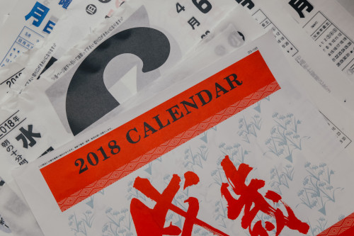

## What is your current level in the language like? Have you taken any of the JLPTs?

{.float-right}

If I had to self-assess myself, I would say that I’m at a level most people refer to as “basic fluency” in Japanese. What I mean by that is I’m able to communicate on day to day matters (eating, hanging out, small talk, etc.) without much difficulty, but if the conversation were to turn towards more specialized topics like literature or politics, I would run into a lot of unknown words.

I first started learning Japanese in my final year at university back in 2010, but only made it about six months until I got too busy with graduation and stopped learning altogether. However, I still felt a strong desire to learn the language, so I finally committed to it and began studying again at the end of 2016. So you could say I’ve been learning for two years total, but really it’s just been the last 18 months consistently.

As of right now I have not taken any of the [JLPTs](https://en.wikipedia.org/wiki/Japanese-Language_Proficiency_Test), but I actually been thinking recently that it would be cool to do so. I can definitely see myself taking in near the end of this year, or even sometime early 2019.

## What got you interested in learning Japanese?

Growing up as a kid I was always fascinated by the idea of being bilingual. I thought that being able to use two different languages with equal skill was so cool! The first language I tried to learn was German, but I never made it past a few nouns. Then my third year of university I took a Spanish class, but really only learned how to pass the tests.

Then I can clearly remember one day after I had finished reading a really good manga (in English of course) and I went online to buy the next volume, but it wasn’t available yet. It was at that time that I discovered that the Japanese version of the manga was way further, something like eight volumes!

I looked inside the manga I owned and saw that there was a five year gap between the Japanese publish date and then English publish date. I thought to myself, “Five years?! I can just learn the language in that amount of time!” That was really the start of my Japanese language learning journey.

## Most people who set out to learn a language will probably stop learning or practicing it at some point. What keeps you going? What keeps you motivated?

For me, the end goal has always been to be able to reach the point where I understand native material with the same amount of ease that I do with English. What I’ve actually done over the last six months is stop buying things in English that I use for enjoyment (books, video games, etc.) and I started buying them in Japanese.

Basically I have changed a part of my life to Japanese only, and the better I get at the language, the more I am able to understand and enjoy the material. It’s an incredibly rewarding feeling when you reread a manga that you didn’t understand six months ago, and now you understand almost everything!

Another thing is that I’ve got the [Japanese Tactics blog](https://japanesetactics.com/) and [YouTube channel](https://www.youtube.com/channel/UC0IOMMbl5jU-OUObEDr4SKA) where I share my knowledge and advice with others. Being in that position also motivates me to constantly improve so that I am better able to assist more people.

## How did you get the idea to start Japanese Tactics? Has working on Japanese Tactics helped you with your studies?

A lot of people say that you should start a language blog in order to publicly hold yourself accountable, so it kind of started that way. I was originally going to just share my thoughts on language learning in general and some specific tips.

But as I continued to learn more Japanese and research new study methods, the blog really turned into a passion for promoting Japanese language learning in general. Despite my original intentions for learning Japanese which centered only around myself, I’ve really fallen in love with the language and would like to not only help other current learners, but also get some new people into it as well.

As for how it has helped me, it’s really forced me to understand concepts on a deeper level before I talk about it with others. It’s also given me great motivation for researching various techniques, trying out many different Japanese courses, and connecting with other language learning enthusiasts.

## What is your ultimate desired level in the language?

The end goal for me personally is to be able to use Japanese at the same level that I can currently use English, my native language. It is a rather high goal, and I certainly don’t feel like everyone needs to aim for the same target, but like I mentioned before it’s always been a childhood dream of mine to have that level of mastery with two separate languages.

## Which resources have you helped you the most?

I feel like there are a lot of things that have helped me for different reasons, so it’s hard to not include them all, but let me just give the top five resources and how each one has helped me.

1 - [Remembering the Kanji by James Heisig](https://japanesetactics.com/a-review-of-remembering-the-kanji-by-james-heisig). I went through about three other books on learning kanji before I finally got a hold of RTK, and it was bar far the biggest help for learning all the kanji.

{.float-right}

2 - [Japanese in MangaLand by Marc Bernabe](https://japanesetactics.com/japanese-in-mangaland-review). Everyone needs a good book that will explain how Japanese grammar works, and this series in particular was extremely helpful and a lot of fun to go through.

3 - [Shadowing Let's Speak Japanese by Hitoshi SaitoÌ](https://japanesetactics.com/how-to-learn-to-speak-japanese-a-review-on-shadowing). This book and CD combination was extremely tough to use at first, but I credit it with helping me to break past the slow Japanese that most beginners are comfortable with and getting me used to normal native speed.

4 - [Anki](https://apps.ankiweb.net/). Being able to store all of my Japanese sentences in one place, and then being able to use it both at home and on the go has been incredible useful. In addition to being an incredible great resource for reviewing Japanese, I also noticed that my ability to correctly read on-yomi went up.

5 - The Internet. I say the internet in general because it has allowed me to connect with other language learners through blogs, forms, and social media sites. This has led to great discussions on Japanese in particular, and also language learning in general. It’s a resource that we probably take for granted, and it’s hard to imagine learning Japanese without it.

## What are your favorite native resources to consume? Which ones have helped you learn the most?

I hate to be the typical nerd who learns Japanese because of manga and anime, but that’s totally me! I’ve watched countless Japanese anime through [Crunchyroll](http://www.crunchyroll.com/) and [Netflix](https://www.netflix.com/jp/) ([賭けぐるい](https://kakegurui-anime.com/) is amazing!), and I even developed a [5-Step Method](https://japanesetactics.com/the-definitive-guide-on-learning-japanese-from-anime) for myself to use in order to learn Japanese from these anime shows that I love. I was actually surprised at just how well it works.

On the other hand, I’ve been buying manga from Japan and then waiting the month (ugh!) it takes to arrive so I could start enjoying it in my free time. I find that even though the ones intended for kids are easier to comprehend, I still enjoy [Shōnen manga](https://en.wikipedia.org/wiki/Sh%C5%8Dnen_manga) the most. My favorite right now is [ゆらぎ荘の幽奈さん](https://yuragisou.com/).

I’ve also recently started getting into light novels, which were always a big problem for me since it took so much time to lookup all of the new words. However, I’ve found that reading them digitally and using the built in dictionaries that most apps like Kindle use has helped a lot. I just stared [盾の勇者の成り上がり](https://ja.wikipedia.org/wiki/%E7%9B%BE%E3%81%AE%E5%8B%87%E8%80%85%E3%81%AE%E6%88%90%E3%82%8A%E4%B8%8A%E3%81%8C%E3%82%8A) the other day, and I like it so far.

## How do you balance learning via immersion and using Japanese vs purposefully sitting down and studying a textbook or going through flashcards?

So what I do is I have daily goals that I hold myself accountable to for deliberate study. This means things like doing all of the Anki flashcards that are due that day, going through a chapter in a textbook to understand the grammar, and practice writing or speaking.

Then what I like to do is simply fill my free time with Japanese things, but not necessarily to learn it. So for example, I have Japanese audio books playing while I’m at work all day, so I manage to get a decent amount of listening done during the week.

{.float-left}

Then I’ll watch YouTube videos in Japanese during lunch breaks or when I have 10-15 minutes of down time, [キズナアイ](https://www.youtube.com/channel/UC0nvIVtPx47cZ393BA6VQ-A/videos) is my favorite YouTuber of course! And I read about an hour before bed every night, strictly a physical manga so that I can disconnect from electronics and then fall right asleep when I’m done.

To summarize my answer, I always have some “core” stuff that I work on each day, and then I simply fill the rest of my free time with Japanese immersion materials. Having said that, I do still watch movies in English and whatnot, but it’s always in the company of friends as my alone time is Japanese only, baby!

## You mentioned on your YouTube channel that although most people do not *need*, to learn how to write Kanji, they should still do it. Is this still your belief? How do you maintain your handwriting skills?

I feel like this is one of the more controversial topics when it comes to learning Japanese, but it really shouldn’t be. My belief is that, as a non-Japanese person you do not need to learn how to write kanji, but there are still some useful benefits that you receive from doing it.

The primary one is memory. From the studies that I’ve read, and from my own experience, I can say that writing out kanji by hand helps you to remember them better. However, if I’ve being totally honest, it’s not really a topic that I push since there is hardly any actual application for it outside of living in Japan.

I myself only write kanji during my Anki reviews, so you could argue that not a useful ability to possess in today’s day and age, and I would probably agree with that.

## You advocate the power of thinking in Japanese. How do you build this habit and keep it up?

I believe that most people’s thoughts are conditioned responses. Now, it may be that you learned a particular reaction to a situation by watching others do it, or it might be that you underwent some sort of training in order to respond effectively. In other words, most people’s reactions, and therefore their thoughts, are predetermined.

{.float-right}

So how do you start thinking in Japanese? You start by conditioning yourself to react in Japanese when certain life events happen. This can be as simple as saying to yourself 喉が渇いた every time you’re thirsty and you want something to drink. If you get enough of these reaction phrases, and you practice them diligently, you will begin to think in Japanese first when they happen.

Once your “automatic thoughts” are in Japanese, it’s a relatively simple process to move on to deliberate thinking in the language for more complicated things like what you plan on doing that day, questions your pondering, and so on.

So half of the process is learning the words and phrases, and the other half is conditioning yourself to automatically think in Japanese first.

## You have several articles on your blog regarding pitch accents. How do you test yourself and how do you incorporate pronunciation into your learning “routine”?

The most effective way that I’ve learned to test both your pronunciation and pitch accent is also the most painful: recording yourself! I absolutely hated doing it at first, but eventually you come to a point where you accept the way that your voice sounds to other people.

Anyway, it’s a pretty simple process that includes four steps, and I recommend doing about ten minutes a day:

1 - Listen to a native recording of a word or phrase.

2 - Record yourself saying the exact same word or phrase.

3 - Compare the two records by listening to each of them again.

4 - Make any self corrections necessary in order to get your recording to match the native’s.

The main thing you have to keep in mind is that the voice you hear yourself speaking, is not the same voice that others hear. A lot of what you personally hear comes through the bones in your skull, so of course it’s going to be different. Unfortunately, it is only what the other person hears that actually matters.

That’s why recording yourself is so invaluable: You get to hear your voice the way that other people do! If I could give you one key point to remember when correcting your pronunciation it would be that correct pronunciation will most likely feel weird to you at first.

It makes sense, right? You naturally try to pronounce words in a way that feels natural in your mouth, but if the Japanese language has new sounds in it, then those new sounds won’t “feel correct” even if they sound correct. Just be patient with yourself and get used to it feeling weird for a while until you really nail down Japanese pronunciation.

## How did you tackle learning vocabulary at your earlier stages of learning? How do you tackle learning vocabulary now?

It’s a pretty interesting question, as my methods have changed over time. Originally I would just keep going over the same words and phrases until I was able to recall them in my head in what I used to call “imaginary conversations.” Basically I would just imagine two people talking to each other in Japanese, using the vocabulary I had studied.

Then I learned about spaced repetition systems and I downloaded Anki so that I could create flashcards for all of the words and phrases that I knew, and then just let the power of the system decide when I needed to review the words. This was a much better method than my original one since it freed up a lot of time for learning new stuff.

Now I have changed tactics once again. Since I am learning primarily now through reading manga and light novels, I actually don’t try to remember new words. Instead I simply look up the meanings of them, understand the sentence that they appeared in as a whole, and then move on.

What I’ve found is that some words will stick right away, and others will take several times of looking them up before they are finally locked in. I think that this new method works pretty well for me since I already have a solid base of high frequency words locked into my long term memory, but even if I didn’t, it would probably still work out well since the most common words pop up a lot, and the rare words (which you probably don’t need) only show up once or twice.

## Do you use any software tools in your learning?

I've been using Anki for ten months now and I really love it. I’ve got it on both my computer and my iPhone, so I can study both at home and when I’m on the go. I’ve also got a few dictionary apps on my phone that I utilize. I’ve tried a lot of the more popular apps like [Memrise](https://www.memrise.com/), [Duolingo](https://www.duolingo.com/), [Busuu](http://www.busuu.com/), and such, but I don’t really use them any more.

## Could you please explain your Anki workflow? About how much time do you spend on flashcards? How has your flashcard use evolved over time?

By the time I learned about Anki, I had already decided that studying the language in full sentences was the best way for me to proceed. So my basic workflow was to do a lesson in either a textbook or course, and then just take all of the example sentences that illustrated the new words and grammar points and create cards out of them.

My primary deck is about 6,000 cards of just Japanese sentences that I’ve learned or encountered in other places, and I’ve compiled them all into the deck. Originally I would have the Japanese sentence on the front with the English translation on the back (plus furigana), but now when I add new cards it’s primarily mono-lingual, things like dictionary entries and such.

As of right now I spend about 40 minutes per day going over my reviews and then adding a few new cards to the stack.

On the other hand, I’ve got a deck dedicated to just kanji, their meanings and how to write them that I also go over each day. It usually takes me about 20 minutes to go through the ones that are due, and I will add any new kanji I run into when reading books, but that happens less and less these days.

## Have you been to Japan?

{.float-left}

Actually I have not yet been to Japan, but I am planning on going soon. I’ve almost got enough money saved up for it, and I’ve still got plenty of vacation time to go for a week or so, but I just haven’t taken the time to sit down and plan the trip out. While I’m there I’d like to take lots of video so I can share it on my YouTube channel, so watch out for that!

## What other languages do you speak? Are you interested in learning other languages?

The only other language I speak is English. I can definitely see myself learning another language sometime after Japanese, but I don’t really know which one it would be. I would probably want to be something pretty different from both English and Japanese though… perhaps Russian.

## If you had to start over, what would you do differently?

When I first started out, I had no idea how to learn a language. Even when I began again at the end of 2016, I still thought that using books and courses was how you go from beginner to fluent, but now I have a much better understanding on how we learn and acquire languages.

The first thing I would do is spend about a month learning and practicing just the sounds of the language, both on an individual level and also at the full sentence level. Knowing about pitch accent would also be a huge advantage so that all the rest of my time could be spent on comprehension, instead of identification of the words.

Then I would go ahead and get some good books or a course and go through them, but I wouldn’t worry too much about remembering all the grammar rules, rather I would just get familiar with them, and then add every single example sentence into an Anki deck.

Then I would spend most of my time engaging in native materials, and referring back to dictionaries and grammar explanations as needed. One of the big mistakes I feel that I made was that I stayed with beginner materials for too long, instead of just using them to get a base of understanding and then refer back to them when I struggled with native stuff.

Another big mistake was not spending enough time per day with the language. For pretty much all of 2017 my goal was to spend about thirty minutes per day, and I did learn a lot, but I felt that I wasn’t making progress quickly enough. So in December I decided to commit to two hours or more, and I’ve seen my comprehension and abilities explode this year, in comparison to last.

## What is your advice for people who want to learn Japanese?

There are lots of different methods that you can use to learn Japanese, so I feel that it’s important that you find one that is effective and that you can commit to working on every day. You’re really going to have to make learning and using Japanese a part of your daily life, because going from beginner to fluent (and beyond) is most likely going to be harder and take longer that what you think. At least, that’s been my experience.

## Where can we reach out to you online? Are you working on any projects you would like to share with readers?

Yeah, so definitely check out my website [japanesetactics.com](https://japanesetactics.com/) where I post articles on learning Japanese, reviews on learning materials, tools you can use, and much more. I’ve also been working on building out [my YouTube channel](https://www.youtube.com/channel/UC0IOMMbl5jU-OUObEDr4SKA) a lot lately, so if you enjoy video then hop over there. Finally, I’ve started creating premium courses on [my Patreon](https://www.patreon.com/nickhoyt) and I’ve got a lot of plans for its growth, so check that out if it sounds interesting.
