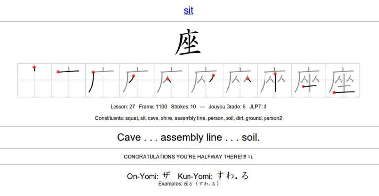
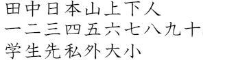
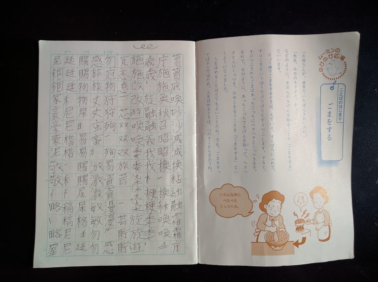
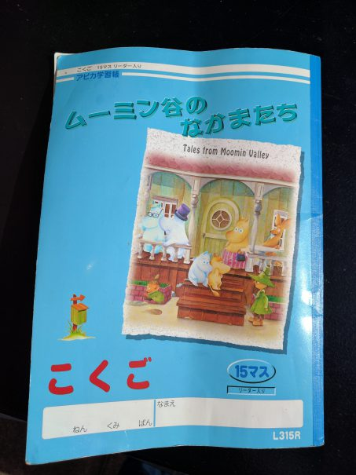
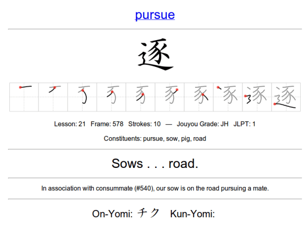

Kanji is one of the toughest parts of learning Japanese. How to learn Kanji? That is a question all students of Japanese will have to tackle. There are many popular resources for learning Kanji such as [Heisig's Remembering the Kanji](https://nirc.nanzan-u.ac.jp/en/files/2012/12/RK-1-6th-edition-sample.pdf). A few weeks ago I reached the halfway point of Heisig's Remembering the Kanji. Throughout the course of my kanji studies with this book I have refined my study methods. I have now reached a point where I have found a method that works well for me and lets me make the most out of Heisig's book. I will share my method and along the way discuss some of the weaknesses and strengths of Heisig's method along with how I reached this point.

## Pre-Heisig: How I first started learning kanji

{.float-right}

I didn't start studying kanji from Heisig's book. I started by studying kanji with the method of the first Japanese class I ever took, which was Japanese 1001 Elementary Japanese I at Georgia Tech with [Matsushima Sensei](http://www.modlangs.gatech.edu/people/person/d16df929-7c6c-5bdf-bc5c-25846c0857d4). This was a fairly intensive four hours a week class that made me fall in love with studying Japanese. Since it was an introductory class, we only studied these 25 kanji, but this was enough to get me started on the "Georgia Tech" method of studying kanji, which is probably what you will see at most college level Japanese courses. After we thoroughly studied hiragana and katakana we started studying kanji. Every week a few kanji would be introduced with a kanji homework which consists of writing each character around eight times and then working through some sentences where you have to add the readings in hiragana to the new kanji and write the correct kanji for some hiragana. Then during class, the (teacher) would quiz us about the meanings and readings of the kanji. It was quite embarrassing to not get them right in front of the class; that provided a good incentive to study. We would also do pair work in which would sit down next to a partner and each one would hold two different versions of the same sheet. With the sheets, we would quiz each other on the kanji. Again, it was quite embarrassing to not get the kanji with your classmate, so the social pressure helped with studying. It was also fun and helpful to work together. Finally, we would be quizzed individually on the kanji we had studied. The quizzes were similar to the homework and easily doable if you had studied enough time. I wanted to get a nice sticker from Matsushima Sensei so I studied hard.

## Problems with my original method

This method was fun and made me feel happy and proud. Since I was a little boy I had always been enthralled by the mysterious kanji and now I was able to write and understand a few them. This method gave me solid progress, but there were also some terrible realizations. まさか・・・

 NO WAY!!!")

Will it really take me this long to learn kanji?! I will never become fluent in Japanese!!? According to the Georgia Tech syllabi, after studying Japanese for five semesters I would only know about 350 kanji. It takes Japanese children all the way until the last year of high school to learn all the (jouyou kanji), the 2,136 kanji that the government of Japan thinks everyone should know. Would it also take me twelve years to become literate in Japanese?! Furthermore, I realized that I was quickly forgetting how to write the kanji I had worked so hard to memorize, and I wasn't the only one. I saw how most of my classmates would also forget the kanji we had previously studied. I tried to remedy this first by creating my own flashcards for [Anki](http://ankisrs.net/), a flashcards software based on [spaced repetition](https://www.theguardian.com/education/2016/jan/23/spaced-repetition-a-hack-to-make-your-brain-store-information), to review the kanji I had learned in class. My retention improved dramatically after doing this, but it was terribly painful to memorize the kanji. I had to do constant reviews to not forget the kanji and my pace for learning new kanji was glacial. Then I found out about Heisig's Remembering the Kanji.

## Enter the Heisig

えよドラゴン (Enter the Dragon)")

Although there are several methods similar to Heisig's method, such as [Kanji Damage](http://www.kanjidamage.com/), [Heisig](https://en.wikipedia.org/wiki/James_Heisig) was one of the first to publish this kind of approach to learning kanji. The premise is captivating; learn 2200 kanji in months instead of years. Instead of learning the kanji by rote memorization, Heisig invites us to create short story plots using as elements of the plots the parts that make up the kanji that we are learning. Let's take the kanji  冒 which has the keyboard "risk" on the Heisig book. This kanji is the combination of two other kanji 日(sun) and 目(eye). The 日 on top of the 目. Instead of memorizing a seemingly random assortment of lines, we memorize the following story.

> Remember when you were young and your mother told you never to look directly into the sun for fear you might burn out your eyes? Probably you were foolish enough to risk a quick glance once or twice; but just as probably, you passed that bit of folk wisdom on to someone else as you grew older. Here, too, the kanji that has a sun above and an eye right below looking up at it has the meaning of risk.

### The Hesig Kanji order

Another radical departure from more traditional methods is the order in which it teaches kanji. For the earlier story to work, the students need to already know the parts of the kanji, 日, and 目. For that reason, instead of teaching kanji by order of usefulness or frequency, we learn them in a logical order in which we unlock entire families of kanji as we slowly learn more about the elements that make up each kanji. It is also important to note what this method doesn't teach.

With this method we don't attempt to learn how to read these kanji or how to make up actual Japanese words with them. We only learn one basic meaning, e.g. "risk" as in the earlier example, and how to write it. You may wonder if this is useful at all. The usefulness depends on your goals.

If you are aiming for an advanced level in Japanese you will need to achieve literacy, and to achieve literacy you need to learn the kanji. This method will put you in a powerful position to tackle real kanji literacy, which means being able to read them.

### How is Heisig's method useful if it doesn't teach me how to actually read Kanji?

Let's take the word  (fallen leaves). Perhaps you have never encountered this word, but if you know that the first kanji means fall and the second one means leaves, you will be able to figure out the meaning of the word without looking at the dictionary. Furthermore, if you then memorize how to read this word, the next time you encounter a word with either of the kanji 落, 葉, you will be able to make an educated guess on how to read it. Let's try to guess how to read (postcard). This word uses the same "leaf" kanji as  with the same は pronunciation (although in the previous case it is vocalized into ば because of [Rendaku](https://en.wikipedia.org/wiki/Rendaku)) and if you already knew to read 書(write) then voilà, you just deduced how to read this new word. Now you can also easily memorize this new word by remembering that in Japanese postcards are leaves with writing. This is just one example of the powers that learning kanji with Heisig will give you.

## How I started to learn Kanji with Heisig

From the start, I have studied Heisig with Anki Spaced Repetition Software (SRS) and [this deck of flashcards made for Anki](https://ankiweb.net/shared/info/1862058740). If you haven't introduced any form of SRS into your language studies I highly recommended it. It structures your studies, hacks your brain to increase your memory and keeps you motivated by measuring your progress.

With Anki, I would study between four or five new cards every day with one kanji on each card and review the kanji as Anki gave me review cards. For each review, I would write the kanji by hand using correct stroke order. Writing the kanji using the correct stroke order while reviewing is essential. Learning the correct stroke order might seem like a nuisance at first, but it will systematize how you write the kanji thus making them easier to write. Eventually, stroke order will become intuitive and it won't become something you need to memorize anymore, instead, it will help you recall how to write kanji when you are writing them. Often I think I forgot how to write a kanji and once I start writing it the rest flows out my hand as if it were deeply ingrained in some primitive part of my brain. I believe stroke order is a part of making that happen.

### The importance of writing Kanji by hand

Writing the kanji by hand, even if you are not interested in mastering handwriting, is also important for learning the differences in the kanji.  and  look almost identical and are often confused by beginners, but to somebody who knows how to write them both the differences are clear. Writing practice is something I have kept in my studies as of today, but there are many parts of my method which I have discarded or changed.

{.float-left}

At the slightest mistake, I would mark flashcards as forgotten on Anki. This made my progress way too slow. Another constant road block was the often cited problem that many of the Heisig keywords, the meanings you learn for each kanji on the book, are often very vague and quite similar to each other. This often turned my studies into a game of remembering useless things such as ways to distinguish two very similar keywords so that I could recall the precise kanji for that keyword. This made me lose motivation since it didn't give me real value. The value of Heisig's method doesn't come from remembering all the keywords. It comes from being able to dissect most kanji you meet into its components and thus making them easier to read, understand and write. This opens the door to something even more important, the improved ability to acquire vocabulary. When you meet new words they will be easier to remember, because you can recognize the kanji the word consists of and use those facts for memorizing the word. Deciding to focus on this aspect, I changed my method.

## Move fast and use images to learn Kanji

, our sow is on the road pursuing a mate.")

I now see around 8 new kanji a day. This is still slow, but it is a speed I am comfortable with and with which I can stay consistent. I have tried going faster but then the reviews get too long and tiring. If instead, I limit the reviews then I have trouble learning the kanji. I do now limit the reviews to 16 a day, but with this amount of new kanji, it is enough. This practice takes around 20 to 30 minutes a day. I have managed to get to this speed while still doing the writing practice by adding images to the keywords. The images greatly aid in my recall and I no longer have the issue of the keywords that are hard to differentiate. The images I chose act as visual representations of the stories. They help me remember the stories and the stories make me remember the kanji. I even use the images to help me write. When I am writing, I recall the image in my mind and then everything comes into place and I can write the kanji. Finally, I have stopped being a perfectionist. Instead of settings flashcards as forgotten at the slightest mistake, I would only mark the card as "hard" on Anki and add a star to it. When a card with a star comes back on a review, if I fail again to recall it then I do set it as forgotten. Could I go even faster? If I followed Heisig's recommendation and focused only on learning the kanji, I would be able to finish this book in a matter of months. The reality is that although I have fun with this method if this all the studying I did I would get bored and quit. If I were learning Japanese from scratch and I wasn't taking a class I would then consider focusing exclusively on studying this book.

## Conclusion

Heisig's Remembering the Kanji is not for everyone, but any serious Japanese learner should at least give it a try. Even if you don't stick with the method, it will get you on a path of finding what works for you for learning kanji. Language learning is hard; you don't only have to learn the language itself, you have to learn how to learn it. If you decide to give Heisig's Method a try, combine the keywords with images and review with real writing practice but without being a perfectionist. Move fast!!
