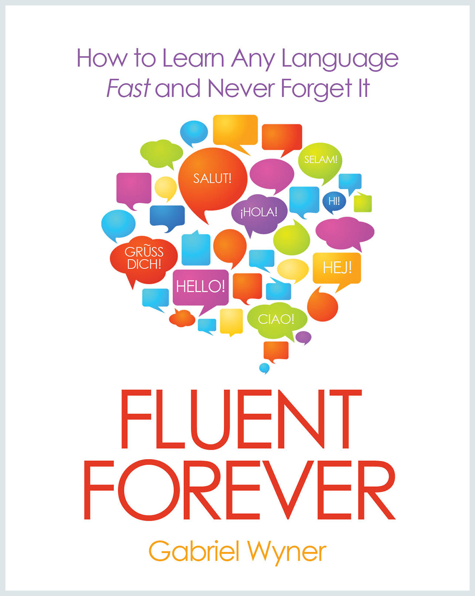
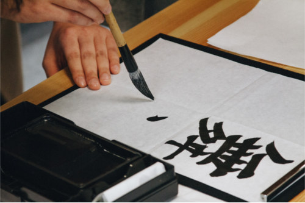
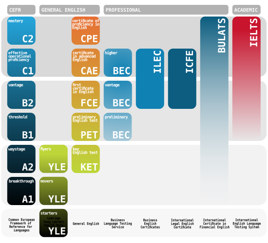

## From Opera Singer to Language Learning Writer

{.float-left}

[Gabriel Wyner](https://fluent-forever.com/about-gabe/) has spent the latter part of his life deciphering language learning.  Now he is tackling his dream language, Japanese.

By trade, Mr. Wyner is an opera singer and needed to know a few romance languages to perform. This is where his language learning journey began. Most opera singers would just learn the basics and pronunciation, only what they needed to sing the music. Mr. Wyner found himself wanting to push further.

To kick off his language learning for his singing career, he attended an immersive program for 14 weeks at [Middlebury Language School](http://www.middlebury.edu/). Within that time, he fell in love with the process of language learning and became fluent in the equivalent of one school semester. Unwilling to lose his momentum or take a break from his new found passion, Wyner moved to study Italian in Perugia, Italy.

After becoming fluent in several languages, Mr. Wyner started writing a book titled [Fluent Forever](https://fluent-forever.com/), which was published on shelves by 2014.

{.float-right}

Mr. Wyner’s success and journey into authorhood didn’t go unnoticed. His book and he himself have been featured in:

- Scientific American
- The Wall Street Journal
- The Four Hour Work Week
- Elsevier
- Fluent in 3 Months
- Business Insider
- And countless other blogs and podcasts

Below is an edited and expanded on account of how to Mr. Wyner is tackling Japanese language learning.

*If you’d like the exact transcription, [contact me directly](mailto:gabriel@koipun.com?Subject=Gabriel Wyner Interview Transcript) and we’ll discuss getting that to you. For any exact interview recaps that do follow, I’ll refer to myself as S1 (speaker one) and Mr. Wyner as (GW).*

## Middlebury Immersion Programs

We started the interview by discussing what got Mr. Wyner interested in learning languages. He told me that the first time he attempted language learning was Hebrew in his childhood. The process of learning Hebrew at Hebrew school didn’t go well for him, and he forgot most to all of it by high school.

It wasn’t until his opera career became a viable option that he put real effort into becoming fluent. He found out quickly that there was more work to be done than he’d ever imagined. After doing research on the best ways to quickly become fluent in a language, Mr. Wyner decided on the Middlebury immersion schools located in Vermont, USA. He started with German and fell in love with the program’s processes from there.

Mr. Wyner accredits his German language success to the Middlebury Vermont schools of language and expanded on the schools in his interview.

## A Recount of an Intensive Language Immersion Experience

**GW**: You sign a contract that says that if you speak one word that isn't German you get kicked out. Everyone there had to sign the same contract, they had the same priorities. Those are the rules and you just follow the rules and if you don't want to then you shouldn't be there. And so, you wake up probably around 8:00 in the morning, you go to breakfast around 8:30.  Breakfast is only with German speakers.

Although, I think actually for breakfast time they combine two languages, so you might have German speakers in one area of the cafeteria and then French in another area, but you're segregated. Then you go to classes, or up to lunchtime and those are exclusively in German. There's no English used during those classes. I was in the beginning level, and so we had really good teachers for that

And so you had teachers who through gesture and through just being like, "Hello, It's me." [chuckle] Like ”Hi Stew", and then like someone will say, "{hi} Mr. Wyner", and like you start having these conversations.

And you go from nothing [in terms of language knowledge] and speak. So we had classes where we'd be in class for a couple of hours then, and then we would have lunch exclusively with the German school, then another couple of hours of classes and then all extracurricular activities.

Like the German frisbee team and the German hacky sack team and the German literature club. You were encouraged to do as many of those as you possibly could, and then you had four hours of homework every night.

It's so intense, it was so great. I love those programs. I miss them... I have dreams about them like every couple of weeks.

And in terms of how rapidly I progressed during the program, I would say it's not that different from all the other students. I think there's not much more you can do in terms of your language getting better from day to day to day than being in the language all day. You can't get more content than that. Like all the time is all the time you have.

## Incorporating Anki Flashcards into Language Studies

Our next topic of discussion was [Anki](https://apps.ankiweb.net/), a [spaced repetition](https://en.wikipedia.org/wiki/Spaced_repetition) based flashcards application. Both Mr. Wyner and I are big fans of using Anki to learn how to remember Japanese words and wouldn't start a new venture without them.

What follows is our discussion of Anki and we’ll explore what it’s theory after that.

**S1**: When did you bump into Anki, and how did you bump into it? When did you first start using it? How did your Anki use develop through time through your experimentation with it?

{.float-left}

**GW**: Sure. I did the German program twice, then I did six weeks in Italy and then... And all that, it was good [practice] doing classes. In 2010, I wanted to do a French immersion. I cheated on the placement test. Basically, I cheated too well on the placement test for this immersion program. Got stuck at the intermediate level, when I shouldn't have been at the intermediate level. And so I panicked, and I started looking online for tools, and I found Anki at that point.

### Wyner's Initial Anki Workflow

**GW**: At that point, I started using [Anki]  I was mostly using picture flashcards. So I'd have a picture of a dog and I could see it from the inside.

I would have answers, pictures, and solutions. So I would have French sentences with the blanked out word and fill it in. I might have the infinitive of a verb for instance and it would be, “put in the right conjugation of the verb” or it would be, “put in the right function.” And that’s what I did for French at that time.

### Using Anki for Russian Studies

{.float-right}

**GW**: Then I did Russian in 2012. At that point, I realized that just [Anki alone] wasn't enough for Russian. It was too hard.

So I added in comprehension parts, meaning that If I had one part that I needed to fill in the blank with a preposition, I would have another part that just had the preposition with nothing  else on it, and my job would be to generate any sentence or have some idea what is the preposition. Same thing for all of my words, there would always be a comprehension part where I would have just the word and have to think, "What does this mean?" I would see a word for dog and I'd be like, "Oh, that's that picture of a dog." And so that fixed Russian.

So that's when the cards got a little more refined. I would say with Japanese these changed dramatically to learn Kanji.

### What is Anki ?

We discuss Anki a lot in this interview since both Mr. Wyner and I use it heavily to learn vocabulary. Anki is a version of the highly efficient spaced repetition learning theory. Instead of running through vocabulary flash cards at random, these systems show cards based on your understanding.

So if you are studying 10 words, it’ll show the words in order and have you mark good, bad, or middle for your understanding level. If you mark the word as bad the program brings up that word again. Words you’re comfortable with get shown less often and that's how you make progress.

Learners have used spaced repetition algorithms to learn everything from languages to med school terms. Over the years other apps have adopted these types of algorithms, but Anki remains a fan favorite, plus it’s [Free and Open-Source software](https://en.wikipedia.org/wiki/Free_and_open-source_software).

### Advanced Anki Usage for Japanese Learning

**S1**: I'm a heavy Anki user myself. Something I have found is that Anki is very strong for the beginning stages of language learning. I think that at the beginning stages, you're kind of bootstrapping your knowledge of the language. You need to know the basic grammar, basic words.  If you don't have this knowledge, you're not gonna go anywhere. But then once you start reaching the intermediate level, you can start doing more. You can start talking a little bit, you can start enjoying some native materials in a limited capacity, once you learn how to remember Japanese words. Have you had this experience of using Anki more at the intermediate or advanced level? And how does your usage compare for these stages of language learning?

**GW**: Good question. At the intermediate level, things get more frustrating. I think that's what's common for a lot of people, where they feel all this progress at the beginning. Like, "Oh my god, I'm learning this language, I'm learning how to remember Japanese words," then I get to this point where I can almost, I can speak. I can have a conversation. And then things suddenly get real slow.

In terms of my Anki usage, one of the things that I  found that's been very, very powerful for Spanish, and I'm going to add it into Japanese as soon as I  go back to Japanese at the end of this year, are these definition flashcards. It's looking at a definition in Spanish or in Japanese that you need to identify what word by talking about it. And I'm using those in conjunction with having already learned that word.

So I'll have one flash card where I need to fill in the correct word, I'll  have another flash card where I just see the word, comprehension card where I have a sense of what this word means. In Japanese, I'll have like four more flashcards testing different aspects of Kanji.

But then there is this additional flash card with like a sentence asking, "What other words do you know? This is the definition of this word in Japanese or in Spanish. Tell me what this  means, and... Or what the word is." And those cards have been very, very powerful for sort of networking all the words I know.

So, I've found that those have been really, really nice for intermediate levels and it's... I  don't know, it feels like almost a relief to start seeing them and start being able to use them, because instead just having sort of separate memories, it's like, "Yes, I know something about dogs, and I  know something about animals" the definition cards seem to bring all of them together.

### Automating Anki Flashcards Creation

**S1**: Are you making all of these cards manually by yourself?

**GW**: I have flash card models that will spit out all these target words. The ones I'm using for Spanish will generally spit out using something that's like a verb and also its conjugation. I think they'll spit out five flash cards at a time. And the Japanese ones, those are spitting out like five to 10 flashcards at a time.

## Mr. Wyner’s Journey to Japanese Learning

**S1**: Tell us, what really got you into Japanese?

**GW**: I've always been into Japanese. I think it might have been the Russian school.

I'm fascinated by the culture, I'm fascinated by the language, it sounds cool, and I love Japanese food a lot. [laughter] So that's been always there. The Russian school had breakfast with the Chinese students.

{.float-left}

Every morning we would walk by the Chinese students and we would see them writing out all the characters. And I remember watching this every day and being like, "God, I wish I could spend some time learning a language that uses that character set."

You know, I've always wanted to learn Japanese, and in this way, I get to learn both if I know Japanese, so I'll do that.

## Working with Kanji and Radicals using Anki

**S1**: Kanji are very, very interesting. They add another additional level (of difficulty) to the language, but it's very interesting. How are you tackling Kanji for Japanese?

**GW**: So, I started the language before I even got the pronunciation in Japanese. It doesn't really matter, you can do one or the other first. I'm learning around 50 to 100 [radicals](https://www.tofugu.com/japanese/kanji-radicals-mnemonic-method/). A lot of people learn radicals and they tie them to like... keywords.

A lot of people tie them to keywords, I don't specifically, I'm really careful to make sure they're not attached to keywords, but they are attached to something. So if I see something that has a keyword of 'strength then I'll pick an object that has something to do with strength but not exactly. l think like, "biceps".

So that strength Kanji is related to bicep… The goal of that is that I'm generally trying to avoid thinking in English as much as I can and I don't wanna have English stimuli or native language stimulus in my flashcards, I don't wanna see that every day.

I will use [triangulations](http://www.bestwaytolearngerman.com/methods/triangulation-learn-third-language/) all day long, it's fine, as long as it's not on my flashcards. So I have no problem with looking at triangulated sentences or anything like that, but on my flash cards, I wanna have images and Japanese only.

In terms of other radicals, I’ll learn them separately. Then every time I hit a new word, I'll start learning vocabulary, go straight into Kanji I have a list of 625 words that I learned at first. Lately, I'm doing a lot of tutoring work.

### Learning words and Kanji with Personal Meaning

{.float-left}

And so I have my tutor help create personal sentences and keywords. Then I have a sentence that is relatively easy to remember because it's a personal story. For example, "Yesterday I went on a plane," that's how I  learned the word 'plane' and the word 'yesterday' and 'I'. [chuckle] "While I was on the plane, I looked out the window", and now I know 'window' and now I learned 'to look'. And, "I looked out and I saw clouds", and now I know 'clouds' 'in the sky', and all these sorts of things. And so these are my triggers for learning new words is I have these contexts that are personal.

So that part's nice, except I still have to deal with the fact that it is Kanji and Kanji is awful. [laughter] That's determining the order with which I learn Kanji. I have this word list, I'm developing the sentences. The sentences are telling me what order I'm learning the words in. And so that means I'm hitting Kanji at random. I'm not looking at the most simple stuff first.

### Incorporating images into Anki Flashcards and using images to learn radicals

**S1**: And do you literally use images in your flashcards? Do you have one image of a bicep on your strength card?

**GW**: I literally use images for the radical flashcards. If I'm trying to memorize a radical that I've attached to bicep then yes, I will have (a picture). At some point, it'll show me a bicep and it'll say,  "What's radical?" and some point it'll show me a radical and say, "What's the image?' And so that's how learning how to remember Japanese words with Kanji. But once I get to the Kanji I'm just writing them down, writing down the radicals.

And so, I'll have this image of you know, this guy with a giant basketball with like, instead of the bicep. That will be one of the flashcards, will ask, "What is the whole Kanji concept for that first character?" So I know where to start.

The guy with the big bicep, and usually that makes it pretty easy to complete it if I just put a few more images. I'll have another image, this is a two­ character word asking the same two questions about  that second character, "What are the first two and what's the rest?" And then I will have another thing asking, "What is the full Kanji for this entire word?"

### On Flashcards becoming a chore

I mean it's been sort of trial and error all the way through in terms of like the right balance? For me, If I'm not generating enough flash cards then I feel bad when I'm reviewing. I get stuck. Like, I'll hit a hard word and I'll be like, "Oh, that's hard" and I just think about it for a minute and it'll knock me off my track. Usually, I like having the process of reviewing and being like, "Review. Yes. Review. Yes. Review. Yes." I  like that rhythm.

And if something stops me in my rhythm it starts becoming frustrating. I stop wanting to review everything. It starts becoming work. And so I basically kept adding flash cards in  Japanese until I hit a level where I get to keep up with my rhythm. And in this particular case, it seems like I needed to have all of those. Basically first two kanji and then the whole combination together. That ended up being about right for me to remember all these things without stopping.

## Experimenting with Japanese Learning Methods

**S1**: You went through all this process of carrying out basically experiments on yourself to see what works and then just developing your own system.  How would you advise people to go about this process by themselves? How can you find what works for you? How to remember Japanese words? Not necessarily only in terms of Kanji, but in vocabulary and so on?

**GW**: That's a good question. I think one of the key things and one of the reasons is that my book starts with theory and I did that on purpose. We thought a lot about how much explaining vs instruction to do.

It's really easy to make a how­-to book. You just say, "Do this", and you don't explain why. Just, "This is the way to do it. It's a good way. Here are a million people who've done it. It's  great. Do it." And you don't get to what's happening in the brain. "Why does this work?" And my book doesn't go into, "Do this" really until later. Like it pretty much starts with, "Let's  talk about our brain." [chuckle] "How do we remember anything?"

And I think that that's important for this experimentation thing. But language learning is so personal. You just have to get in your own head and be like, "This isn't working for me, so I need to try something else." So, I think that the better you understand how the memory works the better you can experiment. There's also the experience aspect of it. I know what it feels like to learn a lot of things fast. And I can try a second language, and now I'm not learning things fast so something's wrong. I need to fix it.

And I think those two aspects together, you have some good experiences, successful experiences in something. Which is why I think it is useful to have a kind of suggestion and be like, "Here's a thing that works. Try this first." But then also having a theory aspect and being like, "You  tried this, this is why that works pretty well." You also know, "I know I tried it, now try other things and see if you can make it better, make you feel better,".

## Learning Japanese with an [iTalki](https://www.italki.com/) Tutor

**S1**: Going back a little bit, you mentioned you were working with a tutor. In which part of your Japanese learning journey did you that? And you mentioned that you were working with your tutor to create your flashcards, and also I know that you're developing a tool to work with your tutor and create your own study content. Can you explain more about this process and how they work together?

**GW**: In the past, I've always started working with a tutor once I could hold a conversation in the language. And I've used tutors for feedback. I'm at a level where I'm having a hard time speaking, but I  can force myself to say enough. And it’s like "Okay, well, this is rough, but let's go. Like, we're just gonna try 100%.

With Japanese, I had signed up to go back into the immersion program that I'd done for French and German. And I knew that given the rate at which I  was learning Kanji if I did my normal thing, I could show up to the immersion program, and I would know some vocabulary and a little grammar. [chuckle] And they would place me in the first level. They would have no reason to place me in any other level because I could speak no Japanese. I'd just be able to say, "Table, table, table." [chuckle] Not good Japanese. I'd have a good foundation, but I wouldn't be able to speak.

### An example iTalki workflow

And so, I needed to learn how to use Japanese grammar from the start, so I started using a tutor with a word list. These are the words that I think I should learn first. And I needed a tutor who could speak English, and so I found someone who was good and we basically sat down and I was like, "Okay, I wanna learn this word. I'd like to say the airplane in the context of, 'I'm on an airplane right now', or 'In December I flew to Japan in an airplane.' How do I say  that?"

Then she would just type out this sentence and then record it. And then I would use that sentence to work into learning in every single thing. Every word, every conjugation, everything [chuckle] And we were repeating sentences like 20, 30, 45 times in the beginning. And then we began to add words, we'd be like, "Okay, word two." That sentence took us 15 minutes because I needed to ask about every word in the sentence. Like, "What's  this thing doing? What's that thing doing?" And let's make sentence number two. So we'd go down to sentence number two and we'd take like 15 more minutes. And we'd get maybe down like five words in a list in an hour.

### Using English while working with a Japanese Tutor

Initially, you're talking about them in English because you have no Japanese to do it. But at this point, like towards the end of when I was really seriously studying Japanese last year, I was making most of those sentences in Japanese, and we'd discuss them in  Japanese. And then she, in Japanese, would tell me why I'm making mistakes and fix them in Japanese. Conversations about the sentences became teaching factor. Eventually, she’d fix my mistakes in and tell me how to improve.

## Developing a natural sounding Japanese accent

**S1**: I wanted to get into pronunciation. I know that on your website you have your pronunciation decks. One of them is for Japanese. I actually tried it myself, and I really liked the approach where you have two sounds that are slightly different and you have to pick out the difference. Besides that, how do you think learners can create a native sounding accent? For example, in Japanese, the rhythm and the accent are very important in the words, not only the pronunciation. What kind of practice are you doing for just sounding as natural as you can?

### Developing an ear for new sounds

**GW**: The tricky thing with pronunciation is that I think a lot of times people attack it from the standpoint of, like, "Hey, you're saying this thing wrong. Can you close your mouth more? Can you move your tongue to the left?" You do something physical and fix it. And that is necessary in some sense, getting instructions on how to fix something is helpful, but it's only helpful if you can hear it.

And so I use this kind of tests where you hear two words and they sound really similar and you need to figure out what's different. Initially, you can't hear the difference, you don't have the ability to hear all sounds in all languages, you lose that ability. We have it when we're babies, then you lose it. But with these tests you can develop the ability to hear new sounds. But then you need more exposure.

### Getting exposure to new sounds

And so for me, most of my exposure comes from the recordings I'm getting from my tutor. Each and every single flash card I  have has the tutor speaking at normal speed, like a normal rate of speed, that whole sentence and I'm  hearing that all the time, I'm using that sentence for five different words.

Then every time I'll be saying the word, and I'll listen to the recording and because I've developed my ear enough for these tests, I can hear when I'm wrong.

I'll make a mistake potentially, and I'll hear her say it, and I'll be like, "Wait, you didn't say the same thing I did." And I've trained myself to hear that difference. So, "Let me repeat what  you said since yours is better." And so getting all of that exposure from these flash cards, where there's always all of these recordings everywhere, that's turned out to be really helpful.

One of the problems with some of the earlier versions of what I was doing, is that it was very piecemeal, it was very word by word, by word. And maybe I would get recordings of words but it would be just one word, I'd find a word off the web. But you lose some of the flow like you lose how words connect.

Getting recordings from my tutor and having an easy way to get them... There's been this tool I recently developed for just having your tutor record a thing and it's downloadable on your computer immediately. That's turned out to be super, super valuable for that because you're just getting so much exposure to real sentences instead of just random vocabulary.

### Shadowing Practice

**S1**: And you do shadowing practice with these recordings?

**GW**: Yeah. Generally, if I'm studying my flashcards I'll be a least saying all of the words as I press the button, and saying yes or no. And then if I hear the recording and it's wrong then I'll mimic the recording. I won't do the full shadowing thing in terms of finding a book and reading, that kinda thing.

## If you had to start over, what would you differently?

**S1**: What if you had to start over what would you do differently for Japanese with the knowledge that you have now?

**GW**: I don't know if I would change that much, honestly the Japanese approach has felt pretty good. I mean it's taken some trial and error to get to where I am with the flash card models that I'm using now. I have added a little bit with Spanish in the sense of the definition flashcards I was talking about. But honestly, I would only be ready for those definition flashcards now, right at the end of my Japanese studies.

So I wouldn't have been using them for the first year, really. So I  think that's the only significant change. I think that I would still learn radicals first, I would still stick with using images only. I would make more of them. One thing I found after about six months or eight months is that it started becoming really effective to not just have images for every single radical but actually having images for every paired up radical every two radical combinations.

I could store those images. There was no limit to how many of those images I can store.  It was really easy to use flashcards in my whole deck.

**S1**: Combinations like?

**GW**: "Biceps plus basketball. A man with biceps, strength biceps." Those sort of things were really, really easy to remember. And then when I got into Kanji with those combinations it was super fast to remember those types of examples.

And so if I started over again what I probably would do is make new mnemonics, make new images for everything all the time and not feel like I should hold back. And then after I felt comfortable enough, which is only right at the end, start adding definitions.

## What is your current Japanese level?

**GW**: Not that far. [laughter] It's around 10,000 flash cards, it'd be like 20,000 to get there. So, yeah... Based on previous languages like French, I'd like I get around C1  at around 5,000 flash cards, 4,000, 5,000. And Russian was around like 8,000 or 9,000 to C1.

Japanese for English speakers is supposed to be around four times harder than French and three times harder than Russian. So, I'm guessing that 20,000 is a decent estimate for me being pretty happy with my way of how to remember Japanese words. I'm guessing I have around one more year, so I am hoping to get pretty solid fluency by the end of 2018, I started up in January (2017).

**S1**: So in the [Common European Framework of Languages](https://en.wikipedia.org/wiki/Common_European_Framework_of_Reference_for_Languages), around what level is your goal for Japanese . . . C1?

{.float-left}

**GW**: C1. I mean, honestly, I may be B1 right now. I really like Japanese. I didn't realize I would like it as much as I do. I also didn't realize it'd be as difficult as it's been. It's so hard with kanji. That is such a hard thing. But I really wanna get fluent in a very deep way. I want that to be probably my best language if I can make it that way. So yeah, I think by C1 maybe C2.

## Maintaining Polyglot Status

**S1**: How are you able to maintain all languages while you're learning?

**GW**: Right now the only thing I'm doing for maintenance is tutoring and that's proving to be pretty effective. I tutor Hungarian, I get tutored in Hungarian an hour every two weeks and I found that that is keeping me about the same as I was.

With Japanese, I'm doing it every week and I am finding that's about enough. If I was really doing this, I had a lot of time, I would be watching Anime with subtitles in Japanese so that I can get some review of my Kanji. But practically I'm just not finding time for that and so I'm just gonna have a very rough time maintaining and I'll just have to deal with it.

But the tutoring thing has worked pretty well to keep my speaking level intact and I'm only doing that for Hungarian and Japanese. My French is dying and my Russian is dying and my Italian is dying as well.

I'm okay with that. I found that in the past, I felt like I had lost my French completely and I needed to get it back in order to record some videos. And so I watched, I think two seasons of 24.

And so that was 48 hours with French. And I watched that over the course of three weeks because it's very addictive. And I found that after three weeks I was dreaming in French again.

**GW**: So I feel once you hit a level where you can really speak in a language. You can hit a new level where you can you can handle TV in a language and it's comfortable. I think TV was really easy way to get a language back with no problems.

So that that's always available. I know that if I need to get my Italian back, or my French back or my Russian back, I can just do that.

## What is your advice for Japanese learners?

**GW**: I think finding a way to keep track of your progress in some sense I think is important for motivation. Japanese is such a long road. At least for anyone who doesn't know Chinese. Honestly, if you don't know that alphabet system, you have a lot of work ahead of you, no matter what. It's an enormous amount of effort.

That's a long road ahead of you, if you can't monitor your progress along that road then it can start feeling like there's no end. I think having specific goals that you're looking at... Like, in my case I'm working through the Routledge frequency list.

They’re these frequency dictionaries. The top 1000 words in Japanese, the top 2000 or top 5000 really,  but I don't wanna do the whole thing. And so, I'm going word by word from this list and anytime I see a word I don't know I'll go to my tutor and we'll make a sentence and I'll learn that that way. And so, it gives you a number. I'm on word 450.

And so, then we’ll go on to our next word. I'll memorize all that stuff and then our next tutoring session maybe we'll get to word 490. And so it feels like I'm making progress in that sense, where it's like,  "Okay, well I'm not done. I have a long way to go, but 490 is bigger than 450."

I think those kinds of things of being able to look through a chart and say,  "Okay, here's the 2000 Kanji I need to know. How many of these do I know already? What's left? Let's check... "

Going through and watching your progress keep going. I think that kind of stuff is really important for maintaining motivation through the long, long, long road that is Japanese.

## Future Fluent Forever Projects

**GW**: We're just about to finish this first Kickstarter for our first app. [The first Kickstarter](https://www.kickstarter.com/projects/gabrielwyner/fluent-forever-foreign-language-pronunciation-trai) was to develop all the app pronunciation plans and the word list section. But these things where you tested two sounds that are similar and you figure out what difference is and you learn the alphabet, all that stuff, that's been the project for the last 3.5 or four years.

It's a challenging app to use in terms of using it in a really nuanced way where you're making flash cards that are really excellent. Making excellent flashcards is hard, and I've done my best to try and make that easy for people by making tutorials and making Anki. Anki is the best to remember Japanese words.

Ideally, there should be zero learning curve. Ideally, you should be able to go straight in and start learning the language. And that also, a lot of the steps in terms of using the flashcards with my system involve a lot of work.

Like a lot of the work is important... You looking at images of what do the Japanese think of when they think of dogs? Or what do they think of when they think of cats? Like that's important work. But you literally typing in the word 'dog' is a waste of time. You searching for five websites and seeing you know, "What is... Here's a  monolingual dictionary for a dog. Here's a bilingual dictionary for dog. Here are images of dogs. Here are  sentences for the dog." You browsing through all these websites, like, much of that time is wasted. Our app that will literally just tell you, "Hey here's a word list." I want this word.

"Okay. Well, here's a list of sentences for that word with pictures." Like, "Okay, well, this seems  like a cool sentence." "Alright. Well, make me flash cards, two derivatives.

We'll search for you and choose an image, that's like, "Okay. Do you want to learn anything more in this  sentence?" You're like, "Oh, this says that 'The dog walked down the street.' I don't know the word  'street', how about 'street'? Or 'down'? Or 'the'? I don't know how to use articles in this language. I don't know how to use prepositions or this other word."

You just tap on the words you want. And it starts giving you suggested images for all those creating flashcards. That would change things a lot. It would make it so that instead of having this huge learning curve getting in, you having to be kind of computer savvy to do this well, I could hand this to my mother and she would be able to learn a language.

So, that's the next project huge one. We're gonna be launching a Kickstarter probably in August or September for it. We've got an estimate of the programming cost of between $300,000 and $600,000.

It's a huge program. It's a giant project. But at this point, I think we have enough of an audience that we can make it happen. And that's super exciting.

## Where to find Fluent Forever?

Mr. Wyner's book, Fluent Forever, is [available on Amazon](https://www.amazon.com/Fluent-Forever-Learn-Language-Forget/dp/0385348118/) and at most large book retailers. You can check out [Mr. Wyner's website](https://fluent-forever.com/) for tips, tricks, and free tools. Good luck and happy learning!
