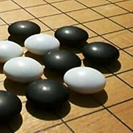

## What is your current level in the language like?

I can use Japanese without thinking about it in most situations. I recently started a new job at a Japanese company and basically most of the things I do, I do in Japanese. I've got quite a natural sounding accent, which means a lot to me. However, depending on the context, I keep noticing situations and subjects where I could be more fluent. This frustrates me a bit sometimes, but maybe more importantly it gives me motivation to keep trying and humility to keep an open mind. I took JLPT N1 in 2014 and passed with almost full marks – a fact that tells much more about JLPT than not-yet-quite-so-good me. Actually the emphasis people place on JLPT is a pet peeve of mine – [I could rant more about it](https://www.quora.com/Japanese-Complete-Novice-to-JLPT-N1-Master-90-pass-rate-What-will-this-require-E-g-resources-mindsets-habits/answer/Pyry-Kontio).

## What got you interested in learning Japanese?

{.float-left}

It was the Internet and an anime called Digimon. We got a broadband Internet connection when I was starting high school in 2004 and I started hanging out on an online discussion forum for Digimon fans. It was there I got my first contact into someone that was studying Japanese. This inspired me to start too. I did multiple Japan-related activities at high school: I started a Go club because I was into an anime called Hikaru no Go, I organised a Japanese study circle and such. (I sucked hard at Japanese back then but I taught other people nevertheless. It wouldn't have been possible without the tremendous amount of help I received from my online friend who was way ahead of me in his studies. Thanks, Eero!)

I've always been kind of a scientifically-minded person and I originally thought about pursuing a carrier in engineering but dabbling in Japanese changed that. I decided to go all the way and applied for Japanese studies in the University of Helsinki. In the end I ended doing also a computer science minor, which reignited my love into programming and in a sense, helped me towards the path I'm on at the moment. (A software engineer in a Japanese company in Tokyo.)

## What keeps you going? What keeps you motivated?

Motivation is a difficult word. It can mean all kinds of things and not all of those things are relevant. First of all, I think that actually acquiring a language depends very much, if not solely, on how much you are actually using it for communication. By the way, I've got to say a disclaimer here: by "using" I don't necessarily mean "speaking", but also – and especially – listening; of course reading and writing too. By "communication" I don't necessarily mean a "live discussion", but simply using language in its all forms to encode and decode some meaningful messages. This means that there's no problem in – for example – thinking of reading a book as communicative use of language!

When you are trying to communicate (= trying to understand or get understood), there's an intrinsic motivation in the situation – you wouldn't be trying without it! I also think that is an inherent problem in much of classroom learning – many of the activities done in classrooms don't have an intrinsic motivation to understand meaning-encoded-as-language for some actual purpose. Indeed, some of the activities are entirely mechanical and even meaning-based activities can be boring and demotivating.

### The need for communication

So, the problem is then, how do you get yourself in situations where it's natural to communicate? That's where the real "need" for a motivation comes into play. You need to have the motivation to reflect a bit: should I try and search for interesting podcasts? Should I overcome my shyness and go to a local "Let's speak in Japanese" gathering? Am I prepared to watch a bit of ten boring Japanese TV shows just in the case I found one that was really addicting? How should I change my routines so that I encountered a bit more Japanese in my life?

That's the general equation and there is no single true solution to it. I tried many things, like downloading a ton of [Downtown](https://en.wikipedia.org/wiki/Downtown_(owarai)) variety shows and cartoons I watched as a kid (Pokemon! [Moomins](https://en.wikipedia.org/wiki/Moomin)!) dubbed in Japanese (btw. this was also great for additional nostalgia trips), and had them going non-stop in our kitchen. I made a rule that every train trip I rode, I would listen to one episode of the hilarious [Sakura Tsūshin podcast](http://sakuratsushin.com/). The list goes on. The general point is: I don't allocate time to study. (I used to do this back in the college, but it was unsustainable and didn't actually help with my Japanese too much.) Instead, I use the bits of motivation I have to construct an environment where I wouldn't need to be "motivated" to use Japanese. (By the way, I got the idea from a blog called [All Japanese All the Time](http://www.alljapaneseallthetime.com/blog/)! Again; kudos to where it belongs!)

### Applying the communication principle

The ultimate manifestation of this principle is that I moved in Japan and started a job in a Japanese company. Of course, this is not feasible for everybody, it's just to illustrate the point. For some, just going to Japanese lessons is a way better way to motivate oneself to be in contact with Japanese than doing nothing. The point is – what works for you is the way to go.

However, I think that everybody should learn and keep some basic principles in mind about how the brain learns languages. If you're motivated to do things that don't actually help, your efforts are next to nothing.

## What is your ultimate desired level in the language?

I want to sound as native-like as is humanly possible! Sounds like a grandiose goal, but hey, what's wrong with dreaming big! I'd also like to be able to read more fluently. I've read a few novels in Japanese, but I'm still quite a slow reader, so there's always a threshold between getting started and really getting into the story.

## Which resources have you helped you the most?

I think that listening to podcasts and watching anime without subtitles did wonders. I can also recommend watching anime with Japanese subtitles. ([Check out this site](http://kitsunekko.net)) As a motivational resource, [All Japanese All the Time](http://ajatt.com) helped me to construct a right kind of a mindset. Watching [Japanese Let's players](https://www.reddit.com/r/LearnJapanese/comments/2zk2tx/how_to_find_japanese_lets_plays/) (ゲーム実況) playing your favourite games on YouTube is also a surprisingly fun pastime.



Japanese manga is great for reading. Just recently I binge-read ["One-Punch Man"](http://galaxyheavyblow.web.fc2.com/fc2-imageviewer/?aid=1&iid=2). As for reading long-form stories, an initial push that got me over the threshold I mentioned earlier was to read a novel and listen to a corresponding audio book at the same time to prevent me getting stuck in the details. I bought the audio books from [FeBe](http://www.febe.jp), and bought the corresponding physical books at [BookOff](https://en.wikipedia.org/wiki/Book_Off) or from Amazon. There's also free audio books of works with expired copyright on the Internet.

### Japanese Grammar

I used to love meticulously detailed grammar explanations, but after studying linguistics, and language acquisition in uni, I realised that knowing about grammar doesn't really do much – it uses entirely different “circuits" in the brain than actually using the language and there’s hardly any crossover.

### Japanese Dictionaries and Grammar Help

A good dictionary is a great resource to have. Nowadays, I mainly use a Japanese-to-Japanese dictionary. I've found that [Daijirin](https://itunes.apple.com/us/app/%E5%A4%A7%E8%BE%9E%E6%9E%97/id299029654?mt=8) is the best of the [big three](http://www.gally.net/translation/kokugo.htm). It also comes bundled with macOS operating system, so Mac users, check it out if you haven't yet. I've also bought a copy of [Eijiro](http://www.japaneselanguagetools.com/docs/Eijiro.html) from Japanese Language Tools. It's one of the best Japanese-English-Japanese dictionaries, well worth the price!

Lately I've been using [HiNative](https://hinative.com) to check some of my word choices and grammar in written text. I'm not sure if that actually helps with acquisition but the service is also useful when you don't understand something and you want a quick explanation.

## What methods and resources have you used to learn kanji?

I used to learn kanji in the college, just taking the Japanese classes. At some point, I found out about the Heisig method and started using that in combination with [Anki](https://apps.ankiweb.net/). Later I found about the [KanjiDamage](http://kanjidamage.com), which seems like a hilarious and very good "reimplementation" of Heisig. At that point, however, I already knew basically all of the [jōyō kanji](https://en.wikipedia.org/wiki/J%C5%8Dy%C5%8D_kanji), so I didn't have a chance to try it. (There might’ve been some that I didn’t, and don’t know even at the moment because let’s admit it, there’s some really obscure kanji on the list. And on the other hand, there’s some really useful and common kanji that are not on the list.)

However, one thing that many kanji training methods miss is that you don't gain fluency by practicing single characters and words. To be able to not only recognise the kanji but also "blast through" a sentence at a natural reading speed, actual reading practice is indispensable.

I used to practice writing back in the days, but unfortunately I don’t have the time and motivation for that any more. I've been quite content with just being able to read fluently. I still get random practice when writing small notes and addresses, but admittedly that isn't much. I think that not writing by hand anymore is not only my problem, but it plagues the Japanese society (especially millennials) as a whole.

## How did you tackle learning vocabulary at your earlier stages of learning? How do you tackle learning vocabulary now?

### What is wrong with drilling and memorizing on purpose

I used to do more traditional-kind of training, like just drilling a list of words from the back of a textbook. Even after discovering Anki, I used it basically as a more sophisticated tool to randomise the order and optimise the retention using spaced repetition.

However, as per my current understanding, there are multiple things that are wrong in that kind of training. First of all, I now think that associating Japanese words with English words is a fruitless practice. Words are series of phonemes we associate to meaning: concepts, memories, sensations, feelings et cetera. To actually be able to use words to express and understand meanings, there shouldn't be any unnecessary indirection between the word and the concept. You don't want to "translate in your head" when you are communicating, we humans ain’t got no brain power to spare for that! The more "naturalistically" the word is stored in your brain, the better the circuits that specialise in processing language are able to use them. Besides, more often than not the words that supposedly mean the same thing in different languages have slightly different nuances, mental images and collocations. Thinking of two different words in two different languages as the same won't do any good.

Secondly, I no longer advocate for learning words without a sentence context. I used to buy into the logical argument that having context in quizzes is bad because it helps to get the meaning without understanding the meaning of the word itself. The problem is that words are not 100% self-contained entities. They have grammatical features that require certain kinds of contexts, collocations, conjugations, particles etc. If you are not exposed to this more nuanced context when learning, you might be skipping some important information of how that word is actually used. Also, many words don't have a singular meaning. If you browse a dictionary, you'll notice that they list a bunch of different senses of the same word. Often having a context can disambiguate between these meanings and leads the learner to have a more concrete and sharper sense of how the word is actually used to express a specific meaning. We shouldn't learn words as "bundles" of all the things the word can mean – it's too much to swallow as a whole. Instead we should regard the senses of the words as almost like different words with different meanings that just happen to sound the same.

### Meaning based vocabulary acquisition

I think that learning vocabulary should be entirely meaning-based; you shouldn't start with a list of words to learn and start memorising their meanings, but you should start with things, thoughts, meanings you want to be able to understand when expressed in Japanese. Again, a disclaimer: By this, I don't mean that you should start practicing from "having an English meaning to producing Japanese expression", quite the opposite! I think it's much more important to be able to understand Japanese expressions than to be able to produce them, especially in the beginning. My point is that if you choose what expressions you want to understand by taking a list of singular words from somewhere, your method of choosing your materials is wrong. Sadly, the hegemony of language textbooks hasn't quite embraced this kind of paradigm with their vocabulary listings.

What’s a good way to choose vocabulary to learn, then? I think that you should consume something in Japanese, and when there’s something you don’t understand, but your Spidey sense tells you that might be interesting to understand, that’s a good candidate for digging into it a bit, and if your Spidey sense still tells you that word in that context and meaning is interesting, funny or useful, try and learn it!

### Questioning the usefulness of spaced repetition

Finally, lately I've become to question the need for spaced repetition itself. I think the theory behind it is sound, but does it actually outperform just listening and reading (and checking meanings of words when needed)? The vocabulary in natural material has high-frequency words and low-frequency words and everything in between. We can think that each word has some "natural" occurring frequency. For example, let's say that there's this word we'd like to know that occurs once per 10,000 words of running text on average. If you read Japanese 5,000 words per week, you won’t be likely to forget that word if you can retain it in your memory longer than two weeks at a time. This means that whether you will be able to retain some word depends not only on the frequency of that word and the "strength" of the memory of that word, but also on how much and fast you read. The less you read, the longer period you have to be able to remember words to be able to keep them.

I think of spaced repetition as a tool that can help you to "artificially" remember words long enough periods that you reach that "natural" retention. However, when reading or listening to natural language, the language itself seems to provide a naturalistic form of spaced repetition: you start with easy material, get a bunch of high-frequency words, get some fluency, start reading longer texts faster, which leads to more frequent encounters with middle-frequency words per time used for reading and so on. On the other hand, with spaced repetition it's easy to achieve good retention without achieving fluency. This has the problem that it doesn't necessarily make you a faster reader, and if you're not a fast reader, the "natural" retention rate for many words might be unreasonably long. I'm not saying that spaced repetition has no value, I'm saying that it should know its place: it's just a tool.

Nowadays I don't use Anki anymore precisely because of these concerns and because it takes time I could use with some more fun Japanese activity. Instead, I'm just trying to flood myself with natural input and checking words that I don't know.

## Do you use any software tools in your learning?

I used to use Anki quite a lot. Tried [Memrise](https://www.memrise.com/) once with Spanish, but didn’t like the contents. (I guess the app itself was fine, but hard to say after using it only for a few days.)

Nowadays I use a dictionary app on my Android phone called [DroidWing](https://play.google.com/store/apps/details?id=com.aokabi.android.droidwingfree&hl=en). (You have to get the dictionary files separately.) I also use HiNative occasionally.

## Can you share with us your Anki workflow? What is your advice for people who want to get started with Anki for learning Japanese?

Here's some tips:

- Don't use readymade decks. Add stuff you've encountered yourself and that has a special meaning to you.
- Add short sentences instead of single words. Add pictures. (I have the habit of taking pictures of sentences with unknown kanji and words with my smartphone.) Use clozes or highlights to focus on a single word in a sentence.
- Try to get rid of the "gotta catch 'em all" mentality with words – there are too much words to learn in one go. A single word has practically no value in the big picture.
- Don't use copious amounts of time with Anki, consider it just a supplemental activity to actually listening and reading Japanese stuff.
- Don't be afraid to delete words that you feel you couldn't care less about, but don't delete the whole deck.
- Don't stuff too much info to the "quiz" part of the card; if there's multiple "items" per one quiz and you remember some but not all, which button are you going to press? My [Cloze Furigana Tools](https://ankiweb.net/shared/info/1263365841) plugin helps with this by splitting a single sentence into multiple cards with different parts clozed out.

## How did you get the idea for Furigana Tools? Do you have any other future projects in mind? What were some of the challenges in developing the tool?

{.float-right}

I was an Anki user at the time, but I was coming to realise some of the downsides of the "normal" Anki workflow I described before. The need for the plugin arose from a series of improvements I tried to do with my own cards. First of all, I started adding more whole-sentence context. This lead to the need of using clozes, because I wanted there still to be a single focus on each quiz. However, more often than not, I wanted to cloze multiple things in the sentence. For example, the furigana and the writing of the kanji should be asked as separate things, since they represent separate modalities; separate "skills". Or there might have been multiple words in a single sentence that I wanted to remember. Creating separate cards for every quiz was really annoying, so I decided to make the job easier and started developing the plugin.

The biggest challenge at the time was the limitations of my own programming skill. However, I think I managed to get the end result quite nice. It doesn’t have exactly Apple-level UI design, but it does its job.

### Challenges with using Anki for my students

{.float-left}

Afterwards, when I was a Japanese teacher, I tried to have my students use Anki and the plugin. At that time, I faced another wall of technical hurdles: getting everybody to install and setup everything properly on a wide variety of platforms, and trying to get people to actually use them. If I were to teach Japanese again, I'd love to use a similar tool, but this time I would definitely opt to a web-based app. I also realised that most of the tools available are made for autodidacts. There isn't anything reasonable that I know of that would allow a class management, assessing, monitoring etc.

### My other Japanese related projects

I have had many Japanese-related projects, but few have seen the light. There was this database of Japanese anime quotations (based on Japanese subtitles) that you could search for – it even had audio stripped from anime and synced into the subtitles so that you could listen to the quotation live. There are obvious copyright problems with that, though.

Then there’s a project that I've really poured myself into during the last year. As a part of my master's thesis, I created a service that tries to teach students the Japanese lexical pitch accent. It does this using a minimal pair based training with spaced repetition. There's some really interesting empirical science to pronunciation training methods and I’d really like to push forward the state of the art, but unfortunately one can do only so much with 24 hours per day. Maybe I'll pursue a PhD some day trying to do that, but for now I have to concentrate on my new job in Tokyo. With regards to the app, I have my hopes that I’d have the time to polish a publishable version sometime this year. (No hard promises though.)

## When did you first go to Japan? How was the experience like?

{.float-right}

I was in my second year at college, in 2009, when I chatted with three of my friends in Japanese studies about how crazy it was that we've been studying Japanese for a year and a half but had never been there. As a result, we decided to travel there during the spring break. We actually took some days off around the week-long break and managed to skip our Japanese lesson. Our teacher was furious about us "going to vacation and skipping class", which really baffles me even today – obviously the reason why we were going to Japan was the same we originally enrolled in the classes – to learn more Japanese and about Japan!

It felt like an adventure. We were young and everything was new to us. We went to Osaka, Kyoto, Izu peninsula, Tokyo and Kamakura. Afterwards, I've re-visited many of the places we went and re-experienced things we did with more thorough understanding and every time I keep finding something new. After our first visit I thought that there's yet so much to uncover that I want to go again. I still think that way!

## When did you move to Japan? How has it been so far? Can you share with us some of your experiences in Japan? How is life in Tokyo like? What are your favorite things about living in Tokyo?

I've been to Japan eight times now; that includes a gig as a tourist guide, hitch-hiking with my girlfriend, going for exchange studies twice (in college and in graduate school), visiting the tsunami-ridden areas as an assistant of a charity tour, doing some short-term baito of questionable legitness, taking a part to a Japanese matsuri as a omikoshi-shouldering nutjob, doing shūkatsu – job-hunting in Japanese style – and taking part to a naitei-shiki, an admission ceremony of new employees in Japanese companies. However, it's my first time to be here as a shakaijin, an adult that stands for themself. Again, there have been all kinds of new experiences, but strangely I finally feel that I'm at the level of skill in Japanese language and knowledge in Japanese society that I can actually handle things on my own.

Starting a new job, searching for an apartment, doing the bureaucracy tango etc. has been stressful, of course. However, I generally enjoy life. I love Japanese food and being the language-learning maniac I am, I'm finally at ease being constantly bombarded by Japanese. I've heard all kinds of horror stories of Japanese work life, but the first month has been quite enjoyable, and I think it really depends quite a lot on the company – I think I’m lucky having found a quite “howaito” (=employee-friendly) one. Having a balanced social life for an adult expat can be a formidable hurdle, but I'm fortunate enough having done exchange studies in Tokyo before, so I have some awesome friends to start with. Of course, it's still too early to say what the life will bring, but I feel generally positive about it.

## What other languages do you speak? Are you interested in learning other languages?

{.float-left}

My mother tongue is Finnish. I learned English at school, but in retrospect, I learned German and Swedish too, and I absolutely suck at them. Maybe it wasn't the school that did the trick. So I consider myself fluent in three languages: Finnish, Japanese and English. Actually, I used to suck at English pronunciation for a long time. I was an avid reader of English but definitely not a movie/TV geek! I think not having much spoken input in English has everything to do with that. However, since some five years ago, I started watching a lot of English YouTube videos and since then, my pronunciation has constantly improved.

I have played with the thought about learning Chinese and Korean for a long time, but realistically speaking I think I wouldn't have the time and motivation. After all, for both Japanese and English, I've really felt the motivation to use the language for something, not just to know it for its own sake, and I’ve yet to found that motivation for languages other than Japanese, English and Finnish. Maybe some day, however!

## If you had to start over, what would you do differently?

For starters, I would have listened the CDs of my textbooks many times over while not caring about the details too much, instead of going in the boringly steady pace of a chapter per week plus drilling the vocabulary plus filling in the exercise book plus all the other cruft. It's now painfully clear to me that the main thing that people are missing at the start is large amounts of exposure to language that's simple enough for their current level. There's also clear empirical evidence that filling in the exercise book doesn't do anything to your proficiency. (It may help you understand explicitly how the grammatical structure works, but then again, there's some evidence that knowing and understanding grammar and actually using language to communicate are functionally quite different things in the brain, and don't readily transfer from one system to another.) Rote-learning vocabulary has all the problems I talked about before. So for bootsrapping, just getting simple input in large amounts would be my choice.

### Starting with audio content

In an ideal world I would listen to easy reader-style audio books with tiered vocabulary. Sadly, there seems to be a chronic shortage of those in Japanese. I think that [JapanesePod101](https://www.japanesepod101.com/) aims for something like that, but in my experience the podcasts are like 10% Japanese and 90% English unless you don't skip directly to an advanced level, which is of course too hard for beginners.

I wouldn't care about kanji too much in the beginning. I wouldn't care even about hiragana, for that matter. Not that I advocate rōmaji. (Shiver.) But I advocate using the most natural medium there is, and what every toddler learns far before understanding those squiggles we learn at school – sound.

I would start watching anime without subtitles earlier than I actually did. Here's a weird thing: when I first watched without subtitles, it felt so hard to understand. But after only tens of episodes I found that I could understand just fine. Not every word, but enough that it was enjoyable to continue – and I learned at a tremendous rate.

### On reading

At some point I would start reading. I would use Anki and KanjiDamage and then try to find something simple and fun to read, like manga. (Of course, there's a lot of manga that's not simple at all; finding the right titles needs some exploring.) I would progress into long-form prose maybe through light novels. At first, I wouldn't want to learn kanji for words that I don't already know by ear – I think that learning vocabulary and kanji for it in one go is too much to swallow, and it has a nasty resemblance to learning words from a list. I wouldn't hesitate to skip kanji like "I don't know what this is for, so I won't be needing it for a while".

### On speaking and writing

I wouldn't stress about speaking and writing. I would try to get my listening and reading to a high level, and then try to apply for a study abroad program. I would also try and hang out with Japanese exchange students in my home country. (I actually did this though; I wouldn't change it.) It's in the actual situation where you have to make yourself understood that you actually develop that skill – but you can't use words that you don't know. That's why I think it's tremendously important to have a good intuitive understanding of the language and a very large passive vocabulary before trying to grow the active one. Having a lot of experience in just listening and understanding helps with creating a mental map of how the language works and makes you understand what you confidently know and what you don't. In my experience, trying to form expressions when you haven’t got the slightest idea how Japanese would express the same thought, you almost surely go wrong, and can even develop bad habits.

## What is your advice for people who want to learn Japanese?

Everybody has their own goals and motivations; everybody has their own starting point; their background and their own interests. This makes the journey different for everybody, and no one should decide the details of that journey for you.

### Basic principles

But there’s some basic principles that are the same for everybody. The Japanese language has the same basic structure, regardless of whether we are speaking of the [gyaru slang](https://www.tofugu.com/japanese/gyaru-go/) or [Akutagawa’s prose](https://en.wikipedia.org/wiki/Ry%C5%ABnosuke_Akutagawa). Our brains have the same basic structure, regardless of our mother tongue, our life experience or our supposed talents or lack of them. I think this means that there’s some common valuable things to know for everybody, because everybody has them the same. I don’t speak of my experience, because that’s just one journey; instead I’m eager to tell people of what I’ve read or heard about the results of scientific research on language learning.

### It's ok to understand things but not being able to say things

First of all, it seems that there is an asymmetry between understanding things and being able to say things. Most of the people out there say that they are able to understand but not able to talk. This is very, very normal. It doesn’t mean there’s a lack of “speaking practice” or that there is something wrong with you. It doesn’t even mean that you should spend more time trying to rehearse speaking. Why? Because you won’t literally be able to speak (other than mimicking planned sentences in an awkward manner) if you don’t have a robust enough internal representation of the language. And the research says that to get that underlying representation, you’ll have to …speak? No! To listen! If you meditate on it, it should be more obvious than it seems: first of all, you can’t speak if you don’t know the words, and you can’t just make them up. This includes not only the phonological representation of the word, but also the meaning and all the grammatical and conventional things that dictate how the word is used. You can’t make this stuff up. You have to get it from the input, so if one hasn’t got enough input, there’s just no way for that person to be able to produce language from thin air. This stuff may take it’s time to wind up in the brain, so some patience and lots of input is needed!

### On grammar rules

Secondly, there’s some real evidence on that it’s totally different to know about a word or a grammatical rule than to be able to use that knowledge. They’re just different systems in our brain, and to be able to “reason” about something requires one to pay attention to it. But we don’t actually pay attention to minute word choices or grammatical forms when we are speaking – most of the “linguistic” layers of communication need to be automatic and unconscious. This doesn’t always happen with non-native languages, but the evidence is clear: the more automatic and unconscious it is, the more fluent the speaker or learner is. There has been some brain imaging studies that show that the advanced learners of languages start to resemble more and more native speakers in their brain activity patterns. I think that tells that it’s possible and desirable to get that automated, unconscious skill.

### Obtaining language intuition and "just using" the language

Then, of course, there’s the argument that one should be able to start from declarative “knowing about language” knowledge, practice, and end up with procedural “knowing how to use language” knowledge. This is a thing I can’t say anything totally certain about, since there’s a bit of disagreement between researchers too, but from what I’ve seen in some recent results, it seems like brains just don’t work that way. Instead, they have multiple systems learning in parallel. The declarative “I know the rules because I read them from the textbook” system is a fast learner, but it’s also a fast forgetter. Unfortunately, the knowledge stored by it is also very slow to be processed and it needs attention to be processed at all. On the other hand there’s the procedural “this should be done this way, I don’t know why, it’s just the way it is” system. It learns slowly through practice, and it’s generally not available for conscious introspection. But once it has learned things, it processes them very fast and unconsciously, without need for attention. It also doesn’t forget things rapidly. This is the system that backs up our “intuition for language” in that something “feels wrong or right”.

There’s an important result about these two systems: they don’t seem to readily communicate. Instead, they do what they do in parallel. Here’s another fact: babies have underdeveloped declarative systems, so the procedural ones are the ones that they use to do the baby learning.

I think that this should be enough to convince people to take just “using language” seriously. Your brain has a lot of unconscious processes that do unconscious learning all the time; just expose them to language. Then again, how you do that is up to you – there’re as many journeys as there’re learners.

## Where can we reach out to you online? Are you working on any projects you would like to share with readers?

I’ve been quite busy with my new job, and I’m afraid I don’t have any projects in the pipeline real soon. As I said, I’d like to publish the pitch accent training tool sometime this year, but I wouldn’t be surprised if that got delayed. The source code is available, but the real meat, of course, are the words and sentences that I’ve painstakingly planned, recorded, edited and compiled into an app. I'll be sure to announce that when the time comes!

I actively use [Twitter](https://twitter.com/golddranks); feel free to follow me and say hi! Lately, I’ve been also active on [Quora](https://www.quora.com/profile/Pyry-Kontio); I’ve been mostly answering questions related to language learning. I also use [GitHub](https://github.com/golddranks) as a collaborative programming platform – I actually host the source code of Cloze Furigana Tools there. I haven’t actively developed the plugin for some years, but bug fixes and new features are more than welcome!
