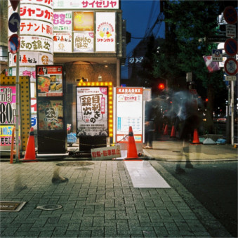

## What is your current level in the language like? For how long have you been studying? How long did it take you from zero to passing the JLPT N1?

I would say my current level is intermediate. I can hold conversations, communicate with my Japanese friends through mail and messages and watch anime and dorama without subtitles. Unfortunately, after taking [JLPT N1](https://en.wikipedia.org/wiki/Japanese-Language_Proficiency_Test) at the end of 2015 I lost motivation and I haven’t been studying Japanese consistently since, so my level dropped.

I took some Japanese classes in university where I learned hiragana, katakana and the very basics. Then at the end of 2012 I went to study Japanese in a language school in Kyoto. Since then it took me 3 years (with some on and off times) of intensive studies to pass JLPT N1.

## You spoke on an article that the movie Kill Bill along with other media got you into Japanese. How was this process like? How did you go from inspiration to actually studying Japanese?



The short lines in broken Japanese that The Bride delivers in Kill Bill Vol.1 were my very first conscious contact with the language. I was about 17: then and there it sounded to me like the coolest language ever. The fascination stayed with me since and later I decided to enroll in a BA in Asian Studies. I would soon find out that the Japanese course there was very basic, but that’s another story.

## Most people who set out to learn a language will probably stop learning or practicing it at some point. What kept you going? What kept you motivated?

What really kept me going is the fact that most of my Japanese studies happened in Japan. I had invested so much money, time, emotional energy into it that quitting was not an option. Besides, I was totally in love with the language and the culture. I wanted to pass JLPT N1 at all costs and I wouldn’t have stopped until then.

## You “broke up” with Japanese. Are you hoping to become friends with Japanese again? How would have done things differently to avoid a breakup?

{.float-left}

[After JLPT N1 I lost my way with Japanese](http://hitoritabi.it/2017/05/26/overcome-a-language-learning-crisis/). I had studied super hard while adapting to life in a new city (London) and working full time, so I think I had some sort of language burnout. I didn’t plan the next step and I lost motivation.

I could have made some plans for the post-JLPT, taking a short break and then creating a new study routine, but my personal life at the time was challenging enough. I definitely hope to renew my love for Japanese, little by little. To be honest I’m doing very little to maintain it at the moment, which is a shame.

## How did your study habits change along your Japanese learning journey?

I am a creature of habit, so I actually stuck with my study routine for a very long time, with [Anki](https://apps.ankiweb.net/) being my favourite tool. I used it every day to study kanji, writing them down on a note at the same time.

While studying for JLPT I added the [Kanzen Master series](https://www.kuropixel.com/kanzen-master-series-review/) books to my routine.

## How has blogging about your language learning goals helped you?

I’m actually not so sure it did! Sharing my goals is supposed to make me accountable, but I often felt stressed and anxious when I wasn’t “performing” enough. That’s why for now I decided to stop setting goals and focus more on creating habits.

## Can you tell readers about your study planner and its combination with the Pomodoro technique? How did you develop it? How did you design it?

The [study planner](http://hitoritabi.it/2017/07/30/language-learning-goals-august-2017/) is meant for people who are studying full-time (for example in preparation for a big exam) or for freelancers, who need to manage their own time efficiently. It divides the day in slots of 30 minutes: 25 minutes of intense work/study and 5 minutes break, with longer breaks for meals. This is based on the [Pomodoro technique](https://en.wikipedia.org/wiki/Pomodoro_Technique), which should improve focus and productivity.

I developed it to help my boyfriend prepare for a university exam (the teacher in me invades my personal life as well!) and later I implemented it in my working days. I designed it with [Canva](https://www.canva.com/), a free online design tool that I often use to prepare lessons materials.

## What software or electronic tools have you used for language learning?

I used Anki regularly to study kanji. I created my own decks, adding new characters I learned in school and doing repetitions every day. I spent quite some time with it, reviewing up to 100 characters per day. As I used to write the kanji during the review it took me time, but it really helped me memorise them.

Another tool I love is my [denshi jisho](https://www.kuropixel.com/fall-japanese-electronic-dictionaries/) (electronic dictionary), I would never change it for any app.

## How did you prepare for the JLPT N1? How did it feel like to pass it?

[I studied for JLPT N1 after leaving Japan](http://hitoritabi.it/2017/02/15/jlpt-study-tips-and-resources) and moving to London. It took about 6 months of dedicated study as I was also working 9 to 5.

I kept studying kanji with Anki, as usual, and bought the Kanzen Master books for reading and grammar. I also got two mock tests to complete while tracking time. I focused mostly on reading, as I knew it would be the hardest part for me, especially for the lack of time. I practiced in my lunch break at the office, on my commute, after work and on weekends.

When taking breaks from proper study I would watch movies or shows in Japanese, listen to Japanese music, read Japanese books. I also went to a few MeetUps where I practised conversation and found some like-minded friends who had lived in Japan. It was a period of intense immersion into Japanese language and culture, in every aspect of my life.

Passing it was a bit of a shock really, because I was absolutely sure I failed. I had to read the page again and again before convincing myself I did it.

## What is your ultimate desired level in the language?

I would be happy if I could read novels and watch any kind of movies and understand 90% of them (because if it was 100% I wouldn’t be learning anything new and that is not fun).

## Which resources have you helped you the most?

I am a bit of a textbook geek, so I like to have one as reference material. Through my course at the Japanese language school I used [Minna no Nihongo](http://japanesetease.net/review-minna-no-nihongo/) and the series [Manabou Nihongo](https://www.amazon.co.jp/%E5%AD%A6%E3%81%BC%E3%81%86-%E3%81%AB%E3%81%BB%E3%82%93%E3%81%94-%E3%83%86%E3%82%AD%E3%82%B9%E3%83%88-%E6%97%A5%E6%9C%AC%E8%AA%9E%E8%83%BD%E5%8A%9B%E8%A9%A6%E9%A8%93N3-%E6%97%A5%E6%9C%AC%E8%AA%9ENAT-TEST3%E7%B4%9A%E5%AF%BE%E5%BF%9C/dp/4883244148) which I recommend.

At the very beginning of my studies I used [JapanesePod101](https://www.amazon.co.jp/%E5%AD%A6%E3%81%BC%E3%81%86-%E3%81%AB%E3%81%BB%E3%82%93%E3%81%94-%E3%83%86%E3%82%AD%E3%82%B9%E3%83%88-%E6%97%A5%E6%9C%AC%E8%AA%9E%E8%83%BD%E5%8A%9B%E8%A9%A6%E9%A8%93N3-%E6%97%A5%E6%9C%AC%E8%AA%9ENAT-TEST3%E7%B4%9A%E5%AF%BE%E5%BF%9C/dp/4883244148) and it worked very well for me.

And of course my best friend, Anki.

## What are your favorite native resources to consume? Which have helped you learn the most?

One of the reasons why I got so passionate about Japan is that I adore its cinema. My favourite native resource is definitely movies: directors like Sono Sion and Kitano Takeshi had a huge impact on my life.

Usually while watching a movie I want give my full attention to the story and direction. Sometimes I take notes about words or expressions I want to look up later, trying to focus on one or two specific grammar points or vocabulary areas. For example while watching After Life by Kore’eda Hirokazu [I concentrated on words and expressions regarding memory and the past](http://hitoritabi.it/2017/05/30/learn-japanese-through-movies-1/).

## You have written about learning languages through music. How do you go about studying and analyzing lyrics in a new language?

Music is a great way to learn vocabulary, expressions and grammar almost effortlessly. It works best for learners who have already some knowledge of the language, ideally from upper beginners onwards.

[First of all I pick a song I really like](http://hitoritabi.it/2017/03/13/7-songs-to-learn-japanese-through-music): I want to be able to listen to it many times without getting tired of it. Then I listen to it a few times, trying to understand the meaning. Only after I analyse the lyrics, checking the words I didn’t understand and looking up new vocabulary. You can be sure that, learning a word this way, it will stick with you!

{.float-left}

I also think that karaoke is a great learning tool, especially for languages like Japanese with a different script, because it helps you read faster while you’re having fun.

## What methods and resources have you used to learn kanji?

Kanji are indeed intimidating at first, but they were always one of my favourite things about studying Japanese. They are great to remember vocabulary, guess meaning of new words, and in general I find them just awesome. As I mentioned earlier, I memorised them thanks to Anki.

I created flashcards with the kanji on one side and hiragana/translation on the other. When reviewing the cards I would try and write the kanji by hand, because I wanted to be able to write the characters as well as reading them. It takes a lot of time to study this way, but for me it paid off. After some time I felt like I knew the kanji with my muscles, they came automatically out of my hands without me having to think about the traits.

## Can you tell us some of you favorite experiences in Japan? Do you have plans to go there again in the future?

{.float-right}

[My favourite experiences were the ones from day to day life](http://hitoritabi.it/2017/02/27/5-signs-have-not-recovered-from-my-stay-japan/): a bike ride along Kamogawa (the river that crosses Kyoto), finding by chance a small temple in my neighbourhood, spending an afternoon walking in the woods to look at the leaves turning red.

For sure I will want to go to Japan again at some point, possibly for a long holiday travelling around the country, but I don’t plan on living there anymore. I am sure I will still bring some Japan with me wherever I go…

## How was your experience learning Japanese at a language school? How did a normal day look like?

I spent in school 4 hours a day from Monday to Friday. Every day started with a short shadowing session, a small kanji test, then we would learn about 5 new characters.

Afterwards we worked on the textbook, studying grammar and vocabulary. Once a week we had reading and listening exercises. We also had some optional classes we could chose from: business Japanese, Japanese literature, Kansai dialect, JLPT preparation.

Some of the teachers were more prepared than others, but all in all I’m satisfied with the experience, also from a personal point of view. I am still in contact with some of the teachers and we’re still good friends with many of my fellow students.

Some people slip into the habit of socialising more than studying, but with some self-discipline one can get fast results thanks to this kind of intensive study experience. If anyone is interested in studying in Japan, [I also wrote about the questions I receive more often on the topic](http://hitoritabi.it/2017/01/30/study-in-japan-frequently-asked-questions/).

## How is live like in Kyoto? How did you decide on Kyoto? How does it compare to other Japanese cities?

I decided to go to Kyoto because I have always been fascinated by traditional Japan, I wanted to be in a city packed with temples and shrines. I was never interested in living in Tokyo, too crowded and big for me.

Kyoto was perfect because there were many festivals and events going on, but I could still find some place to be by myself. A short ride away I could go and hike in the beautiful hills around the city, and I could travel to school and to the centre by bike.

I’ve been told that recently Kyoto has been invaded by tourists, but when I was living there I adored every corner of it.

## What about the not so positive things about life in Japan?

There would be a lot to say here so I’ll try to keep it brief, I hope I won’t sound too superficial. Japan is still very scared of “people from outside” (gaijin) and quite far from gender equality, so as a foreigner and a woman I don’t see myself having an easy time there.

Japan is also a country where people are often lonely, trapped in the eternal contrast between honne (real feelings and desires) and tatemae (the façade one shows to others). Individuals are considered less important than society as a whole and this causes a lot of psychological distress that is not properly addressed.

## How has your Swedish language learning journey impacted your ideas on language learning? Have you gained any insights that could be applied to Japanese language learning?

{.float-left}

Swedish is the first language that I start studying completely by myself. Through this experience I learned that “the more the merrier” doesn’t apply to language learning resources. It’s important to narrow down, without being afraid of dismissing any tool that feels redundant instead of piling up tons of websites, apps, dictionaries.

There is so much choice out there, especially for a popular language like Japanese, that it’s easy to feel overwhelmed. It’s better take some time and set one’s priorities and needs, and then select very few resources that can best help with those.

## How has becoming a language teacher changed your ideas about language learning?

Now I am even more aware that there is no method or teaching strategy that works for everyone. Trying something, accepting that it’s not working and moving to the next thing is a necessary phase successful language learners go through.

I also learned to evaluate resources faster and to know exactly what I’m looking for when I’m looking for a teacher myself.

## If you had to start over, what would you do differently?

{.float-right}

Probably I would dare to speak more and earlier, without so much fear of making mistakes. I would try to push myself out of my comfort zone, spend less time on grammar books and more time picking up slang from the locals.

## What is your advice for people who want to learn Japanese?

First and most important, don’t study Japanese using rōmaji (Latin alphabet): learn hiragana, katakana and kanji from the start.

Second, find out what your strenghts and weaknesses are and pick your resources accordingly. Don’t hesitate to change them if your goals change and don’t rely too much on apps alone: you won’t get too far with them.

Finally, build solid habits but remember to be kind to yourself and accept your limits, or you’ll end up burning out and losing motivation. Keep it fun!

## Are there any particular [Hitoritabi](http://hitoritabi.it/) articles you would recommend to people who want to check out your work?

[This article on slow language learning is a good starting point to summarise my approach](http://hitoritabi.it/2017/05/11/5-situations-when-slow-language-learning-is-best/). I don’t believe in ultra-fast results and I’m not even looking for that, I prefer to enjoy the process and to have fun in my study time.
