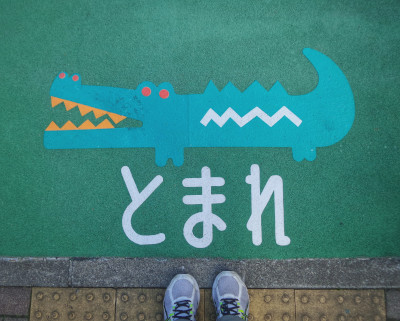

## Have you taken any of the JLPTs?

{.float-right}

I think am N1, the last [JLPT](https://en.wikipedia.org/wiki/Japanese-Language_Proficiency_Test) I took was a bit ago and it was the N2.

## What got you interested in learning Japanese?

I loved Power Rangers and Pokémon as a kid and that love never really went away. Later, at 19, I served a [Church of Jesus Christ of Latter-day Saints](https://en.wikipedia.org/wiki/The_Church_of_Jesus_Christ_of_Latter-day_Saints) (LDS) mission in Japan and that just locked it in as a major love of mine.

## What keeps you going? What keeps you motivated?

At first I HATED when I would try to speak to people and I wouldn’t understand them. The only thing I could understand was when they said “わかりませんね’ which only drove me to study harder. After I was able to understand and speak reasonably as the friendships and my personal pride being a competitive person that made me determined to be a practitioner of the language.

## How did you get the idea to start Manga-sensei? Has working on Manga-sensei helped you with your studies?

[Manga Sensei](https://manga-sensei.com/) came from the hate I felt towards the current method of teaching Japanese at University. I wanted to change things because the teaching was so archaic. I didn’t get the point of memorizing poems and rote conversation. I hated the books, despised the textbooks, and wanted to learn real Japanese that I could use. Why am I taught [classical Bashō](https://en.wikipedia.org/wiki/Matsuo_Bash%C5%8D) but not how to write a business email or how to apply for a job? Also, language learning does not naturally lend itself to a University environment for one simple reason. The University does not like mistakes. You cannot make mistakes in assignments, you certainly don’t want to make them on quizzes and tests. However, you NEED mistakes to learn a language. That idea made me want to teach language in a space where mistakes are okay. That philosophy combined with my love for Japanese projected me to create Manga Sensei.

{.float-left}

Currently Manga Sensei encompasses three different projects; [Learn Japanese through manga](https://manga-sensei.com/comic/), [a podcast](https://manga-sensei.com/podcast/), and [a 30 day challenge](https://manga-sensei.com/30days/) which encourages and promotes actual learning.

As for my personal learning, working on Manga-sensei definitely helps me improve all the time.. something about putting your real Japanese ability out there on a podcast that is listened to by almost 10,000 people every day makes you get better fast.

## What is your ultimate desired level in the language?

I wish to confuse people on the phone or via email to make people think I’m Japanese. Almost there.

## Which resources have you helped you the most?

The [Japan Times Basic Japanese grammar books](https://www.amazon.com/Dictionary-Basic-Japanese-Grammar/dp/4789004546) by Seiichi Makino and Michio Tsutsui

The [Imiwa App](http://www.imiwaapp.com/)

And the manga series [Bakuman](https://en.wikipedia.org/wiki/Bakuman)

## What are your favorite native resources to consume?

I enjoy manga and podcasts. Nearly every day I listen to a business Japanese podcast called [企業インタビュー](http://www.radionikkei.jp/banjo/) and the [NHK news](https://www.nhk.or.jp/podcasts/). I love to read Shaman King, Death Note, Bakuman (my favorite) and Yotsuba for speaking and conversation.

## How did you tackle learning vocabulary at your earlier stages of learning? How do you tackle learning vocabulary now?

i used to be all about the flash cards. Now I am more posters and notes that I take and put on my phone. But to each their own. Personally I want to make an app or tool for audio flash cards someday because I would find that very useful.

## Do you use any software tools in your learning?

The [Shirabe](https://itunes.apple.com/us/app/shirabe-jisho/id1005203380) and [Imiwa](http://www.imiwaapp.com/) apps.

## When did you first go to Japan?

2011 August as an [LDS](https://en.wikipedia.org/wiki/The_Church_of_Jesus_Christ_of_Latter-day_Saints) missionary and it was one of the best experiences of my life. Without getting too religious I'll explain the system that missionaries go through to work.

## How do you become a missionary in Japan?

We pay our own money ($10,000 USD) to go. We fill out some paperwork, do some interviews with our clergy, and then we get a packet in the mail that tell us where we are going. We don't choose our mission. In my home church, three of us went on missions about the same time. One went to Mexico, one to Washington, and the other (me) to Japan.

{.float-right}

I was called to the Chubu area and lived in Gifu, and Nagano. During that time missionaries are required to speak the native language, (which is why Utah has the highest bilingual rating in the US, and the US government studies the LDS missionary training center because we learn languages really fast)

## How was the missionary experience like in Japan?

My first experience in Japan was after 12 weeks of rigorous religious training, and then the next day being shipped to a country where I didn't speak the language and had to talk to them about religion. Not exactly an easy topic in my native language, much less my second. Not to mention Japanese people aren't exactly a Christian country, which makes matters harder when we are trying to teach about Jesus.

It was a scary and humbling being a foreign missionary. Imagine walking off the plane that day and the next day at 10am you are knocking on doors trying to talk to them about spirituality. I had countless doors slammed in my face, people saying ruse things to me, and more rejections and mistakes than I could count because I was nervous and poor at Japanese.

That was also where I figured out that mistakes and failure is often the mother of greater things. I learned to care about improvement but not be overwhelmed or upset even when I made mistakes in Japanese. I was forced to speak Japanese every day for two years, while learning how to make conversations smooth and natural even when I have to talk about difficult subjects. This was where my mantra, "After 10,000 mistakes you can become fluent" came from.

## How was it going back from Japan?

Then after two years, two years of not calling my mother, and two years of complete self-sacrifice. After two years of giving my all for something I believed in morally and spiritualty. After two years of hard work and giving up school, friends, and home. After two years of loving the Japanese people. After two long years of working 120 hour weeks and praying, literally praying, to get better at the language, I went home. It was like a kick in the teeth that also sucked all the air out of my body.

I had really grown to love Japan during that time. I still do, it is very special to me. My Mission is part of that. The people that I taught, and people that I worked with and met, and even the people who rejected my message were all wrapped up into what Japan is for me.

{.float-left}

## What other languages do you speak?

I also speak Korean.

## If you had to start over, what would you do differently?

I would have told my younger self it was okay to make mistakes. When I first started learning Japanese I was all about being perfect. I had to make perfect and do everything right. Now I know that you don’t have to bed perfect in that sense. You need mistakes to improve.

## What is your advice for people who want to learn Japanese?

Aside from tuning into [my show](https://manga-sensei.com/podcast/), make mistakes. Put yourself out there and try. Yo won’t regret it.

## Where can we reach out to you online? Are you working on any projects you would like to share with readers?

I have a project but it is a secret. I’ll talk about it in a couple months. Let’s just say we are going to revolutionize the Japanese learning space. You can find all of my social media links at [The Manga Sensei](https://manga-sensei.com/).
