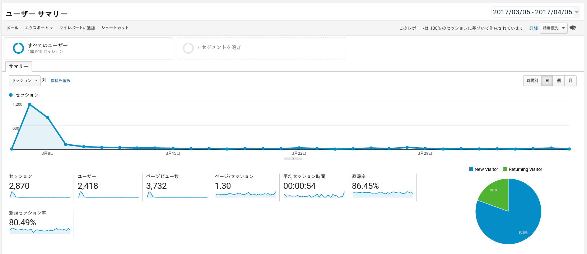
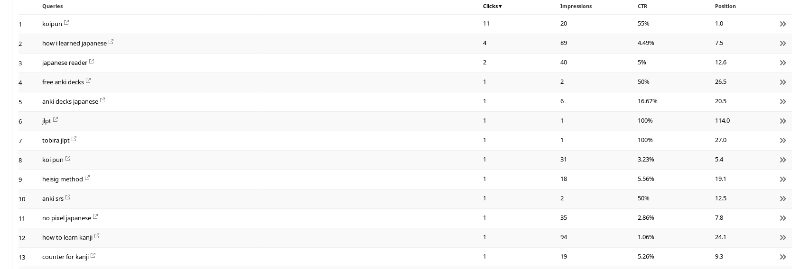

皆さん、こんにちは！Hello everybody!

This month I wasn't able to make as much progress as I had wished because I got quite busy with my day job. Nonetheless, I have some cool things to report on! 😉

## Revenue and Expenses

This was an average month for [Anki deck sales](/anki/). The sales amounted to a total of $54 US dollars. Even though ~$50 a month is not a big amount, it feels great to have achieved this kind of a passive income. The first deck sale was made in July of 2016 and the amount of sales has remained stable since then. Although creating the deck was a massive amount of work, after the deck releases I haven't had to work too much to maintain this income, except for the full revision of the decks I carried out last month. Although this income has given me a lot of motivation, I do not have any plans for increasing this revenue, rather my focus will be on generating new revenue via the [Koipun Reader](/reader/).

This month I didn't have any unusual expenses. Expenses reached a total of $19.30, so for this month I am $34.64 in the green.

- Payment Processing Costs: $2.46
- Heroku for hosting the website: $7
- MailChimp for the Koipun Newsletter: $9.90 (I got a 10% discount by simply enabling two factor authentication, wohoo!)

## Revenue Goals for 2017

My goal revenue goal for 2017 is to reach $1000 in MRR (monthly recurring revenue). I will have to experiment with pricing to find what what truly works, but as initial experiment test I plan on having two pricing tiers for Koipun Reader.

1. One will be $18 a month for Koipun Reader, which will include all of the software features and unlimited use of the service and access to the Koipun Readers community.
2. The other will be priced at $188 a month and will include Koipun Reader and four 60 minutes lessons with a professional Japanese teacher and a monthly in-depth evaluation from the teacher.

These pricing plans will probably change by the time I launch Koipun Reader, but these are my current plans after a lot of reading and consideration. The idea for including lessons with Koipun Reader came from my own Japanese learning experiences and from my previous Koipun iteration.

I want to recreate for other learners the experiences I have  with my Japanese teacher, [絵理子先生](http://elcbkk.wixsite.com/erikojuku2016/), which have helped me tremendously with achieving my learning goals and improving my overall Japanese reading ability. Also, with previous iteration of Koipun, Koipun classroom; which offered online group lessons via Google Hangouts, I learned that some learners are willing to invest significant amounts of time and money to get personalized guidance, coaching and teaching. I will apply those lessons to have an offering that provides, along with Koipun Reader, an integrated learning experience.

With the $188 plan, I would only need five subscribers to reach my goal of $1000 MRR.

## "How I Learned Japanese" Interview Series Release

This month I got more page views than usual, because I finally released the [How I Learned Japanese interview series](/blog/category/how-i-learned-japanese-an-interview-series/) with [Bryan's excellent interview](/blog/how-i-learned-japanese-bryan-from-kuro-pixel/). I [launched the series on reddit/r/learnjapanese](https://www.reddit.com/r/LearnJapanese/comments/5y2wqi/a_story_of_learning_japanese_passing_the_jlpt_n1/) and the response was overwhelmingly positive. I was getting nervous about spending so much time working on this series without much validation, so it was great to receive such a great response. I was delaying the release because I felt that I didn't enough interviews ready, but the majority of the readers didn't read the other articles so that really didn't matter. I could have launched the series with just a single interview. Also, very few readers, around 2-3, subscribed to my newsletter.

My initial goal for the release was to increase the number of newsletter subscribers, but after realizing that the vast majority of people won't subscribe to a newsletter so easily, I changed my goal to getting people to try out Koipun Reader. After changing goals, I aligned the blog design to that goal, by eliminating all noise from the blog articles e.g. eliminating the social share icons and moving the newsletter subscribe form to the very bottom of the page. Instead of those I added a link and a short pitch for Koipun Reader at the bottom of each article. I am not sure those changes made any difference, but a good number of people, around 3% of visitors, did end up trying Koipun Reader.

## New Interviews and blog posts

One of my goals for March was to publish two new interviews. Although I didn't reached that goal, I did publish one interview which is quite different from those I had published before. The [interview](/blog/how-i-learned-japanese-jay-from-the-j-sub-experiment/) features Jay who is studying Japanese as a trained linguist. I do have two other interviews in the pipeline that I hope will materialize in April and I also wrote a [blog post of my own](/blog/10-japanese-immersion-strategies-you-can-use-anywhere-in-the-world/) on Japanese immersion strategies.

## SEO

This month I put some effort into trying to improve SEO for Koipun. Since I have already invested a non-trivial amount of time in blogging I want to see how I can get that content to more people through search engines. This is how Koipun is doing now for some search queries.

This proves that organic traffic is extremely small at this point, but it is already a marked improvement from a few months ago where I was getting no organic traffic at all. I don't think I will see these results improve much until I generate more back-links, but I still want to put some effort in SEO from early ow, since I think it will be critical in the long term. To improve SEO I asked for some tips from a friend who is a blogger and made the following changes:

1. Made it so that there only one h1 tag per page, especially in the blog post.s
2. I renamed almost all of the blog post titles using data from the Google Keywords Tool to optimize for long tail keywords

## Processing Japanese Texts

 This month I made some serious progress on the backend server for Koipun Reader. In short, now I have the basic code to process arbitrary Japanese text, identify its components and lookup definitions. This was made possible by some incredible resources.

I am using [MeCab](https://taku910.github.io/mecab/), a  Japanese morphological analyzer, to parse the Japanese text along with [MeCab Ipadic Neologd](https://github.com/neologd/mecab-ipadic-neologd), a neologism dictionary for MeCab. Then I look up the definitions using data from the incredible [JMdict](http://JMdict, created by Jim Breen and now managed by the Electronic Dictionary Research and Development Group (EDRDG)), created by [Jim Breen](http://www.csse.monash.edu.au/~jwb/japanese.html) and now managed by the [Electronic Dictionary Research and Development Group](http://www.edrdg.org/) (EDRDG). The Koipun Reader will truly be built on the shoulders of giants. Once I started having some revenue from Koipun Reader, I plan on donating to these and other free and open source software projects. Now that I have the basic backend code for processing Japanese texts working, I need to put it into a nice package I can use from the front-end.

## Goals for April

 Like the previous month, I had planned on a new Koipun release for this month, which never materialized 😥 Thus I am going to keep my April goals simple and focused on the development side.

1. Have a working prototype of the Koipun Reader text import functionality where the user can copy and paste any text into Koipun Reader and it will be processed and be beautifully presented, even if it doesn't have any of the Reader features working such as saving known words.

2. Release the two interviews I have left on the pipeline.

As always, thank you for your support — if you've got any ideas, feedback, or questions, [please email me](mailto:gabriel@koipun.com)!
