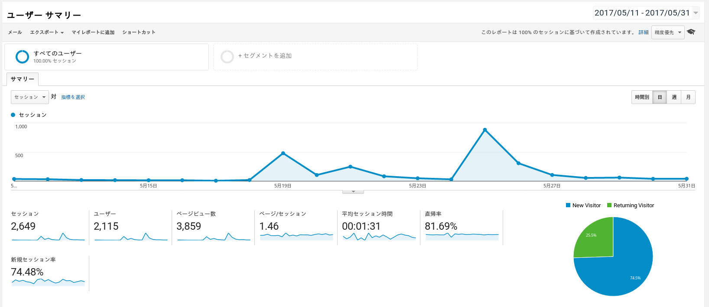
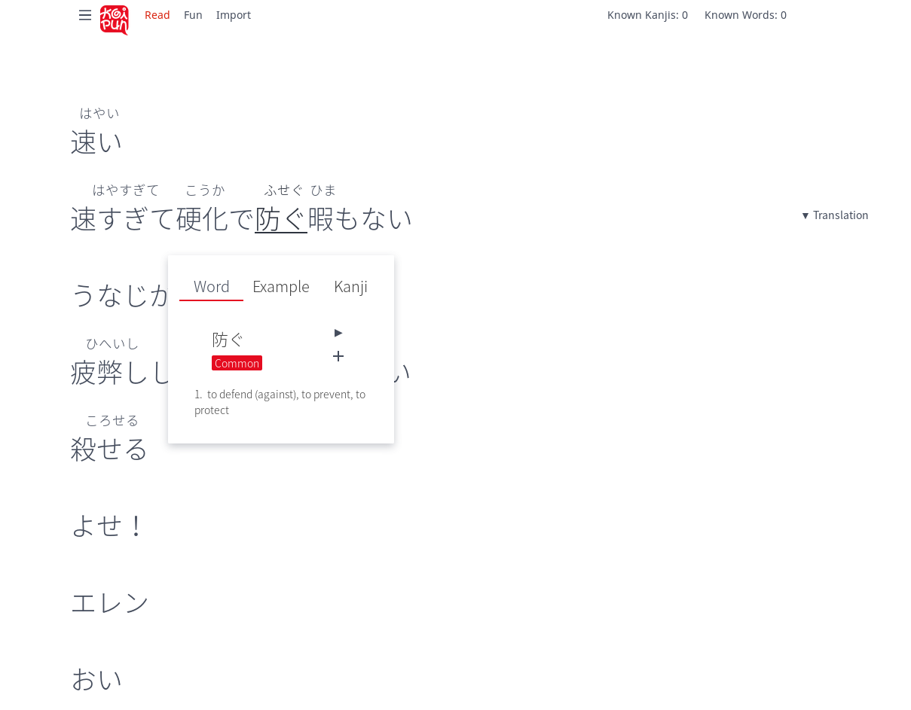

I am super late this month with the review! So I will keep it short and sweet.

## Revenues and Expenses

Anki deck sales amounted to $54 dollars USD this month. And expenses went as following:

- 6 months of access to the [Forvo API](https://api.forvo.com/): $173.70
- Heroku for hosting the website: $7.00
- MailChimp for the Koipun Newsletter: $9.90
- Payment processing costs: $2.73

That puts me in $154.07 in the red for this month.

## Growing Koipun's Audience

This month has been the best month so far in terms of page views. The best thing is that it was due to events that happened naturally and for which I didn't have to work for. Two interviewees of my [How I Learned Japanese: An Interview Series](/how-to-learn-japanese/) posted their own interviews on [Hacker News](https://news.ycombinator.com/) and [reddit](https://www.reddit.com/) respectively and their interviews got some good traction.

Pyry shared [his interview](/blog/learning-japanese-by-listening-and-reading/) on [a comment on a Hacker News](https://news.ycombinator.com/item?id=14373935) [post about the release of the Japanese course at Duolingo](https://news.ycombinator.com/item?id=14373231). Pyry's comment become one of the top comments in that Hacker News discussion and his link brought a lot of traffic. I was surprised by how much traffic a mere comment could bring. Since the reception was so positive, in the future I want to make a full post about Pyry's interview. For some strange reason Hacker News is quite fond of Japan and the Japanese language site, even though on the surface it is site focused on startups and technology.

 In addition to Pyry's comment, Carley shared [her interview](/blog/how-to-become-a-japanese-translator-carley/) as [a post on reddit.com/r/LearnJapanese](https://www.reddit.com/r/LearnJapanese/comments/6dagni/discussion_i_was_recently_interviewed_about/). This post was very well received and successfully converted some people into the [Koipun newsletter](/newsletter/). I had been wanting to post one of the interviews again on [reddit/r/LearnJapanese](https://www.reddit.com/r/LearnJapanese/) as I had done with [Bryan's interview](https://www.reddit.com/r/LearnJapanese/comments/5y2wqi/a_story_of_learning_japanese_passing_the_jlpt_n1/), but I was afraid of being perceived as a spammer by the community so I had been holding back. So it was a blessing to have Carley post the interview by herself and out of her own initiative.

## New Koipun Reader Release

I have finally released a new preview of [Koipun Reader](/reader/)! After months of delays and hard work it is finally out the door. Koipun Reader aims to take Japanese learners to advanced Japanese through helping them them enjoy real and engaging Japanese texts. This new releases demos the most fundamental technology behind Koipun Reader and that is the ability to process arbitrary Japanese texts and automatically generate reading help for those texts.

## Goals for June

It is almost halfway through the month, so I can not set too many goals, but still I want to make some good progress as I must move fast. It's been almost six months since I released the [original Koipun Reader preview on reddit/r/LearnJapanese](https://www.reddit.com/r/LearnJapanese/comments/5i7fi7/new_easy_way_to_read_in_japanese_keeps_track_of/), so I must hurry up and finally launch the paid version and get my first customer. My two goals for what are left of June are:

- Add basic support for user accounts for Koipun Reader
- Experiment with outsourcing content creation for the blog. I must focus on Reader development, but I don't want to neglect marketing entirely, so I will see if I can get some help with developing the blog without breaking the bank.
- Reach out to somebody for a new interview, since I haven't released any new interviews in around a month.

As always, thank you for your support — if you've got any ideas, feedback, or questions, [please email me](mailto:gabriel@koipun.com)!
