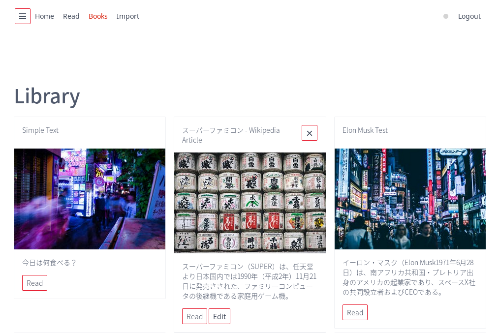

I am making a new explainer video for Koipun. Spoiler alert: it will feature manga! As for lessons learned, this month I learned that Medium is not good for articles related to language learning. Also, I discuss some new Koipun Reader updates in addition to the release of a new interview.

## Revenues and Expenses

Revenue from [Anki deck sales](/anki/) amounted to a total of $54 USD. Expenses went as following:

- Renewing the koipun.com domain with [namecheap](https://www.namecheap.com/): $13.75
- [Heroku](http://heroku.com/) for hosting the website: $32.00
- [Crisp](https://crisp.chat/) for the support chart: $25.00
- [MailChimp](https://mailchimp.com/) for the [Koipun Newsletter](/newsletter/): $9.90
- [Stripe](https://stripe.com/) payment processing costs: $2.46

That puts me $29.11 in the red for this month.

## Koipun Traffic

This month I got a small bump in traffic from releasing a new interview with Elena. Other than that, traffic has remained about the same.

I am quite concerned that organic traffic is growing so slowly. My hope is that when I [Koipun Reader](/reader/) becomes truly useful more people will start spreading the word and creating more backlinks for me. Hopefully if the backlinks grow, organic traffic will grow along with it.

## New Interview

This month I posted a [new interview](/blog/learning-japanese-in-kyoto/) with [Elena Gabrielli](https://twitter.com/hitoritabi_lang) who runs the [Hitori Tabi blog](http://hitoritabi.it/). Elena spent some years in Kyoto studying Japanese at a language school and managed to pass the JLPT N1 within three years.

This interview stands out from the rest since it is the first time I interview with somebody who has stopped studying Japanese for a while and lost some amount of language ability. This makes the interview a bit of a Japanese language learning post-mortem.

Interviewing Elena was a breeze! She responded to my questions in a very concise and thoughtful manner in under a week. Since the interview did not require any editing or organizing, publishing the interview didn't require much work beyond adding images and porting the text to the blog.

## Medium Experiment

In an attempt to try to increase the reach of [Koipun interviews](/how-to-learn-japanese/), [monthly reports](/blog/category/follow-the-koipun-story/) and my other content I decided to experiment with syndicating content on [Medium](https://medium.com/). I started by creating a [Medium publication](https://medium.com/koipun) then I imported the newest interview into the publication using the Medium importer.

In order to promote the new story on Medium I did some research on tags related to language learning and applied some related tags such as "language learning" and "Japanese language". Then I posted about my new Medium publication on my twitter account.

The results where quite underwhelming. The story only received around two "reads" in four days and at least one of those was from a friend. Richard, if you are reading, thank you for your support!

Looking at the "language learning" tag and the other related tags I saw that there are not that many people publishing about language learning on Medium. Also, I did not see any publications about language learning except for the [LingQ's Medium publication](https://medium.com/the-linguist-on-language).

Publishing on big Medium publications is touted as one of the best ways to get stories read on Medium, but unfortunately I did not find any suitable publications for Koipun content. Without any other strategies left to try I decided to pull out of Medium for the time being. I do not think Medium is worth it yet for publishing content on language learning, but I might try some other experiments in the future.

## Koipun Explainer Video

Based on feedback from users I have decided to set out and make an explainer video for Koipun. I don't have a big budget, so I have decided with a rather non-conventional approach. After evaluating many concepts, including recording myself, I have decided to go with manga turned into video concept. With this concept, I think I can do an innovative and effective explainer video with a budget of $300-$400 USD.

I will hire a manga-ka to draw a black and white manga for my video script and then I will get a video editor on [Fivver](https://www.fiverr.com/) to turn the manga into a video by panning through the manga akin to what many youtubers do with popular manga. In addition, I might add voice acting or a voice over to some sections of the video.



I have already written a draft for the script and have contacted some manga writers on Fiverr. After asking a few manga writers on Fiverr to draw some sketches I have decided to instead search for a Japanese artist on another service.

I need somebody who can understand and write Japanese since the manga will feature Japanese. Also, I would like somebody who can deliver something as close as possible to authentic manga.

My plan is that by the end of October the manga will already be in production.

## Koipun Reader Updates

Koipun Reader got a small update! Users can now [rename and delete old books](https://updates.koipun.com/edit-book-titles-and-delete-old-books-34504).

## Goals for October

Last month [I released the monthly update very late](/blog/august-month-in-review-2017/) so I only set one simple goal, to release the monthly update for September early. I didn't get to release this monthly review as early as I wanted, but it comes early enough to be able to set a meaningful set of goals:

- Start working with a manga-ka to develop the Koipun Reader Explainer video
- Improve the way definitions are displayed on Koipun Reader and exported Anki decks
- Add a basic on-boarding tutorial for Koipun Reader
- Publish an blog article about JLPT N3 resources that I started working on some months ago but never published
