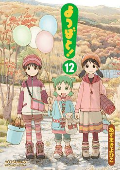
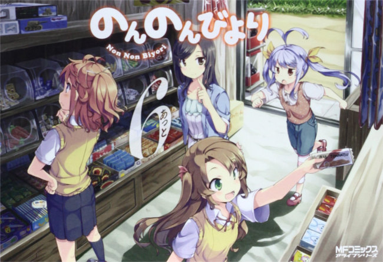
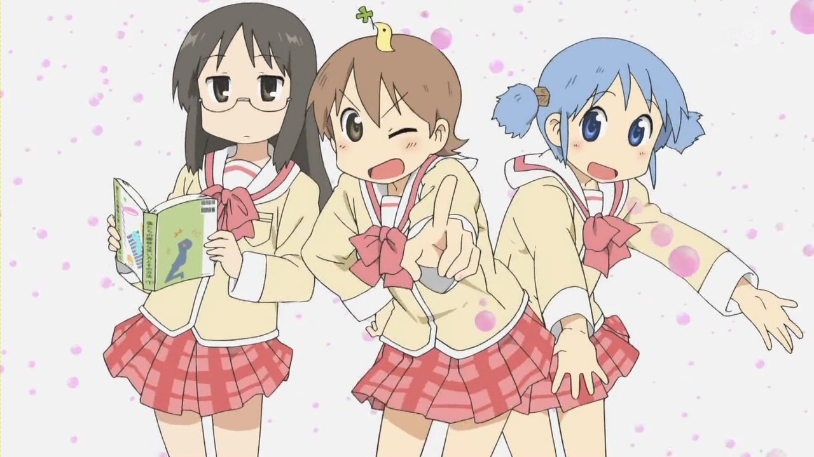

If you’d like to reach advanced Japanese, you will need to eventually take a break from flashcards, textbooks and vocabulary practice, and [focus instead in consuming native materials](/blog/learning-japanese-by-listening-and-reading/). One of the best options to get started with native materials is manga! Yes, this Japanese cultural staple can be used as a learning tool!

It will take you some time, but the contextual learning that reading manga provides will keep you engaged and on track to mastering Japanese.

## Why Learn Japanese with Manga?

There are a few reasons why you should take a break from (not quit entirely!) learning with your traditional Japanese study materials and use manga. Manga is written for a Japanese audience, so you’re getting a more realistic view of the culture and conversation patterns.

When you learn Japanese manga you are going to [learn more vocabulary organically](/blog/how-i-learned-japanese-cure-dolly-from-kawajapa/) than you would learn with even the greatest textbooks or flash cards. Since the conversations aren’t simplified for beginners, reading manga will give you a more realistic learning environment.

When you were a kid, what was the number one thing you had to do to get better at something? Practice! Reading manga will give you practice at recognizing kanji in context in a new and interesting way. If you’re on the edge about remembering some vocabulary, there’s pictures to help you out.

## Choosing Your Japanese Manga

The manga world is huge, so if you don’t know where to start, that is understandable. To make your life easier, we’ve put together a list of series that you can use to learn from Japanese manga. There is something for everyone on this list, so keep reading! Also, [please check out or own home-cooked Manga helpers!](/)

## Dragonball (ドラゴンボール)

There was no way to post a list on how to learn Japanese manga style without mentioning Dragonball. For most foreigners, it was the first manga they ever heard of. Its popularity has led to multiple anime spinoffs, movies, video games and much more, but it was originally a manga.

If you have heard of it but don’t know what it’s about, the series (original) is about the life a little boy who was born with a monkey’s tail. It continues to follow his life story as he trains to be the best martial artist in the world. If you want to make your life easier and avoid looking up every word you don't know in the dictionary, [checkout our guide specifically designed to help you read Dragonball](/#library).

## Yotsubato! (よつばと!)

{.float-left}

This manga series is about a girl with green hair named Yotsuba. The storylines are built around her day to day life and interactions with people in her town and her family. She is an endearing character, since she’s written to be so weirdly naive that it’s funny.

The story’s tagline is “Today is always the most enjoyable day!”, so you know you’re in for a good time when you crack this manga open (even though it will take work to read it).

This series is good for your first attempt to learn Japanese manga since it’s based around everyday activities. The vocabulary is very useful and it has both Kanji and Furigana on its pages. There are even [pre-made Anki flashcards](http://livingjapanese.com/pages/yotsubato_reading_pack1.html) featuring vocabulary from Yotsubato!

For readers in the USA, can [purchase the first volume of Yotsubato!](http://www.kinokuniya.com/us/index.php/fbs003?common_param=9784840224666) via Kinokuniya.

## Chi’s Sweet Home (チーズスイートホーム)

{.float-right}

This manga series features an adorable kitten and her adventures and misadventures with a new family. The kitten can talk to the readers, but her speech abilities are lost on her human family. In this series you watch her go from lost kitten to beloved house pet and see what happens along the way.

It may seem like a childish choice, but this series is well loved by many adults and children alike. It has furigana and kanji on its pages, but you’ll still want to keep a dictionary close by.

## Non Non Biyori (のんのんびより)

This manga story was so well loved that they had it turned into an anime for a few seasons. It’s about a very small village and it’s school aged children, of which there are only five. It’s an outsider story, as the new girl comes from Tokyo and has to adjust to small town life.

It’s also a coming of age tale, as we follow five students of multiple age ranges through the story line. This is an especially good choice to learn vocabulary related to Japanese school life.

## Nichijou (日常)

This manga series is called My Ordinary Life in English. It’s about the goings on a regular size suburb in Japan. The characters are quirky and not all children in this one. There’s a talking robot who was created by an eight year old, so you’re in for some laughs.

This one is great if you are planning on interacting with a large range of Japanese people, since the town members are all of different age ranges. It has furigana on its pages, so you can get through it more easily.

If you’re going to learn Japanese manga style, hopefully something on our list struck your fancy. Before you sit down to translate, make sure you have a good dictionary by your side and are ready to laugh. If you wish to maximize your reading time and skip the dictionary, then [checkout our Manga Reading Guides](/)!
